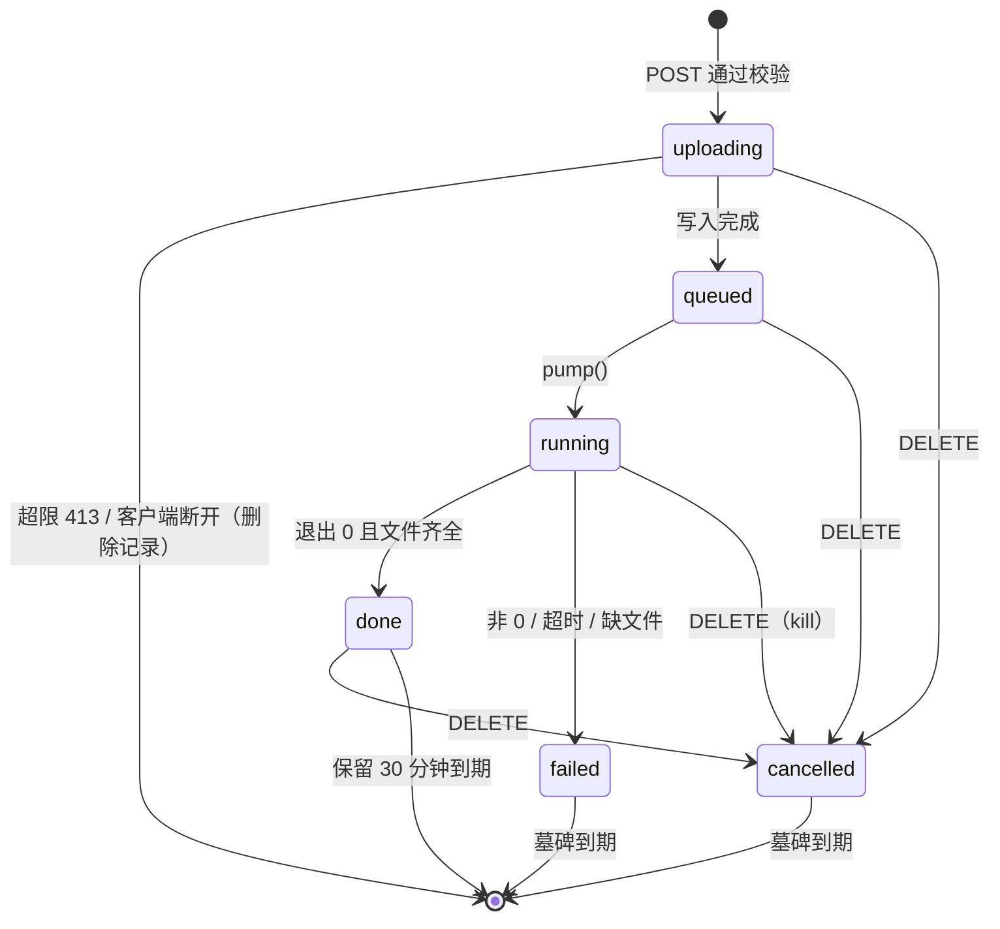

# Design Document

## Overview

本设计给「层间 · 音乐练习」加两条分离路径，并保持现有播放、缓存和测试不变：

1. **Demucs AI 路径**：`server.js` 新增 Demucs_Service（`demucs-service.js`），负责检测 Demucs、流式接收上传、单进程先进先出排队、解析进度、取消与临时文件清理、提供结果 WAV。浏览器端新增 `remote-separator.js`（与服务器对话）和 `stem-mapper.js`（把 Demucs 4/6 轨映射成 8 条 Derived_Stems，额外打击乐、效果音、其他音效用 DSP 派生）。
2. **改进的 DSP 路径**：`separator.js` 支持 Quality_Mode。Fast_Mode（触屏）保持单分辨率 STFT 2048/512，改进掩码结构；High_Quality_Mode（非触屏）使用两级多分辨率级联 HPSS、多遍中值的人声线索、一次 Wiener 迭代细化。两种模式都改为「原子掩码划分」，各原子之和严格等于混音。

App 流程：打开新文件 → 现有长度/大小检查 → 3 秒内查询 `/api/separate/status` → 可用则走 Demucs，任何失败回退 DSP（用户取消除外）→ 结果以同样的 `{ urls, bpm }` 格式交给 Player 与 Library_Cache。

测试侧新增合成 Benchmark_Set、SDR 计算、保留在 `tests/helpers/` 中的 Baseline_Separator，以及一个假的 Demucs_Command（`tests/fixtures/fake-demucs.mjs`）。全部只用 Node ≥ 18 内置模块，浏览器端零依赖。

### 设计决策摘要

| 决策 | 选择 | 原因 |
|---|---|---|
| Demucs 结果映射位置 | 浏览器端 Stem_Mapper | Requirement 5.1 要求服务器只提供 Demucs 原始输出；映射与 DSP 共用 `dsp.js`，Node 测试可直接导入 |
| Demucs 调用方式 | `child_process.execFile`，无 shell，参数数组 | Requirement 2.6；杜绝命令注入 |
| `DEMUCS_CMD` 格式 | JSON 数组或空白分隔（支持双引号） | Windows 下 `node.exe` 路径常含空格，测试需要 `["C:\\Program Files\\nodejs\\node.exe","tests/fixtures/fake-demucs.mjs"]` |
| 结果文件命名 | Demucs `--filename "{stem}.{ext}"` | 输出固定为 `out/<model>/<stem>.wav`，不出现客户端文件名 |
| DSP 改进主线 | 掩码划分 + 相位感知中置 + 频域交叉 + HQ 级联多分辨率 | 每条改动都针对基线的具体误差来源（见「DSP 分离器」一节） |
| SDR 评估电平 | 关闭练习用增益（`levelMatch: false`）后比较 | 基线的最大 4 倍增益只为听感，计入 SDR 会让比较失真；产品中照常启用 |
| 性能对比测试 | 必须实现，但只在 `BENCH_PERF=1` 时运行，子进程隔离 | 计时和内存与机器相关，不应让常规 `node --test` 变得不稳定；最终检查点手动跑一次以验证 8.3/8.4 |
| 属性测试库 | 自写 `tests/helpers/prop.mjs`（种子 PRNG + `forAll`） | 不能引入 fast-check 等依赖 |

## Architecture

```mermaid
flowchart LR
  subgraph Browser["浏览器（零依赖）"]
    APP[app.js<br/>openEntry / separateEntry]
    RS[remote-separator.js<br/>status / upload / poll / download / cancel]
    SM[stem-mapper.js<br/>Demucs → 8 Derived_Stems]
    SEP[separator.js<br/>runSeparation(mode)]
    WK[separator.worker.js]
    DSP[dsp.js]
    WAV[wav.js<br/>encodeWav / decodeWav]
    PL[player.js]
    LIB[library.js]
  end
  subgraph Server["Node 服务器（仅内置模块）"]
    SRV[server.js<br/>静态文件 + /api 路由]
    DS[demucs-service.js<br/>检测 / 队列 / 任务 / 清理]
    TMP[(os.tmpdir()/cengjian-demucs)]
    DEM[[Demucs_Command<br/>execFile]]
  end
  APP --> RS
  RS -- HTTP --> SRV
  SRV --> DS
  DS --> TMP
  DS --> DEM
  RS --> WAV
  RS --> SM
  SM --> DSP
  APP --> SEP
  SEP --> WK
  WK --> DSP
  SEP --> WAV
  APP --> PL
  APP --> LIB
```

### App 分离流程

```mermaid
flowchart TD
  A[打开新文件] --> B{缓存命中?}
  B -- 是 --> Z[直接使用缓存<br/>不发 POST]
  B -- 否 --> C[大小/元数据时长检查<br/>separationLimitMessage]
  C -- 超限 --> E[报错，原曲可播]
  C -- 通过 --> D[GET /api/separate/status<br/>最多 3 秒]
  D -- 失败/超时/不可用 --> F[DSP_Separator<br/>mode = 触屏 ? fast : high]
  D -- 可用 --> G[POST /api/separate]
  G -- 错误码/网络失败 --> N1[提示：已改用浏览器分离] --> F
  G -- 202 --> H[每 1 秒轮询任务]
  H -- failed --> N2[提示含失败原因] --> F
  H -- 用户取消/换文件 --> X[DELETE 任务，停止，不跑 DSP]
  H -- done --> I[逐条下载 WAV → decodeWav → Stem_Mapper]
  I -- 下载失败 --> J[DELETE 任务] --> F
  I -- 成功 --> K[DELETE 任务]
  K --> L[player.setStems(urls)<br/>entry.cache = {urls, analysis}]
  F --> L
```

### 文件改动一览

| 文件 | 改动 |
|---|---|
| `server.js` | `createServer(root, { demucs })`：`/api/separate` 前缀交给 Demucs_Service，其余保持原静态逻辑；主入口创建服务、清理临时目录、打印检测结果 |
| `demucs-service.js`（新，根目录，不在 `public/` 内所以不会被静态服务暴露） | Demucs_Service 全部逻辑与纯函数 |
| `public/js/remote-separator.js`（新） | 浏览器端调用 Demucs_Service、设置清洗、进度文本、回退提示 |
| `public/js/stem-mapper.js`（新） | Stem_Mapper |
| `public/js/wav.js` | 新增 `decodeWav` |
| `public/js/dsp.js` | 新增函数（原有导出的行为不变，Baseline_Separator 依赖它们） |
| `public/js/separator.js` | Quality_Mode、原子掩码划分、`stemNotes(mode)`、`levelMatch` 选项、峰值保护 |
| `public/js/separator.worker.js` | 消息里带 `mode`，`done` 回传 `mode` |
| `public/js/app.js` | 分离入口分流、回退、取消按钮、Demucs_Model 设置、分析面板 |
| `public/index.html` / `style.css` | 「我的」中加模型下拉框与提示；进度区加「取消分离」按钮 |
| `README.md` | Demucs 安装与启用（含 FFmpeg：Demucs 读取 MP4/M4A/MOV 等压缩格式需要它，缺少时任务失败并回退 DSP）、上传说明、模型设置、Quality_Mode、环境变量 |
| `tests/…` | 见 Testing Strategy |

## Components and Interfaces

### 1. Demucs_Service（`demucs-service.js`）

#### 1.1 配置

| 环境变量 | 默认 | 解析规则 |
|---|---|---|
| `DEMUCS_CMD` | `demucs` | 以 `[` 开头按 JSON 字符串数组解析；否则按空白分隔，双引号包住的部分算一个参数。第一个元素是可执行文件，其余为固定参数（例如 `python -m demucs`）。解析失败视为不可用 |
| `DEMUCS_MAX_UPLOAD_MB` | `2048` | 正整数，否则用默认值 |
| `DEMUCS_TIMEOUT_MIN` | `30` | 正数，否则用默认值 |

不支持 `.cmd` / `.bat`（`execFile` 无 shell 无法运行），README 建议 Windows 用户使用 `demucs.exe` 或 `python -m demucs`。

```js
// demucs-service.js
export const DEMUCS_MODELS = ['htdemucs', 'htdemucs_6s'];
export const MODEL_STEMS = {
  htdemucs: ['vocals', 'drums', 'bass', 'other'],
  htdemucs_6s: ['vocals', 'drums', 'bass', 'other', 'guitar', 'piano'],
};
export const UPLOAD_EXTS = ['mp4', 'm4a', 'mp3', 'wav', 'aac', 'flac', 'ogg', 'webm', 'mov', 'mkv'];
export const JOB_ID_RE = /^[0-9a-f]{32}$/;

export function parseDemucsCmd(raw)            // -> { file, args } | null
export function readConfig(env = process.env)  // -> { command, maxUploadBytes, timeoutMs }
export function isAllowedModel(m)              // DEMUCS_MODELS.includes(m)
export function isJobId(s)                     // JOB_ID_RE.test(s)
export function safeExt(ext)                   // 小写后在 UPLOAD_EXTS 中则返回，否则 'bin'
export function jobPaths(tempRoot, id, ext)    // -> { dir, input, outDir, resultDir(model) }
export function buildDemucsArgs(fixedArgs, model, paths)
//   -> [...fixedArgs, '-n', model, '-o', paths.outDir, '--filename', '{stem}.{ext}', paths.input]
export function parseProgress(text)            // -> 0..100 的最后一个进度值，或 null

/** 纯调度器：不碰文件和进程，runner(job, done) 由调用方提供，便于属性测试。 */
export function createJobQueue({ runner, maxUnfinished = 4 })
// -> { submit(job): boolean, finish(id, status), cancel(id), position(id), unfinished(), runningId() }

export function createDemucsService(options) // 返回 service，内部使用 createJobQueue
//   options: { command, maxUploadBytes, timeoutMs, tempRoot, retentionMs = 30 min,
//              tombstoneMs = 5 min, maxUnfinished = 4, probeTimeoutMs = 10_000,
//              env, log = console.log, execFile = child_process.execFile }
// service: {
//   init(): Promise<void>         // 清空并重建 tempRoot，然后探测 Demucs
//   status(): StatusJson
//   handle(req, res): boolean     // 处理 /api/separate*，非该前缀返回 false
//   close(): Promise<void>        // 终止进程、清掉计时器（测试用）
// }
```

`tempRoot` 默认 `path.join(os.tmpdir(), 'cengjian-demucs')`。启动清理只删这个专用目录，不碰系统临时目录里的其他东西。

#### 1.2 可用性检测

`init()` 调用 `execFile(command.file, [...command.args, '--help'], { timeout: probeTimeoutMs, windowsHide: true })`：

- 回调无错误（退出码 0）→ `available = true`，打印 `  AI 分离:  已启用 Demucs（htdemucs / htdemucs_6s）`。
- `ENOENT`、退出码非 0、超时（`err.killed`）→ `available = false`，打印 `  AI 分离:  未检测到 Demucs，将使用浏览器分离`。
- 探测完成前 `status()` 返回 `{ available: false, checking: true, … }`，App 当作不可用处理。

#### 1.3 HTTP 接口

所有 JSON 响应带 `Content-Type: application/json; charset=utf-8`、`Cache-Control: no-store`、`X-Content-Type-Options: nosniff`。不发 CORS 头，只允许同源页面调用。

| 方法与路径 | 成功 | 错误 |
|---|---|---|
| `GET /api/separate/status` | 200 `{ available, checking, models, maxUploadBytes, queueLength }` | — |
| `POST /api/separate?model=<m>&ext=<e>`（请求体为文件原始字节） | 202 `{ id, status: 'queued', position }` | 503 不可用；400 模型非法；429 未完成任务已有 4 个；413 超过上限 |
| `GET /api/separate/<id>` | 200 `JobJson` | 404 |
| `GET /api/separate/<id>/<stem>.wav` | 200 `audio/wav`，带 `Content-Length`，流式输出 | 404（ID 非法 / 不存在 / 未完成 / 音轨名不属于该模型） |
| `DELETE /api/separate/<id>` | 204 | 404 |
| `/api/separate*` 上的其他方法 | — | 405 |

`queueLength` = 排队中 + 处理中 + 上传中的任务数。

```ts
type JobJson = {
  id: string;
  model: 'htdemucs' | 'htdemucs_6s';
  status: 'queued' | 'running' | 'done' | 'failed' | 'cancelled';
  position?: number;   // 排队中时，等待队列中的下标 + 1（不计正在运行的任务）
  progress?: number;   // 处理中时 0..100（整数）
  error?: string;      // 失败时，中文说明
  stems?: string[];    // 完成时，等于 MODEL_STEMS[model]
};
```

#### 1.4 POST 处理顺序

1. `available` 为假 → 503，`req.resume()` 丢弃请求体，不建文件。
2. `model` 不在 `DEMUCS_MODELS` → 400；`ext` 经 `safeExt` 过滤（不在白名单时用 `bin`，只影响扩展名，不报错）。
3. 未完成任务数（含上传中）≥ 4 → 429，不建文件。
4. `Content-Length` 已知且大于上限 → 413，不建文件。
5. 生成 `id = crypto.randomBytes(16).toString('hex')`，任务状态为内部的 `uploading`（占用队列名额，防止并发上传绕过上限），`mkdir(dir)`，`req.pipe(fs.createWriteStream(input))`，同时累计字节数。
6. 累计字节超过上限（覆盖无 `Content-Length` 的分块上传）→ `unpipe`、关闭写流、`fs.rm(dir, { recursive: true, force: true })`、删除任务记录、回 413（`Connection: close`），响应结束后 `req.destroy()`。
7. 客户端中途断开（`req` 的 `aborted` 或未 `end` 就 `close`）→ 同样删除目录和任务记录，不回响应。
8. 写流 `finish` → 状态改为 `queued`，进入 Job_Queue，回 202，调用 `pump()`。

#### 1.5 Job_Queue 与运行

```js
// 内部状态
jobs: Map<id, Job>          // Job = { id, model, ext, status, progress, error, child, timer, expireTimer, paths }
queue: id[]                 // 只含 status === 'queued' 的任务，FIFO
running: id | null
```

`pump()`：`running` 为空且 `queue` 非空时，取队首，`status = 'running'`、`progress = 0`，执行：

```js
const child = execFile(command.file, buildDemucsArgs(command.args, job.model, job.paths), {
  windowsHide: true,
  maxBuffer: 64 * 1024 * 1024,   // tqdm 用 \r 刷新，30 分钟输出也远小于此值
  env: options.env,
}, onExit);
child.stderr.on('data', (chunk) => {
  const p = parseProgress(String(chunk));
  if (p != null && p !== job.progress) job.progress = p;
});
job.timer = setTimeout(() => { job.timedOut = true; child.kill(); }, timeoutMs);
```

`onExit(err)`：

- 已取消 → 忽略（取消时已经清理）。
- `job.timedOut` → `failed`，`error = 'AI 分离超过 N 分钟未完成，已终止'`。
- `err` 非空 → `failed`，`error` 取 stderr 末尾一行非空文本（截断 200 字符），没有则 `'Demucs 退出码 X'`。
- 成功但缺任一 `MODEL_STEMS[model]` 文件 → `failed`，`error = 'Demucs 没有生成完整的音轨文件'`。
- 成功 → `done`，删除上传文件，`expireTimer = setTimeout(remove, retentionMs)`。
- `failed` → 立即 `fs.rm(dir)`；记录作为墓碑保留 `tombstoneMs` 供轮询读取失败原因，到期删除。
- 最后 `running = null`，`pump()`。

`parseProgress` 匹配 tqdm 格式 `/(\d{1,3}(?:\.\d+)?)%\|/g`，取最后一个匹配，`Math.round` 后夹到 0..100。

#### 1.6 取消与清理

`DELETE /api/separate/<id>`：

- `uploading`：中止上传（同 1.4 第 7 步）。
- `queued`：从 `queue` 移除。
- `running`：设置 `cancelled` 标志后 `child.kill()`，再 `pump()` 下一个任务。
- `done`：清除 `expireTimer`。
- 所有情况：`status = 'cancelled'`，`fs.rm(dir, { recursive: true, force: true })`，记录作为墓碑保留 `tombstoneMs` 后删除，回 204。墓碑和 `failed` 记录不计入未完成任务数。

`retentionMs` 到期或 DELETE 后，`GET /api/separate/<id>/<stem>.wav` 返回 404。

`init()` 先 `fs.rm(tempRoot, { recursive: true, force: true })` 再 `fs.mkdir(tempRoot, { recursive: true })`，满足 Requirement 4.6。

#### 1.7 `server.js` 集成

```js
export function createServer(root = ROOT, { demucs } = {}) {
  return http.createServer((req, res) => {
    if (demucs && demucs.handle(req, res)) return;   // 只认领 /api/separate 前缀
    // 以下为原有逻辑，一字不改：405 / resolvePath / 404 / MIME / HEAD
  });
}

if (isMain) {
  const demucs = createDemucsService({ ...readConfig(), tempRoot: defaultTempRoot() });
  createServer(ROOT, { demucs }).listen(port, host, () => { /* 原有打印 */ });
  demucs.init();   // 探测结果异步打印一行
}
```

不传 `demucs` 时行为与现在完全一致，现有 `server.test.mjs` 不需要改。

#### 1.8 假 Demucs_Command（`tests/fixtures/fake-demucs.mjs`）

测试用 `command = { file: process.execPath, args: ['tests/fixtures/fake-demucs.mjs'] }`，行为由环境变量 `FAKE_DEMUCS_MODE` 控制：

| 模式 | `--help` | 分离 |
|---|---|---|
| `ok`（默认） | 输出用法，退出 0 | 解析 `-n/-o/--filename` 与输入路径，向 stderr 依次写 `  10%|█ | 1/10 [..]` … `100%|…`，在 `out/<model>/<stem>.wav` 写 0.5 秒立体声正弦（每条频率不同，便于断言），退出 0 |
| `fail` | 退出 0 | stderr 写 `RuntimeError: fake failure`，退出 1 |
| `hang` | 退出 0 | 写一次 `5%|` 后无限等待（用于超时和取消测试） |
| `slow` | 退出 0 | 每 100 ms 写一次进度，2 秒后成功（用于排队测试） |
| `nohelp` | 退出 2 | — |
| `probehang` | 无限等待 | — |

“不存在”用 `command.file = 'definitely-not-demucs-xyz'` 模拟。测试把 `probeTimeoutMs`、`timeoutMs`、`retentionMs` 调小，`tempRoot` 指向每个测试自己的 `fs.mkdtemp` 目录。

### 2. 浏览器端 Demucs 客户端（`public/js/remote-separator.js`）

无 DOM 依赖，`fetch` 可注入，Node 测试可直接导入。

```js
export const DEFAULT_DEMUCS_MODEL = 'htdemucs';
export const API = '/api/separate';

/** 不在允许值里的一律回到 htdemucs（Requirement 7.2 / 7.4）。 */
export function sanitizeDemucsModel(v)

/** 3 秒超时；任何异常、非 2xx、JSON 无效都返回 null，从不抛错。 */
export async function fetchDemucsStatus({ fetch = globalThis.fetch, timeoutMs = 3000, signal } = {})
// -> { available, models, maxUploadBytes, queueLength } | null

/** 进度区文字（Requirement 3.5）。 */
export function remoteProgressText(phase)
// phase: { stage: 'upload' } -> '上传到本地服务器…'
//        { stage: 'queued', position: N } -> `排队中（第 ${N} 位）`
//        { stage: 'running', progress: N } -> `AI 分离中 ${N}%`
//        { stage: 'download' } -> '整理 AI 音轨…'

/** 回退提示（Requirement 6.1 / 6.2）。 */
export function fallbackNotice(err)
// err.reason 存在时 -> `AI 分离失败（${reason}），已改用浏览器分离。`
// 否则            -> 'AI 分离暂时不可用，已改用浏览器分离。'

export class DemucsError extends Error { /* reason, stage: 'upload'|'job'|'download' */ }

/**
 * 引擎选择与回退的纯流程（App 的 separateEntry 直接调用它），依赖全部注入，便于属性 1、12 测试。
 * status 为 null、available 不为真或 checking 为真 → 只调用 runDsp，不调用 runDemucs。
 * runDemucs 抛 AbortError → 原样抛出，不调用 runDsp。
 * runDemucs 抛其他错误 → onNotice(fallbackNotice(err))，再调用 runDsp。
 */
export async function separateWithFallback({ fetchStatus, runDemucs, runDsp, onNotice, stillCurrent = () => true })
// -> { engine: 'demucs' | 'dsp', result } | null（stillCurrent() 为假时）

/**
 * 上传、轮询、下载、映射。成功返回与 runSeparation 相同的结构外加来源信息。
 * 用户取消（signal abort）：发 DELETE（keepalive），停止轮询，抛 AbortError。
 * 其他失败：必要时发 DELETE，抛 DemucsError，由 App 回退 DSP。
 */
export async function runDemucsSeparation(file, {
  model, signal, encode, onPhase, onProgress,
  fetch = globalThis.fetch, pollMs = 1000, sleep,
})
// -> { urls: Record<stemId, blobUrl>, bpm, model, sources, sampleRate, mono, duration }
```

`runDemucsSeparation` 步骤：

1. `POST ${API}?model=${model}&ext=${extOf(file.name)}`，`body: file`，`Content-Type: application/octet-stream`。非 202 → `DemucsError({ stage: 'upload', reason: 服务器 JSON 的 error 或 'HTTP 状态码' })`；网络错误同样包装。
2. 循环：`await sleep(pollMs, signal)`，`GET ${API}/${id}`。`queued`/`running` → `onPhase` + `onProgress`（总进度：上传 0.02，运行 `0.05 + 0.85·p/100`，下载与映射 0.90–1.00）。`failed` → `DemucsError({ stage: 'job', reason: job.error })`。`cancelled` 或 404 → `DemucsError({ stage: 'job', reason: '任务已被服务器清理' })`。单次轮询的网络错误连续 5 次才算失败，避免偶发抖动。
3. `done` → `mapDemucsStems({ model, load, emit })`，其中 `load(name)` 下载 `${API}/${id}/${name}.wav` 并 `decodeWav`，`emit(id, chs)` 调用 `encode(chs, sampleRate)` 生成 Blob URL。下载或解码失败 → 先撤销已建的 Blob URL，`DELETE`，再抛 `DemucsError({ stage: 'download' })`（Requirement 6.3）。
4. 全部 8 条完成 → `DELETE ${API}/${id}`（失败忽略，服务器 30 分钟后自清），返回。
5. 任意时刻 `signal` 中止：`fetch(DELETE, { keepalive: true })`（不等待结果），撤销 Blob URL，抛 `DOMException('已取消', 'AbortError')`。

### 3. Stem_Mapper（`public/js/stem-mapper.js`）

```js
export const STEM_SOURCES = {
  htdemucs: {
    vocal: 'Demucs vocals',
    inst: 'Demucs drums + bass + other 相加',
    drums: 'Demucs drums',
    bass: 'Demucs bass',
    harmony: 'Demucs other',
    perc: 'Demucs drums 经 5 kHz 高通（DSP）',
    fx: 'Demucs other 中 1.5 kHz 以上的立体声两侧成分，左右同相（DSP；单声道取 6 kHz 以上）',
    other: 'Demucs other 减去效果音后的残余（DSP）',
  },
  htdemucs_6s: { /* inst: '… + guitar + piano'，harmony: 'Demucs guitar + piano + other'，其余同上 */ },
};

/** 左右声道最大差值不超过两者峰值的 1e-4 即视为单声道来源（Demucs 总是输出立体声）。 */
export function isMonoPair([L, R])

/**
 * 按固定顺序逐条加载 Demucs 输出并立即派生、发出 Stem，控制峰值内存。
 * load(name) -> Promise<{ channels: Float32Array[], sampleRate }>
 * emit(id, channels) -> Promise|void
 * 返回 { bpm, sampleRate, mono, duration }
 */
export async function mapDemucsStems({ model, load, emit })
```

处理顺序与公式（`c` 为声道，`hp(x, f)` = `highpass(highpass(x, f), f)`，与现有 4 阶零相位高通一致）：

| 步骤 | 加载 | 发出 |
|---|---|---|
| 1 | `vocals` | `vocal = vocals` |
| 2 | `drums` | `drums = drums`；`perc_c = hp(drums_c, 5000)`；`inst_c ← drums_c`（累加器副本）；用 `(drumsL+drumsR)/2` 估计 BPM |
| 3 | `bass` | `bass = bass`；`inst_c += bass_c` |
| 4（6s） | `guitar`、`piano` | `inst_c += guitar_c + piano_c`；`harmony_c ← guitar_c + piano_c` |
| 5 | `other` | `inst_c += other_c` → 发出 `inst`；`harmony_c (+)= other_c` → 发出 `harmony` |
| 6 | （复用 `other`） | 立体声：`s = hp((otherL − otherR)/2, 1500)`，`fx = [s, s]`；`other' = [otherL − s, otherR + s]` |
|   |   | 单声道来源（`isMonoPair(other)`）：`s = hp(otherL, 6000)`，`fx = [s, s]`；`other' = [otherL − s, otherR − s]` |
| 7 | — | 发出 `fx`、`other = other'` |

「其他音效 = other − 效果音」按效果音在 other 中的原始相位相减：两侧成分在左声道是 `+s`、右声道是 `−s`，所以右声道加回 `s`。这样 `other' + 原相位效果音 = other` 逐样本成立，效果音在播放时仍左右同相（沿用现有「单喇叭也听得到」的做法）。

每条 Stem 发出前经过 `dsp.js` 的 `limitPeak(chs)`：峰值大于 1 时整体乘 `0.98 / peak`，否则原样返回（Demucs 输出相加可能超过满幅）。`limitPeak` 放在 `dsp.js` 而不是 `separator.js`，这样 Stem_Mapper 不依赖分离器模块。Demucs 结果不做练习增益，因为它的电平已经正确。

峰值内存：同一时间最多持有 `inst` 累加器、`harmony` 累加器、当前输出和一个滤波临时数组，约 8 条单声道 Float32 数组，小于把 6 条立体声全部解码后再处理。

### 4. WAV 解码（`public/js/wav.js` 新增）

```js
/**
 * 解析 RIFF/WAVE：PCM 16/24/32 位整数、IEEE float 32 位、WAVE_FORMAT_EXTENSIBLE（子格式取前 2 字节）。
 * 跳过未知块，奇数长度块按 RIFF 规则补齐。
 * @returns {{ channels: Float32Array[], sampleRate: number }}
 * @throws Error('不支持的 WAV 格式') / Error('WAV 文件不完整')
 */
export function decodeWav(arrayBuffer)
```

Demucs 默认输出 16 位 PCM；`encodeWav` 现有行为不变。

### 5. App 流程（`public/js/app.js`）

#### 5.1 状态与设置

```js
// 新增字段
state.progressText = '';   // 非空时替代百分比显示在进度区
state.notice = '';         // 非错误提示（回退原因、已取消）
state.demucs = null;       // 最近一次 fetchDemucsStatus 的结果
// settings 增加 demucsModel，存于同一 SETTINGS_KEY 对象
function loadSettings() {
  const s = JSON.parse(localStorage.getItem(SETTINGS_KEY) || '{}');
  return { speed: …, loop: …, demucsModel: sanitizeDemucsModel(s.demucsModel) };
}
```

「我的」页面新增：

```html
<label>AI 分离模型
  <select id="demucsModel">
    <option value="htdemucs">htdemucs（4 轨，较快）</option>
    <option value="htdemucs_6s">htdemucs_6s（6 轨，含吉他和钢琴）</option>
  </select>
</label>
<p id="demucsHint" class="hint" hidden>服务器未安装 Demucs，当前使用浏览器分离</p>
```

`change` 时 `settings.demucsModel = sanitizeDemucsModel(value)` 并 `saveSettings()`；正在进行的分离不受影响，下一次 `openEntry` 读取新值。App 启动时调用一次 `fetchDemucsStatus` 更新 `#demucsHint`，每次分离前的状态查询也会刷新它。

#### 5.2 `openEntry` 改动

缓存命中分支不变（Requirement 10.3，不发任何请求）。未命中时，原有的大小与元数据时长检查、`evictStemCaches` 保持在最前，然后调用新的 `separateEntry`：

```js
async function separateEntry(entry, { signal, stillCurrent, mobile, metaDuration }) {
  const out = await separateWithFallback({
    stillCurrent,
    fetchStatus: async () => {
      const status = await fetchDemucsStatus({ signal });
      state.demucs = status; renderDemucsHint();
      return status;
    },
    runDemucs: () => runDemucsSeparation(entry.file, {
      model: settings.demucsModel, signal, encode: encodeWav,
      onPhase: (ph) => { if (stillCurrent()) { state.progressText = remoteProgressText(ph); renderStems(); } },
      onProgress: (p) => { if (stillCurrent()) { state.progress = p; renderStems(); } },
    }),
    onNotice: (text) => { state.notice = text; state.progressText = ''; state.progress = 0; },
    // DSP：原有 arrayBuffer → decodeAudio → 时长检查 → runSeparation
    runDsp: async () => {
      const mode = mobile ? 'fast' : 'high';
      const { urls, bpm } = await runSeparation(audioBuffer, { mode, encode: encodeWav, signal, onProgress });
      return { urls, analysis: { …原有字段, bpm, engine: 'dsp', qualityMode: mode } };
    },
  });
  if (!out) return null;
  if (out.engine === 'dsp') return out.result;
  const r = out.result;   // AbortError 已由 separateWithFallback 原样抛出（Requirement 6.4：不跑 DSP）
  return {
    urls: r.urls,
    analysis: { duration: r.duration || metaDuration, sampleRate: r.sampleRate,
                channels: r.mono ? 1 : 2, bpm: r.bpm,
                engine: 'demucs', model: r.model, sources: r.sources },
  };
}
```

`openEntry` 拿到结果后照旧 `player.setStems(urls)`、`entry.cache = { urls, analysis }`，所以 Player 和 Library_Cache 的接口、缓存数量、释放顺序、Blob URL 回收完全不变（Requirement 10.1、10.2）。分离进行中 `state.stemsReady === false`，现有渲染逻辑已经只允许「原曲」可点（Requirement 3.6）。

Demucs 路径不在浏览器解码原文件，内存只花在 8 条结果上。若元数据时长未知，下载后用 `vocals` 的长度再跑一次 `separationLimitMessage`，超限时报错（不回退 DSP，因为 DSP 同样会超限）。

#### 5.3 取消

进度区新增「取消分离」按钮，仅在 `state.separating` 时显示，点击执行 `state.abort.abort()`，并设置 `state.separating = false`、`state.notice = '已取消分离，原曲可以正常播放。'`。打开另一个文件时原有的 `state.abort.abort()` 同样会触发 `runDemucsSeparation` 发 `DELETE` 并停止轮询（Requirement 4.2）。

#### 5.4 Analysis_Panel

- `engine === 'demucs'`：统计区显示「分离方式：Demucs AI（htdemucs）」，音轨列表用 `analysis.sources[id]`。
- `engine === 'dsp'`：显示「分离方式：浏览器 DSP（高质量模式 / 快速模式）」，音轨列表用 `stemNotes(analysis.qualityMode)[id]`。
- 「原曲」说明不变。

### 6. DSP_Separator 改进（`separator.js`、`dsp.js`）

#### 6.1 基线的误差来源

| 现象 | 基线原因 | 影响的 Stem |
|---|---|---|
| 反相的两侧效果被当成人声 | Avendano 相似度只看 `|L·R̄|`，`L = e, R = −e` 时同样得 1 | 人声、纯伴奏、效果音 |
| Stem 之间不守恒 | 掩码乘积后在时域再做带通/低通/相减，各 Stem 之和不等于混音，相减产生二次误差 | 纯伴奏、和声伴奏、贝斯 |
| 效果音成分同时留在「其他音效」和「鼓」 | 效果音从残余和打击部分取两侧，但「其他音效」直接等于整个残余，「鼓」等于整个打击部分 | 其他音效、鼓 |
| 贝斯交叉点固定 250 Hz | 低音音高不同时，贝斯谐波与和弦低端互相串 | 贝斯、和声伴奏 |
| 单一分辨率 2048 点 | 46 ms 窗对低频音高分辨率不够（21.5 Hz/bin），对鼓的时间分辨率又偏粗 | 贝斯、鼓、额外打击乐 |
| 单声道时人声 = 全部频带内谐波 | 没有空间线索后，和弦铺底全部进人声 | 单声道人声、和声伴奏 |

#### 6.2 原子掩码划分（两种模式共用）

每个时频点把混音划分成 7 个「原子」，各原子掩码非负且和为 1，因此在 STFT 完美重建的前提下各原子相加严格等于混音：

| 原子 | 含义 | 组成 Stem |
|---|---|---|
| `V` | 中置、谐波、人声频带（单声道一条，左右共用） | 人声 |
| `B` | 谐波且低于自适应交叉点 | 贝斯 |
| `H` | 其余谐波 | 和声伴奏 |
| `D` | 打击、低于 5 kHz、非两侧高频 | 鼓 |
| `T` | 打击、高于 5 kHz、非两侧高频 | 鼓、额外打击乐 |
| `F` | 两侧、高于 1.5 kHz 的打击与残余（单声道：高于 6 kHz 的残余） | 效果音 |
| `O` | 其余残余 | 其他音效 |

Stem 由原子组成：`vocal = [V, V]`，`inst_c = X_c − V`（= 其余原子之和），`drums = D + T`，`perc = T`，`bass = B`，`harmony = H`，`fx = [s, s]`（立体声 `s = (F_L − F_R)/2`，单声道 `s = F`），`other = O`。

人声原子用中声道：`V = M_v · (X_L + X_R)/2`。其余原子作用在去掉人声后的各声道谱 `Y_c = X_c − V` 上，掩码重新归一化：

```
M'_j = M_j / Σ_{k≠v} M_k        （分母 < 1e-9 时令 M'_O = 1，其余为 0）
A_j,c = M'_j · Y_c
⇒ V + Σ_{j≠v} A_j,c = V + Y_c = X_c
```

初始掩码由三部分软掩码 `Mh, Mp, Mr`（和为 1）与频率/空间权重相乘得到，权重同样在每组内和为 1：

```
相位感知中置度  C  = max(0, 2·Re(L·R̄) / (|L|² + |R|²))^4        （同相 1，反相 0，单侧 0）
两侧度          S  = 1 − max(0, 2·Re(L·R̄) / (|L|² + |R|²))
频率坡          hi(f, f0) = 在 log2 频率上从 f0·2^(−1/6) 的 0 到 f0·2^(1/6) 的 1 的 cos² 过渡
                lo(f, f0) = 1 − hi(f, f0)

谐波组  Mh:  w_v = band(f) · Cv          （band 即现有 vocalBandWeight，120 Hz–8 kHz）
             w_b = (1 − w_v) · lo(f, fc_t)
             w_h = 1 − w_v − w_b
打击组  Mp:  w_f = S² · hi(f, 1500)      （单声道 w_f = 0）
             w_t = (1 − w_f) · hi(f, 5000)
             w_d = 1 − w_f − w_t
残余组  Mr:  w_f = S² · hi(f, 1500)      （单声道 w_f = hi(f, 6000)）
             w_o = 1 − w_f

M_V = Mh·w_v   M_B = Mh·w_b   M_H = Mh·w_h
M_D = Mp·w_d   M_T = Mp·w_t   M_F = Mp·w_f(打击) + Mr·w_f(残余)   M_O = Mr·w_o
```

`Cv` 为人声的中置线索：立体声时为 `C`（HQ 还乘以 6.5 节的波动线索）；单声道时 Fast_Mode 取 1（与基线相同），High_Quality_Mode 取波动线索。

所有频率划分都在频谱里完成，不再做时域带通/低通/相减，既去掉了相减误差，也省掉了基线 6 次以上整段 `filtfilt`。

#### 6.3 自适应贝斯交叉点

逐帧计算，只依赖前后 8 帧，因此满足分段无关性（6.7 节）：

```
E_t(k) = Σ_{|τ|≤8} Mh(t+τ,k) · |X̄(t+τ,k)|²,   f_k ∈ [30, 300] Hz，X̄ 为两声道平均幅度
f̄_t   = Σ f_k·E_t(k) / Σ E_t(k)
fc_t   = clamp(2.2 · f̄_t, 150, 320) Hz；Σ E_t < 1e-10 时 fc_t = 250 Hz（基线值）
```

`2.2` 与上下限是初值，实施时在 Benchmark_Set 上调参，最终值写入 `QUALITY_PRESETS` 并由基准测试锁定。

#### 6.4 Fast_Mode（触屏）

单遍、单分辨率，参数与基线相同，只改掩码结构：

| 参数 | 值 |
|---|---|
| STFT | n = 2048，hop = 512，Hann，contextFrames = 16，segment = hop·256 |
| HPSS | kTime = 13，kFreq = 13，β = 1.5（`hpssMasks` 原样复用） |
| 中置 | 相位感知 `C`，指数 4 |
| 掩码 | 6.2 节划分，不做迭代细化 |
| 内核输出 | 立体声 12 路：`V`、`B_L/R`、`H_L/R`、`D_L/R`、`T_L/R`、`s`（效果音两侧信号，频域直接算 `(F_L − F_R)/2`）、`O_L/R`；单声道 7 路 |

内存控制（保证峰值 ≤ 基线 110%）：

- 先算 BPM 再分配输出，`mid` 用后立即丢弃引用。
- 基线峰值约为「2 输入 + 1 mid + 7 输出 + 发出阶段 6–8 条时域滤波/相减临时数组」；新流程为「2 输入 + 12 输出 + 发出阶段 ≤ 2 条增益副本」，不再有时域滤波临时数组。
- 发出顺序：`vocal` → `inst`（在输入数组上原地 `X_c −= V`，不新分配）→ `bass` → `harmony` → `perc` → `drums`（原地 `D_c += T_c`）→ `fx` → `other`；每条发出后把对应引用置空，让 GC 回收。

耗时：FFT 次数与基线相同（输入 1 对，输出 6 对），中值滤波相同，额外的掩码乘法和逐帧交叉点计算约占 5%；去掉的时域滤波约省 5–8%。

#### 6.5 High_Quality_Mode（非触屏）

两级级联、两种分辨率（Driedger 2014 级联 HPSS 的思路），加多遍中值人声线索和一次 Wiener 细化。

**第 1 级：长窗分谐波**（n = 4096，hop = 1024，10.8 Hz/bin，contextFrames = 40）

- HPSS：`kTime = 17`（约 0.39 s），`kFreq = 17`（约 183 Hz），β = 2（更严格，只留确定的谐波）。
- 长时中值：在隔帧抽取的时间轴上做 `k = 33` 的中值（约 1.5 s），再线性插值回每帧，得到 `Hlong`。
- 波动线索 `φ = clamp(1 − Hlong / (Hshort + ε), 0, 1)`：长时间不变的铺底 `φ ≈ 0`，有颤音和换音的人声 `φ` 大（FitzGerald 多遍中值人声分离）。
- 人声线索：立体声 `Cv = C · (0.4 + 0.6·φ)`，单声道 `Cv = φ`。HQ 中 `C` 的互谱与自谱先在 ±1 帧上平滑再求比值，降低单帧估计的抖动。
- 原子：`V`、`B`、`H`、`Rem`（`Rem = 1 − Mh`，即非谐波部分），按 6.2 节在 `Y_c` 上归一化。
- 输出 7 路：`V`、`B_L/R`、`H_L/R`、`Rem_L/R`。

第 1 级结束后立即发出 `vocal`、`inst`（原地 `X_c −= V`）、`bass`、`harmony`，然后释放输入与这些数组，只保留 `Rem_L/R`。

**第 2 级：短窗分打击**（n = 1024，hop = 256，43 Hz/bin，contextFrames = 24），输入为 `Rem_L/R`

- HPSS：`kTime = 17`（约 0.1 s），`kFreq = 17`（约 730 Hz），β = 1.5；`Mp` 为打击部分，`Mr = 1 − Mp` 为残余（含第 1 级漏下的弱谐波）。
- 原子：`D`、`T`、`F`、`O`（6.2 节打击组与残余组）。
- 输出 7 路：`D_L/R`、`T_L/R`、`s`、`O_L/R`。

**Wiener 细化（两级各一次）**：以初始掩码得到各原子功率 `v_j = box3×3(Σ_c |M_j·X_c|²)`（时间 ±1 帧、频率 ±1 bin 的均值），再令 `M_j ← v_j / (Σ_k v_k + ε)`。新掩码仍然非负且和为 1，划分性质不变；平滑后的功率比单点掩码更稳定，减少「音乐噪声」。这相当于 norbert 等工具里单次迭代的多通道 Wiener 滤波的单声道功率简化版。

| 参数 | 第 1 级 | 第 2 级 |
|---|---|---|
| STFT | 4096 / 1024 | 1024 / 256 |
| contextFrames | 40（覆盖长时中值半窗 33 帧 + 平滑） | 24 |
| kTime / kFreq / β | 17 / 17 / 2 | 17 / 17 / 1.5 |
| 额外 | 长时中值 k = 33（隔帧）、互谱平滑、自适应交叉点 | — |
| Wiener 细化 | 1 次，原子 V/B/H/Rem | 1 次，原子 D/T/F/O |

预算估计（相对基线，3 分钟立体声）：

- 耗时：第 1 级 FFT ≈ 1.1×、中值 ≈ 1.3×、长时中值 ≈ 0.2×；第 2 级 FFT ≈ 0.9×、中值 ≈ 0.7×；Wiener ≈ 0.2×。合计约 2.4–2.7×，低于 300% 上限。
- 内存：整段数组峰值为第 1 级「2 输入 + 7 输出」= 9 条，少于基线的约 16 条；分段谱缓冲约 80 MB（基线约 40 MB）。合计低于基线，满足 150% 上限。

若实测超预算，按顺序降级：长时中值改为隔 3 帧抽取 → 第 2 级 `kFreq` 降到 13 → 关闭第 2 级 Wiener 细化。降级后仍须通过 9.1 的 SDR 门槛。

#### 6.6 输出电平与峰值

- `separateChannels(channels, sampleRate, hooks, { mode = 'fast', levelMatch = true, consumeInput = false })`。默认 `mode = 'fast'`，现有直接调用 `separateChannels` 的测试耗时不变。
- 6.4、6.5 节中「在输入数组上原地 `X_c −= V`」只在 `consumeInput: true` 时发生；Worker 和 `runSeparation` 的主线程回退持有自己的副本（`getChannelData().slice()`），会开启它。默认不修改调用方传入的数组，未开启时 `inst` 另分配 2 条数组。
- `levelMatch` 为真时沿用 `scaleToReference`（上限 4 倍，峰值 ≤ 0.98）。
- 每条 Stem 发出前都经过 `limitPeak`：峰值 > 1 时整体乘 `0.98 / peak`（Requirement 9.5）。`scaleToReference` 在增益为 1 时不会降低超过满幅的 Stem，所以 `limitPeak` 必不可少。
- 返回值增加 `mode`：`{ bpm, mode }`。
- 新增可选测试钩子 `hooks.onAtom(name, channels)`：只有传入时才额外输出效果音原子的原始相位分量 `F_L/F_R`（多 2 条输出），产品代码不传，内存与耗时不受影响。

#### 6.7 分段无关性

`processSegments` 的前提是「每帧输出只依赖 ±contextFrames 内的帧」。新增的逐帧计算（交叉点用 ±8 帧、长时中值半窗 33 帧、Wiener 平滑 ±1 帧、互谱平滑 ±1 帧）都在各级的 contextFrames 之内，因此分段处理与整段处理结果一致，不会在分段边界产生咔哒声。

#### 6.8 `dsp.js` 新增导出

现有导出（`hpssMasks`、`centerMask`、`lowpass`、`highpass`、`bandpass` 等）的行为保持不变，Baseline_Separator 继续使用它们。

```js
export function centerMaskPhase(specL, specR, sharpness = 4, smoothFrames = 0) // -> { C, S }
export function freqRamp(bins, binHz, f0, rising = true)  // hi()/lo() 的 cos² 坡，长度 bins
export function bassCrossover(Mh, magAvg, frames, bins, binHz, opts) // -> Float32Array(frames) fc_t
export function decimatedTimeMedian(mag, frames, bins, k, step)      // 长时中值
export function wienerRefine(masks, specs, frames, bins)  // 原地更新 masks，保持和为 1
export function partitionMasks(groups)                     // 6.2 节组合，返回和为 1 的原子掩码
export function limitPeak(channels)                        // 峰值 > 1 时整体乘 0.98 / peak；DSP_Separator 与 Stem_Mapper 共用
```

#### 6.9 Quality_Mode 预设与说明文字

```js
export const QUALITY_MODES = ['high', 'fast'];
export const QUALITY_LABELS = { high: '高质量模式', fast: '快速模式' };
export const QUALITY_PRESETS = {
  fast: { stages: [{ n: 2048, hop: 512, context: 16, kTime: 13, kFreq: 13, beta: 1.5 }],
          wiener: false, longMedian: false, phaseSmooth: 0 },
  high: { stages: [{ n: 4096, hop: 1024, context: 40, kTime: 17, kFreq: 17, beta: 2 },
                   { n: 1024, hop: 256,  context: 24, kTime: 17, kFreq: 17, beta: 1.5 }],
          wiener: true, longMedian: { k: 33, step: 2 }, phaseSmooth: 1 },
};
export const STEM_NOTES_BY_MODE = { fast: { … }, high: { … } };
export function stemNotes(mode)              // 非法 mode 按 'fast'
export const STEM_NOTES = STEM_NOTES_BY_MODE.fast;   // 保留旧导出，兼容现有导入
```

说明文字示例（High_Quality_Mode）：

| Stem | 说明 |
|---|---|
| 纯伴奏 | 原曲减去人声估计；各音轨按频谱比例划分，相加等于原曲。 |
| 人声 | 长窗（4096 点）谐波中左右同相、偏中置、音高有波动的 120 Hz–8 kHz 成分。 |
| 鼓 | 短窗（1024 点）打击部分，去掉两侧高频效果。 |
| 贝斯 | 长窗谐波中自适应交叉点（约 150–320 Hz，随低音音高变化）以下的部分。 |
| 和声伴奏 | 长窗谐波去掉人声和贝斯后的和弦、铺底、和声。 |
| 额外打击乐 | 打击部分里 5 kHz 以上：镲、沙锤、拍手。 |
| 效果音 | 1.5 kHz 以上的立体声两侧打击与残余，左右同相输出（单声道取 6 kHz 以上残余）。 |
| 其他音效 | 既非旋律也非打击、且不属于效果音的残余。 |

Fast_Mode 说明把「长窗 4096 点 / 短窗 1024 点」换成「2048 点」，人声去掉「音高有波动」，单声道人声注明「无立体声线索，取频带内全部谐波」。

#### 6.10 Worker 与 `runSeparation`

- `runSeparation(audioBuffer, { mode = 'fast', … })`；Worker 消息为 `{ channels, sampleRate, mode }`，`done` 消息带 `mode`。
- `mainThread()` 回退、`ready` 之前失败才回退、`ready` 之后出错直接报错、`signal` 取消，这些逻辑一行不改，只是把 `mode` 传给 `separateChannels`（Requirement 8.7）。

## Data Models

### Separation_Job（服务器内存）

```js
{
  id: '9f86d081884c7d659a2feaa0c55ad015',   // 32 位小写十六进制，crypto.randomBytes(16)
  model: 'htdemucs',                        // DEMUCS_MODELS 之一
  ext: 'mp4',                               // safeExt 结果
  status: 'uploading' | 'queued' | 'running' | 'done' | 'failed' | 'cancelled',
  progress: 0,                              // 0..100
  error: '',                                // 失败原因（中文，≤ 200 字符）
  createdAt: 1700000000000,
  paths: { dir, input, outDir, resultDir },  // 全部由 tempRoot + id 拼出
  child: null | ChildProcess,
  timer: null | Timeout,                    // 运行超时
  expireTimer: null | Timeout,              // 完成结果保留 / 墓碑到期
}
```

状态转换：



### 临时目录布局

```
<os.tmpdir()>/cengjian-demucs/
  <id>/
    input.<ext>                   完成或失败后删除
    out/<model>/<stem>.wav        Demucs 输出（--filename "{stem}.{ext}"）
```

### 前端分析信息（`entry.cache.analysis`）

```js
// DSP
{ duration, sampleRate, channels, bpm, engine: 'dsp', qualityMode: 'high' | 'fast' }
// Demucs
{ duration, sampleRate, channels, bpm, engine: 'demucs', model: 'htdemucs' | 'htdemucs_6s',
  sources: STEM_SOURCES[model] }
```

### 设置（localStorage `SETTINGS_KEY`）

```js
{ speed: 1, loop: false, demucsModel: 'htdemucs' }
```

### Benchmark_Set 样本

```js
{
  name: 'stereo-1',
  sampleRate: 44100,
  channels: [L, R] | [M],          // 混音
  refs: {                          // 每条 Derived_Stem 的参考，声道数与 DSP 输出一致
    inst, vocal, drums, bass, harmony, perc, fx, other,
  },
}
```

## Error Handling

| 场景 | 服务器 | App |
|---|---|---|
| Demucs 未安装/探测失败/超时 | `available = false`，终端打印一行提示 | `fetchDemucsStatus` 返回不可用 → DSP，不上传；「我的」显示提示 |
| 状态请求 3 秒超时或网络失败 | — | 返回 null → DSP，不上传 |
| POST 503 / 400 / 429 / 413 / 网络错误 | 见 1.4 节，不留文件 | `fallbackNotice` → DSP |
| Demucs 进程失败或超时 | `failed` + 原因，立即删目录 | 提示含原因 → DSP |
| 轮询偶发失败 | — | 连续 5 次失败才算任务失败 → DSP |
| 下载或 WAV 解码失败 | — | 撤销已建 Blob URL，DELETE，→ DSP |
| 用户取消 / 换文件 | DELETE：移出队列或 kill，删目录 | 停止轮询，抛 AbortError，不跑 DSP |
| 非法任务 ID / 音轨名 / 已清理任务 | 404 | 轮询中遇到 → 当作失败 → DSP |
| `/api/separate*` 不支持的方法 | 405 | — |
| 服务器 `fs.rm` 失败 | 打印警告，不影响响应；下次启动整体清理 | — |
| DSP Worker 启动失败 | — | 主线程运行（不变） |
| DSP Worker 运行中出错 | — | `音轨分离失败：…`（不变，不再回退） |
| DSP 输入超过长度/大小限制 | — | 原有提示（不变） |

服务器所有错误响应体为 `{ "error": "中文说明" }`。`console.error` 只记录任务 ID 和原因，不记录客户端文件名。

## Correctness Properties

*A property is a characteristic or behavior that should hold true across all valid executions of a system-essentially, a formal statement about what the system should do. Properties serve as the bridge between human-readable specifications and machine-verifiable correctness guarantees.*

属性反思：1.6 与 2.8 合并为属性 1；2.2 与 2.6 合并为属性 2；2.7 与 5.1 都是「非法标识返回 404」，合并为属性 5；3.1 与 3.2 用同一个队列模型测试，合并为属性 6；5.2–5.4 都是「按模型的线性组合」，合并为属性 9；5.6 与 5.7 合并为属性 11；6.1 与 6.2 合并为属性 12；7.2–7.4 合并为属性 13。9.1–9.3 是固定 Benchmark_Set 上的验收门槛，作为基准测试（见 Testing Strategy），不重复写成属性；属性 14、15 是支撑它们的设计不变式。

### Property 1: 状态未确认可用时不上传

*For any* 状态查询结果，只要它是网络错误、超时、非 2xx、无效 JSON、`available` 不为真或 `checking` 为真中的任意一种，`separateWithFallback`（App 分离流程的引擎选择部分）都只调用 `runDsp`、从不调用 `runDemucs`，且注入的 `fetch` 从未收到 `POST /api/separate` 请求。

**Validates: Requirements 1.6, 2.8**

### Property 2: 任务文件路径只由服务器值组成

*For any* 客户端提供的 `ext` 和 `model` 查询值（含 `../`、绝对路径、空字节、Unicode），以及任意生成的任务 ID，`jobPaths` 产生的每个路径都位于 `tempRoot/<id>/` 之内、文件名只取自固定名称和 `UPLOAD_EXTS`；`buildDemucsArgs` 产生的参数只包含固定参数、允许的模型名和这些路径。

**Validates: Requirements 2.2, 2.6**

### Property 3: 超限上传被拒且不留文件

*For any* 上传上限 `limit` 和任意大于 `limit` 的请求体长度（带或不带 `Content-Length`），`POST /api/separate` 返回 413，不创建 Separation_Job，且 `tempRoot` 中没有残留文件；*for any* 不超过 `limit` 的长度，上传成功且写入文件的字节与请求体相同。

**Validates: Requirements 2.1, 2.3**

### Property 4: 非法模型被拒

*For any* 不在 `['htdemucs', 'htdemucs_6s']` 中的字符串 `m`，`POST /api/separate?model=m` 返回 400，Job_Queue 长度不变，`tempRoot` 中没有新文件。

**Validates: Requirements 2.4**

### Property 5: 非法任务 ID 与音轨名返回 404

*For any* 不匹配 `/^[0-9a-f]{32}$/` 的字符串或不对应现存任务的合法格式 ID，`GET`/`DELETE /api/separate/<id>` 返回 404；*for any* 已完成任务和任意不在 `MODEL_STEMS[model]` 中的音轨名，`GET /api/separate/<id>/<name>.wav` 返回 404，而该模型的每个输出名都返回 200。

**Validates: Requirements 2.7, 5.1**

### Property 6: 队列先进先出、单进程、未完成上限 4

*For any* 由提交、运行结束（成功或失败）、取消组成的随机操作序列，在注入假 runner 的 Job_Queue 上：同时运行的任务数始终 ≤ 1；任务开始运行的顺序等于其进入队列的顺序（去掉被取消的）；未完成任务数始终 ≤ 4，且恰好在已有 4 个未完成任务时提交会被拒绝（429）；排队中任务的 `position` 等于它在等待队列中的下标加 1。

**Validates: Requirements 3.1, 3.2, 3.3**

### Property 7: 进度解析取最后一个值

*For any* 由任意文本片段与 tqdm 进度行 `"{p}%|…"`（`p` 为 0–100 的整数或一位小数）交错组成的 stderr 块，`parseProgress` 返回最后一个进度行的 `round(p)`；不含进度行时返回 null。

**Validates: Requirements 3.4**

### Property 8: 进度文字包含位置和百分比

*For any* 正整数 `N`，`remoteProgressText({ stage: 'queued', position: N })` 等于 `排队中（第 N 位）`；*for any* 0–100 的整数 `N`，`remoteProgressText({ stage: 'running', progress: N })` 等于 `AI 分离中 N%`。

**Validates: Requirements 3.5**

### Property 9: Demucs 输出按模型线性映射

*For any* 模型 `m` 和任意随机生成的、峰值不超过 0.2 的 Demucs 立体声输出（每条长度相同），Stem_Mapper 的结果逐样本满足：`vocal = vocals`、`drums = drums`、`bass = bass`；`m = htdemucs` 时 `inst = drums + bass + other`、`harmony = other`；`m = htdemucs_6s` 时 `inst = drums + bass + other + guitar + piano`、`harmony = guitar + piano + other`（误差 ≤ 1e-6）；发出的 Stem id 集合恰为 8 条 Derived_Stems。

**Validates: Requirements 5.2, 5.3, 5.4, 5.9**

### Property 10: 额外打击乐等于 drums 的 5 kHz 高通

*For any* 随机 `drums` 输出，Stem_Mapper 发出的 `perc` 的每个声道等于 `highpass(highpass(drums_c, 5000), 5000)`（误差 ≤ 1e-6）。

**Validates: Requirements 5.5**

### Property 11: 效果音左右同相且与其他音效还原 other

*For any* 随机 `other` 输出，`fx` 的两个声道逐样本相同；立体声来源时 `other'_L + fx = other_L` 且 `other'_R − fx = other_R`；单声道来源（`L = R`）时 `fx = highpass(highpass(other_L, 6000), 6000)` 且 `other'_c + fx = other_c`（误差 ≤ 1e-6）。

**Validates: Requirements 5.6, 5.7**

### Property 12: 回退时给出提示并带上失败原因

*For any* `POST` 错误状态码（400–599）或网络异常，以及 *for any* 非空的任务失败原因字符串 `r`，`runDemucsSeparation` 抛出非 AbortError 的错误，App 随后调用 DSP_Separator；提示文字包含「浏览器分离」，且任务失败时包含 `r`。

**Validates: Requirements 6.1, 6.2**

### Property 13: 模型设置的保存往返与清洗

*For any* 允许的模型 `m`，保存设置后重新 `loadSettings` 得到 `m`；*for any* localStorage 内容（缺失、损坏的 JSON、任意类型或任意字符串的 `demucsModel`），`loadSettings().demucsModel` 属于允许值列表，且不是合法值时等于 `htdemucs`。

**Validates: Requirements 7.2, 7.3, 7.4**

### Property 14: 原子掩码划分守恒

*For any* 随机的单声道或立体声输入（噪声、正弦叠加、脉冲串的随机组合，峰值 ≤ 0.9）和任意 Quality_Mode，在 `levelMatch: false` 下：`inst_c + vocal_c = x_c`，且 `drums_c + bass_c + harmony_c + other_c + F_c = inst_c`，其中 `F_c` 是效果音原子在声道 `c` 上的原始相位分量（通过测试钩子 `hooks.onAtom('F', [F_L, F_R])` 读取）；`perc_c` 是 `drums_c` 中 5 kHz 以上的部分，即 `drums_c − perc_c` 在 5.7 kHz 以上的能量 ≤ `drums_c` 该频段能量的 1%；误差的 RMS ≤ 输入 RMS 的 1e-4。

**Validates: Requirements 9.1, 9.2, 9.3**

### Property 15: 分段无关性

*For any* 随机输入、任意 Quality_Mode 和任意两个合法的分段长度（hop 的整数倍），两次 `separateChannels` 的每条输出逐样本差的最大值 ≤ 1e-5。

**Validates: Requirements 8.3, 8.4, 9.1, 9.2**

### Property 16: 单声道效果音非零

*For any* 包含 6 kHz 以上噪声成分（RMS ≥ 0.01）的单声道输入和任意 Quality_Mode，DSP_Separator 发出的 `fx` 只有一个声道且 RMS > 0。

**Validates: Requirements 9.4**

### Property 17: 输出峰值不超过满幅

*For any* 输入（含满幅方波、削波噪声、直流偏移、静音）和任意 Quality_Mode，DSP_Separator 发出的每条 Derived_Stem 的峰值绝对值 ≤ 1.0；*for any* Demucs 输出（含相加后超过满幅的情况），Stem_Mapper 发出的每条 Stem 峰值 ≤ 1.0。

**Validates: Requirements 9.5**

### Property 18: WAV 编解码往返

*For any* 1–2 声道、长度 0–4096、取值在 [−1, 1] 的 Float32 数据和任意采样率 8000–96000，`decodeWav(encodeWav(ch, sr))` 返回相同声道数和采样率，每个样本误差 ≤ 1/32767；*for any* 随机生成的 PCM 16/24/32 位或 float32 WAV（含额外未知块），`decodeWav` 返回与生成数据一致的样本。

**Validates: Requirements 5.9**

## Testing Strategy

所有测试用 `node --test tests/*.test.mjs` 运行，只用 Node 内置模块。单元测试覆盖具体例子、边界和错误条件；属性测试覆盖上面的 18 条属性；基准测试覆盖 Requirement 9.1–9.3 的 SDR 门槛。

### 测试辅助文件

| 文件 | 内容 |
|---|---|
| `tests/helpers/prop.mjs` | `mulberry32(seed)`、生成器（`int`、`float`、`string`、`oneOf`、`array`、`signal`）、`forAll(gen, fn, { runs = 100, seed })`。失败时报告种子和反例；环境变量 `PROP_SEED` 可复现 |
| `tests/helpers/baseline-separator.mjs` | Baseline_Separator：本功能实施前 `separateChannels` 的逐行副本（2048/512、HPSS 13/13/1.5、Avendano 中置、增益上限 4、单声道跳过中置），只依赖 `dsp.js` 中行为不变的原有导出，另加 `levelMatch` 选项 |
| `tests/helpers/benchmark.mjs` | Benchmark_Set 生成、`sdr`、`evaluate`、结果表格化 |
| `tests/helpers/perf-run.mjs` | 子进程中跑一次分离并输出 `{ ms, peakBytes }` JSON |
| `tests/fixtures/fake-demucs.mjs` | 假 Demucs_Command（1.8 节） |

### Benchmark_Set

由 `makeBenchmarkSet()` 用固定种子生成，44.1 kHz，每个样本 8 秒。立体声 3 个（种子、调性、速度 100/118/128 BPM、和弦宽度不同），单声道 2 个（同类成分直接相加成单声道）。

| 成分 | 合成方法 | 立体声摆位 | 参考归属 |
|---|---|---|---|
| 人声 | 旋律音符 0.4–0.8 s，基频 200–600 Hz，5.5 Hz ±30 音分颤音，12 次谐波，三个共振峰包络，音符间 20 ms 滑音 | 正中（L = R） | `vocal` |
| 底鼓 + 军鼓 | 底鼓：120→45 Hz 指数下滑正弦，150 ms 衰减；军鼓：180 Hz 音调 + 200 Hz–4 kHz 带限噪声，120 ms 衰减；按节拍网格 | 正中 | `drums` |
| 高频打击 | 7 kHz 以上的高通噪声，30–60 ms 衰减，八分音符 | L 1.0 / R 0.8 | `drums`、`perc` |
| 贝斯 | 41–110 Hz 音符，4 次谐波递减，每拍或每两拍换音 | 正中 | `bass` |
| 和弦铺底 | 3–4 音和弦，150–1000 Hz，6 次谐波，200 ms 起音，每小节换和弦 | 左右各失谐 ±3 音分、初相不同（宽立体声） | `harmony` |
| 两侧效果 | 2→10 kHz 扫频带通噪声上升音，每 2 秒一次 | 纯两侧（L = +e，R = −e） | `fx`（参考为 `[e, e]`） |
| 噪声残余 | 200 Hz–1.2 kHz 带限平稳噪声 | 正中 | `other` |

单声道样本中两侧效果改为 7→14 kHz 上升音（参考为 `[e]`），其余成分直接相加。电平（RMS，dBFS）：人声 −14、鼓 −16、贝斯 −17、铺底 −20、高频打击 −26、效果 −26、噪声 −30；所有成分最后同乘一个系数使混音峰值为 0.9。`inst` 参考 = 混音 − 人声参考。

### SDR 计算

```js
// 所有声道拼接计算；分母下限 1e-12，结果上限 100 dB
export function sdr(refChannels, estChannels) {
  let num = 0, den = 0;
  for (let c = 0; c < refChannels.length; c++) {
    const r = refChannels[c], e = estChannels[c];
    for (let i = 0; i < r.length; i++) { num += r[i] * r[i]; const d = r[i] - e[i]; den += d * d; }
  }
  return Math.min(100, 10 * Math.log10(num / Math.max(den, 1e-12)));
}
```

`evaluate(separate, sample)` 以 `levelMatch: false` 运行分离器，收集 8 条 Derived_Stems，对每条计算 SDR。去掉首尾各 0.1 秒（STFT 边缘），其余全部计入。

### 基准测试（`tests/separation-benchmark.test.mjs`）

每个分离器在整个 Benchmark_Set 上只跑一次，结果缓存后供各断言使用，并用 `t.diagnostic` 打印 8 条 Stem × 3 个分离器的 SDR 表格。

| 断言 | 门槛 | 对应需求 |
|---|---|---|
| High_Quality_Mode 立体声 | 8 条中每条平均 SDR ≥ 基线 + 1.0 dB | 9.1 |
| Fast_Mode 立体声 | 每条平均 SDR ≥ 基线；8 条平均值的均值 ≥ 基线均值 + 0.5 dB | 9.2 |
| 两种模式单声道 | 每条平均 SDR ≥ 基线（同一单声道输入） | 9.3 |
| 单声道效果音 | 单声道样本上 `fx` 只有 1 个声道且 RMS > 0 | 9.4 |
| 峰值 | 所有样本、所有模式（`levelMatch: true`）每条 Stem 峰值 ≤ 1 | 9.5 |

Requirement 9.2 中「8 条的平均 SDR 合计比 Baseline_Separator 高至少 0.5 dB」按「8 条各自平均 SDR 的均值之差 ≥ 0.5 dB」实现。预计总耗时：基线约 3 秒、Fast 约 3 秒、HQ 约 8 秒（单声道约减半）。

### 性能对比（必做，按需运行：`BENCH_PERF=1`）

Requirement 8.3、8.4 是硬性预算，所以该测试必须实现，并在最终检查点至少用 `BENCH_PERF=1` 运行一次。为保持常规 `node --test` 稳定，`tests/separation-perf.test.mjs` 在未设置 `BENCH_PERF` 时 `skip`。设置后用 `child_process.execFile(process.execPath, ['--expose-gc', 'tests/helpers/perf-run.mjs', which])` 在独立子进程中对 3 分钟 44.1 kHz 立体声合成曲（Benchmark_Set 成分循环拼接）分别运行基线、Fast、HQ 各 2 次取较小值。`perf-run.mjs` 以 `consumeInput: true` 运行，在每次 `onProgress` 与 `onStem` 时采样 `process.memoryUsage()` 的 `heapUsed + arrayBuffers` 取最大值。断言 Fast ≤ 110% / 110%，HQ ≤ 300% / 150%（Requirement 8.3、8.4）。

### 属性测试

每条属性一个测试，至少 100 次迭代，测试名带标签：

```js
test('Feature: separation-accuracy, Property 9: Demucs 输出按模型线性映射', async () => {
  await forAll(gen.demucsOutputs(), async ({ model, outputs }) => { /* … */ }, { runs: 100 });
});
```

| 属性 | 测试文件 | 被测对象与生成器 |
|---|---|---|
| 1、12 | `remote-separator.test.mjs` | `separateWithFallback`：属性 1 注入生成的状态结果（含 `fetchDemucsStatus` 在假 `fetch` 上的网络错误、超时、非 2xx、无效 JSON）与 `runDsp`/`runDemucs` 桩；属性 12 用假 `fetch` 驱动真实 `runDemucsSeparation`，生成状态码、网络异常、原因字符串 |
| 2、4、5、7 | `demucs-service.test.mjs` | `jobPaths`、`buildDemucsArgs`、`isAllowedModel`、`isJobId`、`parseProgress` 纯函数；属性 5 的 HTTP 部分用 20 个随机名对一个已完成任务发请求，其余 80 次在纯函数上进行 |
| 3 | `demucs-service.test.mjs` | 真实 HTTP 服务，`maxUploadBytes` 取 1–64 KB 随机值，请求体长度随机，100 次小请求 |
| 6 | `demucs-service.test.mjs` | `createJobQueue({ runner })` 纯调度器（从服务中拆出），随机操作序列 |
| 8 | `remote-separator.test.mjs` | `remoteProgressText` |
| 9、10、11、17（Demucs 部分） | `stem-mapper.test.mjs` | 随机 0.05–0.2 秒、22.05 kHz 的 Demucs 输出 |
| 13 | `remote-separator.test.mjs` + `app.test.mjs` | `sanitizeDemucsModel`；`app.test.mjs` 用桩 localStorage 验证 `loadSettings` |
| 14、15、16、17（DSP 部分） | `separator.test.mjs` | 0.25–0.5 秒、16 kHz 随机信号，两种模式 |
| 18 | `wav.test.mjs` | 随机声道、长度、采样率、位深 |

DSP 属性测试的输入很短，100 次迭代 × 两种模式约 30 秒。

### 单元与集成测试（例子）

`demucs-service.test.mjs`（假 Demucs_Command）：

- 探测：`ok` → 可用并打印启用提示；`nohelp`、不存在的命令、`probehang`（`probeTimeoutMs = 200`）→ 不可用并打印回退提示（1.1、1.3、1.4）。
- `GET /status` 字段齐全（1.2）；不可用时 POST → 503 且目录为空（2.5）。
- 完整成功流程：POST → 轮询到 `running` 且进度递增 → `done` → 每个输出名 200 → 上传文件已删除、结果仍在 → DELETE → 204 且目录被删（2.1、3.3、3.4、4.4、5.1）。
- `retentionMs = 200` 到期后结果 404、目录被删（4.4）。
- `fail` → `failed`、`error` 含 `fake failure`、目录立即删除（4.3）。
- `hang` + `timeoutMs = 300` → `failed`、原因含「超过」（3.7）。
- `slow` × 5 个并发：第 5 个 429；前 4 个按提交顺序运行，`position` 依次为 1、2、3（3.1、3.2）。
- 排队中 DELETE → 移出队列；运行中 DELETE（`hang`）→ 进程被终止、状态 `cancelled`、目录被删（4.1）。
- 启动前在 `tempRoot` 放入旧文件，`init()` 后被删除（4.6）。
- 客户端中途断开上传 → 目录被删、不创建任务。
- 静态文件：现有 `server.test.mjs` 不变；新增一例：传入 `demucs` 后静态 MIME、路径穿越 403、404、HEAD、POST `/` 405 行为不变（2.9）。

`remote-separator.test.mjs`：

- 状态请求永不返回，`timeoutMs = 50` → 返回 null（1.5）。
- 轮询节奏：注入假 `sleep`，验证每次间隔 1000 ms（3.5）。
- 下载第 3 条失败 → 已建 Blob URL 被撤销、发出 DELETE、抛 DemucsError（6.3）。
- 运行中 abort → 发出 `keepalive` DELETE、停止轮询、抛 AbortError（4.2、6.4）。
- 全部下载完成 → 发出 DELETE（4.5）。

`app.test.mjs`（扩展现有桩 DOM）：

- 现有两个测试不变。Node 环境下相对 URL 的 `fetch` 会抛错，`fetchDemucsStatus` 返回 null，因此现有用例自然走 DSP，验证 1.6 的默认回退。
- 注入 `globalThis.fetch` 桩返回可用状态与完成任务：8 个按钮在完成后可用，`entry.cache.analysis.engine === 'demucs'`，分析面板含模型名（5.9、5.10）。
- 同一文件再次打开：桩 `fetch` 未收到 POST（10.3）。
- 分离进行中只有「原曲」可点（3.6）。
- POST 返回 500 → 走 DSP，`state.notice` 含「浏览器分离」（6.1）。
- 点击「取消分离」→ DELETE 发出，`runSeparation` 未被调用（6.4）。
- `mobile = true` → `runSeparation` 收到 `mode: 'fast'`；`mobile = false` → `'high'`；分析面板显示对应模式名（8.1、8.2、8.6）。
- 状态不可用时 `#demucsHint` 可见（7.5）；改下拉框后 localStorage 更新（7.3）。

`separator.test.mjs`：

- 现有用例保持通过（默认 `mode = 'fast'`；单声道仍输出 1 声道；效果音在 L 单侧高频时单声道求和仍可听到）。
- 两种模式都通过「Worker 不存在 → 主线程」「`ready` 前失败 → 回退」「`ready` 后失败 → 报错」「abort → AbortError 且撤销 URL」的桩 Worker 测试（8.7）。
- `stemNotes('high')` 与 `stemNotes('fast')` 各含 9 个键且文字不同；`stemNotes('bogus')` 等于 Fast（9.6）。
- `consumeInput` 默认 false 时调用方数组未被修改。

`library.test.mjs`、`player.test.mjs`：不改动，验证 10.1、10.2 的现有行为。

### 其他检查

- `package.json` 不新增 `dependencies` / `devDependencies`（10.6），由 `server.test.mjs` 中一例断言。
- README 更新（10.7）为人工检查项。
