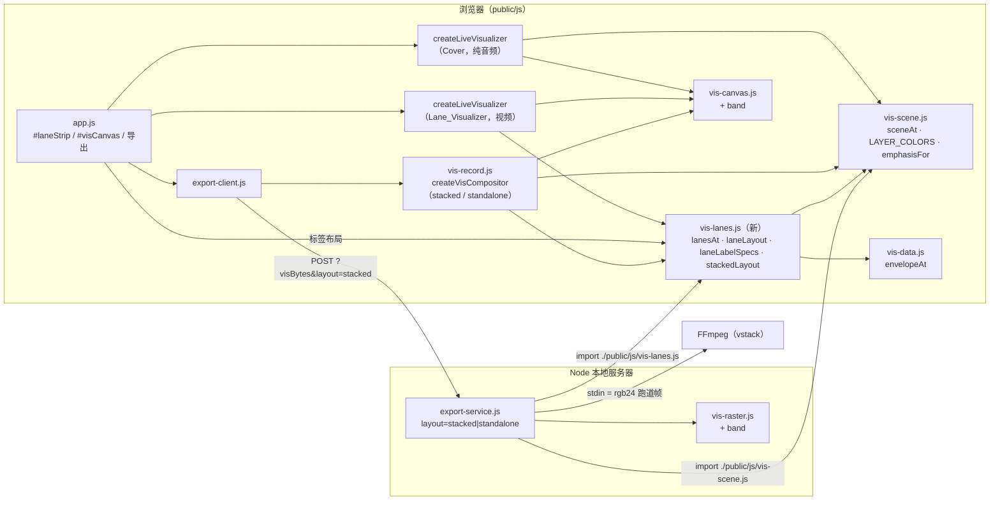
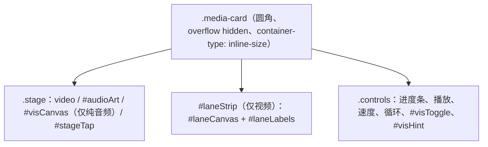

# Design Document：音轨跑道（stem-lanes）

## Overview

本设计修订 stem-visualizer 中 Video_Source 的可视化：画面上的叠加层删除，改为画面正下方的横向滚动 Lane_Strip；带可视化导出改为「画面在上、跑道在下」的 Stacked_Layout。Audio_Only_Source 的封面替换可视化和 Standalone_Layout 导出不变。

- **Lane_Function**（新，`public/js/vis-lanes.js`，同构纯函数）：`lanesAt(t, visData, opts)` → Shape 列表。同一模块还导出 `laneLayout`（Lane 的 y / h）、`laneLabelSpecs`（标签位置和可见性）、`onsetsInWindow`（窗口内 Onset 的二分查找）和 `stackedLayout`（导出叠放尺寸）。
- **Band 图元**（新）：`vis-raster.js` 和 `vis-canvas.js` 各加一个绘制分支，覆盖率模型与 `wave` 相同（竖直距离）。
- **Lane_Visualizer**：直接复用 `createLiveVisualizer`（它已支持注入 `sceneAt`、`isTransparent`、`background`），第二个实例绑定 `#laneCanvas` 和 `lanesAt`。`visualizer.js` 只改 `readVisSettings` 的默认值。
- **导出**：`export-service.js` 的 `VIS_LAYOUTS` 改为 `['stacked', 'standalone']`；`visRenderPlan` 和 `buildVisMuxArgs` 的 overlay 分支替换为 stacked（`vstack`）；`runVisJob` 在 stacked 时用 `lanesAt` 渲染 Lane_Strip 帧。`vis-record.js` 的 `createVisCompositor` 对 Video_Source 改为上下版式。
- **界面**：`index.html` 在 `.stage` 与 `.controls` 之间加 `#laneStrip`（含 `#laneCanvas` 和 `#laneLabels`）；`#visCanvas` 只用于纯音频。

沿用的已有结构：

| 已有模式（来源） | 在本功能中的用法 |
| --- | --- |
| `sceneAt` 输出 Shape、两个后端绘制（stem-visualizer 决策 3） | `lanesAt` 输出同类 Shape，新增 `band` 一种 `kind` |
| `envelopeAt`（`vis-data.js`） | Band 采样直接调用，越界为 0 |
| `LAYER_COLORS`、`emphasisFor`、`MAX_SHAPES`（`vis-scene.js`） | Lane 颜色、亮度系数、图元上限 |
| `createLiveVisualizer`（`visualizer.js`） | 第二个实例，`sceneAt: lanesAt`、`isTransparent: () => false`、`background: LANE_BACKGROUND` |
| `fitEven`、`parseProbeVideoSize`、`pumpFrames`、`watchMux`（`export-service.js`） | Stacked 计划和任务沿用 |
| `runServerMux({ vis })`、`runBrowserRecording({ frameSource })`（`export-client.js`） | 逻辑不变，只是 `layout` 的取值变为 `stacked` |
| FakeEl 假 DOM（`app.test.mjs`、`vis-app.test.mjs`）、`fake-ffmpeg.mjs`、`prop.mjs` | 新测试复用；Fake_FFmpeg 不需要改（它记录参数并按 `-s` 读帧） |

约束：浏览器零依赖；Server 只用 Node ≥ 18 内置模块；`vis-lanes.js` 只导入 `./vis-data.js` 和 `./vis-scene.js`；`player.js`、`library.js`、`vis-data.js`、`vis-analysis.js`、`vis-compute.js` 不改。

## 关键设计决策

### 决策 1：跑道放在画面下方，而不是半透明叠加或侧边栏

| 方案 | 优点 | 缺点 |
| --- | --- | --- |
| 降低叠加层透明度 | 改动最小 | 仍然压在身体上，用户已明确不要 |
| 画面左右两侧的竖向条 | 竖屏视频在横屏设备上有空白可用 | 手机竖屏时没有空白；横屏视频完全没有位置 |
| **画面下方的横向跑道（用户选定）** | 任何宽高比都不遮挡；横向时间轴天然适合「提前看到下一拍」；与 DJ 软件、节奏游戏的视觉习惯一致 | 多占 112–160 px 高度；导出视频变高 |

### 决策 2：时间窗口 1 秒 + 3 秒，Playhead 位置由窗口推出

`playheadX = width × past / (past + future)`，`pxPerSec = width / (past + future)`。取 1 秒 + 3 秒时 Playhead 在 25% 处，Playhead 两侧每秒像素数相同，任何 Onset 的轨迹都是匀速直线。窗口用媒体时间，所以 0.5 倍速时滚动速度减半，与听到的节奏一致，不需要额外处理。3 秒的「未来」在 120 BPM 时约 6 拍，足够预判；1 秒的「过去」让刚响过的鼓点有一个短暂的尾巴，便于对照。

### 决策 3：Lane 顺序为 鼓 → 额外打击乐 → 贝斯 → 人声 → 和声伴奏 → 纯伴奏 → 效果音 → 其他音效

跑道紧贴画面下方，最上面的 Lane 离舞者的视线最近，所以把跳舞最依赖的节奏（鼓、额外打击乐）放在最上面；贝斯（律动）和人声（旋律、歌词提示）在中间；纯伴奏是整首歌的铺底，信息量最少；效果音和其他音效稀疏，放在最下面。顺序固定，不随数据变化，用户可以凭位置记住每条 Lane。

### 决策 4：选中 Lane 权重 3，没有过渡动画

高度按权重分配：选中 3、其余 1，8 条时选中 Lane 占 30%（160 px 条中为 48 px，112 px 条中约 34 px）。亮度沿用 `EMPHASIS`，与全画面可视化的强调规则一致。切换音轨时布局在下一帧直接变成新值：Lane_Function 保持纯函数、没有跨帧状态，导出和属性测试都更简单；切换是用户主动操作，一帧内完成不会让人迷失。

### 决策 5：标签用 DOM 文字，只在实时显示中出现

Canvas 上的 `fillText` 会随设备像素比和画布缩放变糊，且 Software_Rasterizer 没有字体。DOM 文字在手机上清晰、可用 CSS 控制字号。`laneLabelSpecs(layout)` 是纯函数，App 只在布局变化（音轨切换、数据就绪、尺寸变化）时更新 `#laneLabels` 中的 `<span>`，不在每帧更新。高度不足 14 px 的 Lane 隐藏标签（10 px 字号放不下），只靠颜色识别。导出视频不带标签（requirements「假设」第 4 条）。

### 决策 6：新图元 Band，而不是用很多 `rect` 或 `wave` 拼波形

| 方案 | 单条 Lane 的 Shape 数 | 问题 |
| --- | --- | --- |
| 每列一个 `rect` | 约 200–400 | 8 条 Lane 远超 `MAX_SHAPES = 400` |
| 上下两条 `wave` 描边 | 2 | 只有轮廓、没有填充，不像 DJ 波形 |
| **`band`：中线 + 等距半高数组** | 2（已播放 / 未播放各一个） | 两个后端各加约 40 行 |

Band 的距离定义为 `d = |p.y − y| − h(p.x)`，`h(p.x)` 为 `hs` 的线性插值，覆盖率 `cov(d)` 与其他图元相同。它是 `wave` 的推广：`wave` 是「中线随 x 变化、半宽固定」，Band 是「中线固定、半宽随 x 变化」。光栅化时每列插值一次 h，再只遍历 `[y − h − glow, y + h + glow]` 的行，开销与 `wave` 同级。`hs` 全为常数 h 时与 `ys` 全为 y、`width = 2h` 的 `wave` 每个像素的 d 完全相同，因此可以做逐字节等价测试（Property 11）。

### 决策 7：采样时刻对齐到网格

如果采样从 `t − past` 开始等距取点，t 每帧变化时采样点相对波形的位置也在变，波形会「抖动」。改为在 `Δ` 的整数倍时刻取样：`τ_m = m × Δ`，m 从 `floor((t − past) / Δ)` 到 `ceil((t + future) / Δ)`。同一个 τ_m 在不同帧取到同一个包络值，只是横坐标平移，滚动是平滑的。`Δ = (past + future) / n`，`n = clamp(ceil(width / 2), 1, 400)`：大约每 2 像素一个采样，最多 400 个（100 Hz 包络在 4 秒内正好 400 帧，再多没有新信息）。每条 Lane 最多 `n + 2 = 402` 个采样。

已播放 / 未播放用两个 Band：`m_p = ceil(t / Δ)`，过去的 Band 取 `m0 … m_p`，未来的 Band 取 `m_p … m1`，两者只共享一个端点，最多比 Playhead 多出一个采样间隔（≤ 2 像素，落在 Playhead 线下）。

### 决策 8：导出叠放尺寸以「整幅」为单位放进框里

旧的 overlay 规则是「画面放进 1920×1080」。叠放后总高度 = 画面高度 + 跑道高度，竖屏 1080×1920 的画面加跑道会超过 1920。规则改为：

```
SH(OW) = max(96, even(round(0.2 × OW)))
k = min(1, maxW / w, maxH / (h + 0.2 × w))
OW = max(2, even(floor(w × k)))；PH = max(2, even(floor(h × k)))；SH = SH(OW)
若 PH + SH > maxH（只会在 96 的下限起作用时发生）：
  PH = max(2, even(maxH − SH))；OW = max(2, even(min(OW, floor(w × PH / h))))；SH = SH(OW)
```

`even(v) = v − v mod 2`。不考虑 96 下限时 `PH + SH ≤ k(h + 0.2w) + 0.5 ≤ maxH + 0.5`，两者都是整数，所以 ≤ maxH。Server 用 `maxW = maxH = 1920`，浏览器录制用 1280。例子：

| 原画面 | Server 输出（画面 + 跑道） | 浏览器录制 |
| --- | --- | --- |
| 1920×1080 | 1920×1080 + 384 = 1920×1464 | 1280×720 + 256 = 1280×976 |
| 1080×1920（竖屏） | 970×1724 + 194 = 970×1918 | 646×1150 + 128 = 646×1278 |
| 3840×2160 | 1920×1080 + 384 | 1280×720 + 256 |
| 640×360 | 640×360 + 128 | 640×360 + 128 |
| 尺寸读不出 | 按 1280×720：1280×720 + 256 | 按 1280×720 |

Server 只渲染跑道：Strip_Render_Size 宽度 `even(min(OW, 960))`，高度按比例取偶数（1920×384 → 960×192），FFmpeg 用 `bicubic` 放大到 OW×SH。960×192 = 184 320 像素，比 stem-visualizer 的 640×360（230 400）还少，性能目标不变。

### 决策 9：FFmpeg 用 `vstack` 拼接，不用 pad + overlay

```
[0:v:N]fps=30,scale=OW:PH:force_original_aspect_ratio=decrease,pad=OW:PH:(ow-iw)/2:(oh-ih)/2,setsar=1,format=yuv420p[top];
[1:v]scale=OW:SH:flags=bicubic,setsar=1,format=yuv420p[strip];
[top][strip]vstack=inputs=2[v];
[2:a:0]apad[a]
```

`vstack` 要求两路宽度和像素格式相同，两路都先 `format=yuv420p`。原画面在 YUV 中只缩放、补边，不再经过 `gbrp` 转换和 `blend`，画质比 overlay 更好、更快。`pad` 与 overlay 版相同，用于读出的尺寸与解码后不一致时（旋转元数据）只加黑边不变形。

### 决策 10：删除 `layout=overlay`，不保留别名

App 是唯一调用方，和 Server 同一次发布更新；保留别名意味着保留一条不再使用的渲染路径和测试。`overlay` 返回 400 `可视化布局参数无效`（requirements「假设」第 8 条）。

### 决策 11：计算中就占位

视频文件默认打开后，分离完成到 Vis_Data 就绪之间会有几秒。如果就绪时才显示 Lane_Strip，播放控件会在用户操作时突然下移。所以「开关打开且 Vis_Data 正在计算或已就绪」就显示 Lane_Strip（空的深色条），关闭、失败、尚未开始计算时不占位（requirements 6.3–6.5）。分离尚未完成时 `status === 'idle'`，不占位，此时用户还没在练习。

## Architecture



### 页面结构



### Lane_Strip 的组成（宽度 W、高度 H）

```
x = 0                playheadX = 0.25W                                 x = W
┌──────────────────────┃────────────────────────────────────────────────┐
│ 鼓   ▮ (暗)    ▮ (暗) ┃✺  ▮        ▮        ▮        ▮        ▮       │ ← Onset_Lane：淡 Band + Onset_Marker + 闪光
│ 贝斯 ▃▅▃▂ (0.45 倍)   ┃ ▂▃▅▆▅▃▂▁▂▃▅▆▅▃▂ (完整亮度)                       │ ← Envelope_Lane：对称 Band
│ ...                  ┃                                                 │
└──────────────────────┃────────────────────────────────────────────────┘
   过去 1 秒            t           未来 3 秒（从右向左移动）
```

## Components and Interfaces

### 1. `public/js/vis-lanes.js`（新，同构纯函数）

```js
import { envelopeAt, ONSET_STEM_IDS, VIS_STEM_IDS } from './vis-data.js';
import { LAYER_COLORS, emphasisFor, MAX_SHAPES } from './vis-scene.js';

export const LANE_ORDER = Object.freeze(['drums', 'perc', 'bass', 'vocal', 'harmony', 'inst', 'fx', 'other']);
export const LANE_PAST_SEC = 1;
export const LANE_FUTURE_SEC = 3;
export const LANE_SELECTED_WEIGHT = 3;
export const LANE_BACKGROUND = Object.freeze([11, 13, 20]); // #0b0d14
export const LANE_ENV_SCALE = 0.45;        // Envelope_Lane 半高 / Lane 高度
export const LANE_ONSET_ENV_SCALE = 0.35;  // Onset_Lane 淡 Band
export const LANE_MAX_SAMPLES = 400;
export const LANE_MAX_MARKERS = 48;
export const LANE_FLASH_SEC = 0.15;
export const LANE_LABEL_MIN_PX = 14;
export const LANE_ALPHA = Object.freeze({
  band: 0.85, faintBand: 0.22, marker: 0.95, baseline: 0.12, playhead: 0.85, flash: 0.9,
});
export const LANE_PAST_DIM = Object.freeze({ band: 0.45, marker: 0.4 });
export const PLAYHEAD_COLOR = Object.freeze([255, 255, 255]);
export const STRIP_RATIO = 0.2;
export const STRIP_MIN = 96;

/**
 * Lane_Layout（2.1、2.2、5.1、5.2）。ids 中属于 LANE_ORDER 的按 LANE_ORDER 排序、去重；
 * selected 在其中且 Lane 数 > 1 时权重 3，其余 1。y_k = height × (前 k 条权重和) / 总权重，
 * 最后一条 h = height − y_last，使总和正好等于 height。ids 为空或 height 无效时返回 []。
 * @returns {{ id: string, y: number, h: number }[]}
 */
export function laneLayout(ids, selected, height);

/** Lane_Label 规格（2.4）：[{ id, top: y + h / 2, visible: h ≥ minPx }]，顺序同 layout。 */
export function laneLabelSpecs(layout, minPx = LANE_LABEL_MIN_PX);

/**
 * [t0, t1] ∩ [0, duration] 内 Onset 的时间（秒，idx / frameRate），按时间递增。
 * onsets 是严格递增的 Int32Array，二分查找起点，不分配大数组。
 */
export function onsetsInWindow(visData, id, t0, t1);

/**
 * 叠放尺寸（决策 8；12.2、12.3、13.1）。w、h 不是正有限数时按 1280×720。
 * @returns {{ width: number, pictureHeight: number, stripHeight: number }}  全部为 ≥ 2 的偶数
 */
export function stackedLayout(w, h, maxW, maxH);

/**
 * @param {number} t  秒（媒体时间）
 * @param {object} visData
 * @param {{ selected: string, width: number, height: number, reducedMotion?: boolean,
 *           pastSec?: number, futureSec?: number }} opts
 *   pastSec / futureSec 不是 ≥ 0 的有限数或两者之和为 0 时用默认值 1 / 3（3.2）。
 * @returns {object[]}  最多 MAX_SHAPES 个
 */
export function lanesAt(t, visData, opts);
```

`lanesAt` 的计算（W = width，H = height，S = past + future，`px = W / S`，`playheadX = W × past / S`，`x(τ) = playheadX + (τ − t) × px`）：

1. W 或 H 不是 ≥ 1 的有限数、`visData.stems` 没有键 → 返回 `[]`（8.5）。
2. `layout = laneLayout(Object.keys(visData.stems), selected, H)`。
3. 采样网格（决策 7）：`n = clamp(ceil(W / 2), 1, 400)`，`Δ = S / n`，`m0 = floor((t − past) / Δ)`，`m1 = ceil((t + future) / Δ)`，`mp = clamp(ceil(t / Δ), m0, m1)`；每条 Lane 对 `m0 … m1` 各调用一次 `envelopeAt(visData, id, m × Δ)`（≤ 402 次，10.4）。
4. 每条 Lane（`cy = y + h / 2`，`a = emphasisFor(id, selected).alpha`，`color = LAYER_COLORS[id]`）依次输出：

| role | kind | 几何 | alpha（夹到 [0, 1]） |
| --- | --- | --- | --- |
| `baseline` | `rect` | `x = 0, w = W, y = cy − 0.5, h = 1`（h < 2 时为 `h / 2`），`glow = 0` | `0.12 × a` |
| `band`，`side: 'past'` | `band` | `x0 = x(m0Δ)`、`x1 = x(mpΔ)`、`y = cy`、`hs[j] = scale × h × env(m0 + j)`、`glow = 0.1h` | `base × 0.45 × a` |
| `band`，`side: 'future'` | `band` | `x0 = x(mpΔ)`、`x1 = x(m1Δ)`，其余同上 | `base × a` |
| `marker`（仅 Onset_Lane） | `rect` | 中心 `x(τ)`，`w = clamp(0.006W, 2, 8)`，`y = cy − 0.35h`，`h = 0.7h`，`glow = clamp(0.15h, 1, 6)` | 未来 `0.95 × a`；`τ ≤ t` 为 `0.95 × 0.4 × a` |
| `flash`（仅 Onset_Lane，非 Reduced_Motion） | `disc` | `(playheadX, cy)`，`r = 0.2h`，`glow = 0.8h` | `0.9 × (1 − age / 0.15)² × a` |

   - Envelope_Lane：`scale = 0.45`，`base = 0.85`；Onset_Lane：`scale = 0.35`，`base = 0.22`（淡 Band 透明度 ≤ 0.3 × 同侧标记，4.2：`0.22 / 0.95 ≈ 0.23`，`0.099 / 0.38 ≈ 0.26`）。
   - 只有 1 个采样的 Band（`m0 = mp` 或 `mp = m1`）不输出。
   - 标记：`onsetsInWindow(visData, id, t − past, t + future)`；超过 48 个时按 `|τ − t|` 升序（并列取较早）保留 48 个，再按时间升序输出（4.4）。
   - 闪光：`onsetsInWindow(visData, id, t − 0.15, t)` 中满足 `τ > t − 0.15` 的最后一个，`age = t − τ`（4.7）。
5. 最后输出 Playhead：`rect`，`layer: 'playhead'`，`role: 'playhead'`，`x = playheadX − pw / 2`，`w = pw = max(2, round(0.003W))`，`y = 0`，`h = H`，`glow = pw`，`color = PLAYHEAD_COLOR`，`alpha = 0.85`（4.6，不乘亮度系数）。
6. 截断到 `MAX_SHAPES`。上限：8 × 3 + 4 × (48 + 1) + 1 = 221 < 400。

越界 t：`envelopeAt` 在 `[0, duration]` 外返回 0，`onsetsInWindow` 只返回 `[0, duration]` 内的 Onset（3.6）。Reduced_Motion 只跳过 `flash` 一行，其余完全相同（7.1）。所有透明度只由 role、side 和 `a` 决定（7.2）。

### 2. `public/js/vis-raster.js` 改动：`band`

```js
case 'band': {
  const hs = s.hs;
  if (!isNum(s.x0) || !isNum(s.x1) || !isNum(s.y) || !hs || !(hs.length >= 1)) return;
  for (let k = 0; k < hs.length; k++) if (!isNum(hs[k]) || hs[k] < 0) return;   // 9.5
  drawBand(s.x0, s.x1, s.y, hs, glow);
  return;
}
```

`drawBand(x0, x1, y, hs, glow)`：列范围与 `drawWave` 相同（`[ceil(lo − 0.5), floor(hi − 0.5)]` 与画面求交）；每列按与 `drawWave` 完全相同的 u / k 公式插值得到 h；行范围 `[ceil(y − h − glow − 0.5), floor(y + h + glow − 0.5)]`；`d = |py + 0.5 − y| − h`，`cov(d)` 与其他图元相同（9.1、9.2）。插值和距离的算术顺序与 `drawWave` 逐项一致（`wave` 的 `yc` 换成常数 y、`hw` 换成插值的 h），保证常数 hs 时与 `wave` 逐字节相同（9.3）。

### 3. `public/js/vis-canvas.js` 改动：`band`

```js
function drawBand(ctx, s, alpha) {
  // hs 为空或含非有限数 / 负数 → 跳过（9.5）
  // outline(extra)：moveTo(x0, y − hs[0] − extra)，依次 lineTo 上边缘，再从右到左 lineTo 下边缘 y + hs[j] + extra，closePath
  // glow > 0：fillStyle = rgba(color, alpha × 0.25)，outline(glow)，fill()
  // fillStyle = rgba(color, alpha)，outline(0)，fill()        （9.4）
}
```

加入 `DRAWERS.band`。`drawSceneToCanvas` 其余不变（仍为 `'lighter'`、结束时恢复合成模式）。

### 4. `public/js/visualizer.js` 改动

```js
/** 开关设置（requirements 6.1、6.2）：非布尔值用默认值（visVideo = true、visAudio = true）。 */
export function readVisSettings(s);
```

`createLiveVisualizer` 不改：它把 `sceneAt` 当作 `(t, data, { selected, width, height, reducedMotion }) => Shape[]` 调用，`lanesAt` 的签名兼容（`pastSec` / `futureSec` 用默认值）。

### 5. `public/js/vis-record.js` 改动

```js
export const RECORD_STACK_BOX = 1280; // 宽度和总高度上限（13.1）

/**
 * Video_Source（video 非 null）：size = stackedLayout(videoWidth, videoHeight, 1280, 1280)，
 *   canvas = width × (pictureHeight + stripHeight)。每帧（13.2、13.3）：
 *   1. source-over：[0, PH) 填黑，[PH, PH + SH) 填 LANE_BACKGROUND
 *   2. drawImage(video, 按 contain 放进 width × PH 的矩形)
 *   3. save → translate(0, PH) → beginPath + rect(0, 0, width, SH) + clip →
 *      drawSceneToCanvas(ctx, lanesAt(t, visData, { selected: stemId, width, height: SH, reducedMotion: false }),
 *                        { clear: false }) → restore
 * Audio_Only_Source：与 stem-visualizer 相同（1280×720、背景 + sceneAt），13.4。
 */
export function createVisCompositor({ ..., lanesAt = defaultLanesAt });
```

### 6. `export-service.js` 改动

```js
import { lanesAt, stackedLayout, LANE_BACKGROUND } from './public/js/vis-lanes.js';

export const VIS_LAYOUTS = Object.freeze(['stacked', 'standalone']);   // 11.2
export const VIS_STACK_BOX = 1920;                                      // OW ≤ 1920，PH + SH ≤ 1920
export const VIS_STRIP_RENDER_MAX_W = 960;
export const VIS_DEFAULT_PICTURE = Object.freeze([1280, 720]);          // 尺寸读不出时（12.3）
// 删除 VIS_OUTPUT_BOX（只有 overlay 使用）；VIS_RENDER_BOX、VIS_STANDALONE_OUTPUT 保留给 standalone

/**
 * stacked（12.2–12.5）：s = stackedLayout(videoSize ?? 1280×720, 1920, 1920)；
 *   picture = { w: s.width, h: s.pictureHeight }，strip = { w: s.width, h: s.stripHeight }，
 *   output = { w: s.width, h: s.pictureHeight + s.stripHeight }，
 *   render = { w: even(min(OW, 960)), h: max(2, even(round(SH × renderW / OW))) }
 * standalone：不变。D、frames 规则不变。
 */
export function visRenderPlan({ layout, probeDuration, payloadDuration, videoSize });

/** stacked：输入 0 = 原文件、1 = pipe:0、2 = WAV，滤镜图见「决策 9」；standalone 不变。 */
export function buildVisMuxArgs(fixedArgs, plan, video, paths);
```

`runVisJob`：`layout === 'stacked' && !info.video` → 失败 `文件里没有画面`（12.1）；`videoSize` 只在 stacked 时解析；stacked 的 `renderInto` 为 `raster.render(lanesAt(k / 30, visData, { selected, width: RW, height: RH, reducedMotion: false }), LANE_BACKGROUND, buf)`（12.5），standalone 仍为 `sceneAt` + `VIS_BACKGROUND`。其余（`spawnMux`、`pumpFrames`、`watchMux`、取消、超时、清理）不改（12.7）。`parseVisQuery` 的代码不改，只是 `VIS_LAYOUTS` 变了。

### 7. `public/js/export-client.js` 改动

只改 JSDoc：`vis?: { payload: Blob, layout: 'stacked' | 'standalone' }`。逻辑不变（11.4）。

### 8. `index.html` / `style.css` / `app.js` 改动

#### 8.1 页面元素

```html
<!-- .stage 之后、.controls 之前 -->
<div class="lane-strip" id="laneStrip" hidden>
  <canvas class="lane-canvas" id="laneCanvas" aria-hidden="true"></canvas>
  <div class="lane-labels" id="laneLabels" aria-hidden="true"></div>
</div>
```

```css
.media-card { container-type: inline-size; }
.lane-strip { position: relative; height: 128px; height: clamp(112px, 20cqw, 160px); background: #0b0d14; }
.lane-canvas { position: absolute; inset: 0; display: block; width: 100%; height: 100%; }
.lane-labels { position: absolute; inset: 0; pointer-events: none; }
.lane-label { position: absolute; left: 6px; transform: translateY(-50%); font-size: 10px; line-height: 1;
              padding: 1px 4px; border-radius: 3px; background: rgba(11, 13, 20, 0.6); white-space: nowrap; }
```

`.lane-strip` 在普通文档流中、位于 `.stage` 之后，所以与画面没有重叠（1.3）。`height: 128px` 是不支持容器查询单位的浏览器的回退值。`.lane-canvas` 内部用绝对定位，标签不影响画布尺寸。

#### 8.2 `app.js`

```js
import { lanesAt, laneLayout, laneLabelSpecs, LANE_BACKGROUND } from './vis-lanes.js';
import { LAYER_COLORS } from './vis-scene.js';

const coverOn = () => !!currentVisData() && state.current.kind === 'audio' && settings.visAudio;      // 1.4
const laneOn = () => !!state.current && state.current.kind === 'video' && settings.visVideo
  && (state.vis.status === 'computing' || state.vis.status === 'ready');                           // 6.3、6.5

visualizer = createLiveVisualizer({ canvas: els.visCanvas, isEnabled: coverOn, isTransparent: () => false, ... }); // 10.3
laneVisualizer = createLiveVisualizer({
  canvas: els.laneCanvas, sceneAt: lanesAt, isEnabled: laneOn, isTransparent: () => false,
  background: LANE_BACKGROUND, getVisData: currentVisData, getTime: () => player.currentTime, ... });            // 10.1
```

- `invalidateVis()` 同时 `invalidate()` 两个实例。计算中 `getVisData()` 为 null，Lane_Visualizer 不绘制，画布保持 CSS 背景 `#0b0d14`（6.4）。
- `renderVis()`：`els.visCanvas.hidden = !coverOn()`；`els.laneStrip.hidden = !laneOn()`；`mediaCard` 的 `vis-on` 类改为只跟随 `coverOn()`（纯音频 CSS 依赖它）；开关和提示规则不变（6.6）；最后调用 `renderLaneLabels()`。
- `renderLaneLabels()`：Lane_Strip 隐藏或没有 Vis_Data 时清空 `#laneLabels`；否则 `laneLabelSpecs(laneLayout(Object.keys(data.stems), state.selected, els.laneStrip.clientHeight))`，每个 id 复用同一个 `<span class="lane-label">`：`textContent` 为 STEMS 中的 label，`style.top = top + 'px'`，`style.color` 为 `LAYER_COLORS[id]`，`hidden = !visible`（2.4、2.5）。在 `renderVis()`、`selectStem()` 和窗口 `resize` 中调用。
- 视频文件的 Vis_Export：`layout: isVideo ? 'stacked' : 'standalone'`（11.1）。
- 所有新元素都做 null 判断（`if (els.laneStrip)`），使不含这些元素的旧假 DOM（`app.test.mjs`、`export-app.test.mjs`）继续可用。

## Data Models

### Lane Shape（在 stem-visualizer 的 Shape 上增加 `band` 和两个可选字段）

```js
{ kind: 'band', layer: 'bass', role: 'band', side: 'future',
  x0: 160.0, x1: 641.6, y: 72, hs: [0, 3.1, 5.7, …], glow: 1.8, color: [72, 132, 255], alpha: 0.85 }
{ kind: 'rect', layer: 'drums', role: 'marker', side: 'past', x, y, w, h, glow, color, alpha }
{ kind: 'disc', layer: 'drums', role: 'flash', x, y, r, glow, color, alpha }
{ kind: 'rect', layer: 'drums', role: 'baseline', x: 0, y, w, h, glow: 0, color, alpha }
{ kind: 'rect', layer: 'playhead', role: 'playhead', x, y: 0, w, h, glow, color: [255, 255, 255], alpha: 0.85 }
```

`role`、`side` 只供测试和调试使用，两个后端忽略它们。

### Lane_Layout

```js
[{ id: 'drums', y: 0, h: 16 }, { id: 'perc', y: 16, h: 16 }, { id: 'bass', y: 32, h: 48 /* 选中 */ }, …]
```

### Vis_Export_Job 的 `plan`（stacked）

```js
{ layout: 'stacked', D, frames, fps: 30,
  picture: { w: 1920, h: 1080 }, strip: { w: 1920, h: 384 },
  output: { w: 1920, h: 1464 }, render: { w: 960, h: 192 } }
```

### 设置（localStorage `cengjian.settings`）

```js
{ speed, loop, demucsModel, visVideo: boolean /* 默认改为 true */, visAudio: boolean /* 默认 true */ }
```

## 已知风险

- **导出视频变高**：叠放后横屏 1080p 输出为 1920×1464，不是标准 16:9；部分平台上传时会加黑边或裁切。这是不遮挡画面的直接代价。
- **跑道放大后的清晰度**：Server 以 960 宽渲染、放大到 1920，Playhead 和标记边缘会略软。换取的是光栅化速度。
- **手机上标签不全**：112 px 条、8 条 Lane、选中一条时，其余 Lane 约 11 px，标签隐藏，只能靠颜色和固定顺序识别。
- **容器查询单位**：不支持 `cqw` 的旧浏览器用固定 128 px 高度。
- **已保存的 `visVideo: false`**：以前关闭过的用户升级后仍是关闭（requirements「假设」第 1 条），需要手动打开一次。
- **高度变化导致画布重设尺寸**：窗口变化时 Lane_Canvas 像素尺寸改写会清空画布，由 `createLiveVisualizer` 在下一帧重绘，暂停时也会重绘一次（key 含尺寸）。

## Error Handling

| 情况 | Server 行为 | App 行为 |
| --- | --- | --- |
| Vis_Data 计算中 | — | 开关打开时 Lane_Strip 占位、只显示背景色，提示「可视化准备中…」（6.3、6.4） |
| Vis_Data 生成失败 | — | Lane_Strip 隐藏，提示「可视化数据生成失败」，播放和导出不受影响（6.5） |
| Vis_Data 中没有任何 Stem / 画布尺寸为 0 | — | `lanesAt` 返回 `[]`，只画背景（8.5） |
| Band 的 `hs` 为空或含非有限数 | 光栅化跳过该 Band（9.5） | Canvas 跳过该 Band（9.5） |
| `layout=overlay` 或其他未知值 | 400 `可视化布局参数无效`，不写文件（11.2） | ExportError(upload) → 提示并回退浏览器录制 |
| stacked 但没有画面流 | failed `文件里没有画面`（12.1） | 提示并回退浏览器录制 |
| 画面尺寸读不出 | 按 1280×720 计算，`pad` 补黑边（12.3） | — |
| 录制时视频帧尚未就绪 | — | `drawImage` 抛错时保留黑色画面区域，跑道照常画 |
| 其余上传、FFmpeg、取消、超时错误 | 与 stem-visualizer 相同 | 与 stem-visualizer 相同 |

## Correctness Properties

*A property is a characteristic or behavior that should hold true across all valid executions of a system-essentially, a formal statement about what the system should do. Properties serve as the bridge between human-readable specifications and machine-verifiable correctness guarantees.*

属性反思：Lane 顺序、高度之和、首尾相接和 3 倍权重（2.1、2.2、5.1、5.2）都是 `laneLayout` 的不变式，合并为一个属性；窗口映射、只画窗口内 Onset、标记尺寸和 48 个上限（3.1、3.3、4.3、4.4）都是「标记集合等于参考模型」，合并；Band 半高公式、网格对齐、越界为 0 和采样次数（4.1、4.2 的半高部分、4.8、3.6、10.4）合并为波形采样属性；颜色、已播放变暗、亮度系数和「透明度只取决于类别」（2.3、4.2 的透明度部分、4.5、5.3、7.2）合并为一个透明度模型；Playhead 与闪光（4.6、4.7）合并；Reduced_Motion（7.1）是独立的蜕变关系，单列。确定性（8.1）同时覆盖 3.4、3.5（画面只是 t 的函数）。Band 的覆盖率与范围（9.1、9.2、9.5）合并，与 `wave` 的等价（9.3）单列，顺序无关与单调把 stem-visualizer Property 25、26 的生成器扩展到 Band。调度（10.1–10.3、7.3、5.4）复用 stem-visualizer Property 14 已验证的 `createLiveVisualizer`，这里只做示例测试。录制合成器（13.x）用假 ctx 做示例测试。

### Property 1: Lane 场景确定性

*For any* Vis_Data、时刻序列 t₁…tₙ（随机顺序，含重复、负数和超过时长的值）、`selected`、尺寸、`reducedMotion`、`pastSec` 和 `futureSec`，按该顺序调用 `lanesAt` 得到的每个结果与对同一参数单独调用的结果深度相等；调用后参数对象和 Vis_Data（含 `env`、`onsets` 的字节）没有被修改。

**Validates: Requirements 8.1, 3.4, 3.5**

### Property 2: Lane 输出界限

*For any* Vis_Data（含只有部分 Stem、全静音、Onset 极密集——每 5 帧一个）、任意有限 t、宽 ∈ [1, 4096]、高 ∈ [1, 512]、任意 `selected` 和 `reducedMotion`，`lanesAt` 返回不超过 400 个 Shape；每个 Shape 的 `kind` ∈ {`disc`, `ring`, `wave`, `rect`, `band`}，所有数值字段（含 `hs` 的每个元素）是有限数，`alpha ∈ [0, 1]`，`color` 是三个 0–255 的整数，`r`、`w`、`h`、`glow` 和 `hs` 元素 ≥ 0；每条 Onset_Lane 的 `marker` 不超过 48 个；每个 `band` 的 `[y − max(hs), y + max(hs)]` 和每个 `marker` 的 `[y, y + h]` 落在其 Lane 的 `[y, y + h]` 内；每个 `band` 满足 `x0 ≥ −Δ·px`、`x1 ≤ W + Δ·px`；*for any* 宽或高为 0、负数、NaN、Infinity，或 `stems` 为空的输入，结果为 `[]`。

**Validates: Requirements 8.2, 8.3, 8.4, 8.5, 4.4**

### Property 3: Lane 布局

*For any* Stem id 列表（VIS_STEM_IDS 的随机子集，随机顺序、可重复、混入未知 id）、`selected ∈ ALL_STEM_IDS ∪ {未知 id}` 和高度 ∈ [1, 1000]，`laneLayout` 的 id 序列等于 `LANE_ORDER` 中属于该列表的元素按 `LANE_ORDER` 排列；第一条 `y = 0`，每条 `y_{k+1} = y_k + h_k`，最后一条的 `y + h` 等于高度（误差 ≤ 1e-9）；`selected` 在列表中且 Lane 数 > 1 时，选中 Lane 的 h 等于其他每条 h 的 3 倍（相对误差 ≤ 1e-9），其余情况全部等高。

**Validates: Requirements 2.1, 2.2, 5.1, 5.2**

### Property 4: Lane_Label 门限

*For any* `laneLayout` 的输出，`laneLabelSpecs` 返回与之同序、同 id 的列表，每项 `top = y + h / 2`，`visible` 为真当且仅当 `h ≥ 14`。

**Validates: Requirements 2.4**

### Property 5: 时间窗口映射与 Onset_Marker

*For any* Vis_Data、t（含窗口跨过 0 或时长的情况）、宽度、高度、`selected`、`pastSec` 和 `futureSec`，每条 Onset_Lane 中 `role === 'marker'` 的 Shape 的中心横坐标 `x + w / 2` 组成的序列，等于参考模型的序列：取 `[t − past, t + future] ∩ [0, duration]` 内该 Stem 的 Onset 时间，超过 48 个时按 `|τ − t|`（并列取较早）保留 48 个，按时间升序映射为 `playheadX + (τ − t) × W / (past + future)`（误差 ≤ 1e-6）；每个标记的高度为 `0.7 × Lane 高度`，竖直中心为 Lane 中线；不传 `pastSec` / `futureSec` 的结果与传 1 / 3 的结果深度相等。

**Validates: Requirements 3.1, 3.2, 3.3, 3.6, 4.3, 4.4**

### Property 6: 波形采样

*For any* Vis_Data、t、宽度、高度和 `selected`，每条 Lane 的 `band` Shape 满足：把第 j 个采样的横坐标 `x0 + j × (x1 − x0) / (hs.length − 1)` 反算为时刻 τ_j，τ_j / Δ 与最近整数相差 ≤ 1e-6（网格对齐），且 `hs[j] = scale × Lane 高度 × envelopeAt(visData, id, τ_j)`（误差 ≤ 1e-6），`scale` 对 Envelope_Lane 为 0.45、对 Onset_Lane 为 0.35；`past` Band 的 `x1` 等于 `future` Band 的 `x0`；*for any* t 和 t' = t + kΔ（k 为整数），两帧中同一网格时刻的半高相等；用计数包装的 `envelopeAt` 时，每帧每条 Lane 的调用次数 ≤ 402。

**Validates: Requirements 4.1, 4.2, 4.8, 3.6, 10.4**

### Property 7: 颜色与透明度模型

*For any* Vis_Data、t、尺寸、`selected` 和 `reducedMotion`，`layer` 为 Stem id 的每个 Shape 的 `color` 等于 `LAYER_COLORS[layer]`，非 `flash` Shape 的 `alpha` 等于 `min(1, base(kind 类别, role, side) × emphasisFor(layer, selected).alpha)`，其中 base 由 design 第 1 节的表给出（`past` Band 为未来 Band 的 0.45 倍，`past` 标记为未来标记的 0.4 倍），因此只取决于 Stem、`selected`、role 和 side，与 t 无关；同一 Onset_Lane 同一 side 的淡 Band 透明度 ≤ 0.3 × 标记透明度。

**Validates: Requirements 2.3, 4.2, 4.5, 5.3, 7.2**

### Property 8: Playhead 与闪光

*For any* Vis_Data、t、尺寸和 `selected`（`reducedMotion: false`），输出中正好一个 `role === 'playhead'` 的 Shape，它的 `x + w / 2 = playheadX`、`y = 0`、`h = H`、`color = [255, 255, 255]`；每条 Onset_Lane 的 `flash` 个数为 1 当且仅当存在 Onset 时刻 τ ∈ (t − 0.15, t] ∩ [0, duration]，此时它位于 `(playheadX, Lane 中线)`，透明度等于 `min(1, 0.9 × (1 − (t − τ*) / 0.15)² × emphasisFor(id, selected).alpha)`，τ* 为其中最大的 τ；Envelope_Lane 没有 `flash`。

**Validates: Requirements 4.6, 4.7**

### Property 9: 减少动态效果

*For any* Vis_Data、t、尺寸、`selected`、`pastSec` 和 `futureSec`，`lanesAt(…, reducedMotion: true)` 与 `lanesAt(…, reducedMotion: false).filter((s) => s.role !== 'flash')` 深度相等。

**Validates: Requirements 7.1**

### Property 10: Band 光栅化

*For any* 尺寸 1–64、背景色和单个 Band（随机 `x0`、`x1`（可越出画面、可 `x0 > x1`）、`y`、1–50 个非负半高、`glow`、颜色和透明度），渲染结果中外接范围（`[x0, x1] × [y − max(hs) − glow, y + max(hs) + glow]`）之外的像素都等于背景色，范围内每个像素的每个通道与参考模型 `bg + color × alpha × cov(|py + 0.5 − y| − lerp(hs, px + 0.5))` 取整并限制到 0–255 后的值相差不超过 1；*for any* `hs` 为空、含 NaN / Infinity / 负数的 Band，渲染结果与只渲染背景逐字节相同。

**Validates: Requirements 9.1, 9.2, 9.5**

### Property 11: Band 与 wave 等价

*For any* 尺寸、背景色、`x0`、`x1`、`y`、非负 h、`glow`、颜色、透明度和采样数 n ∈ [1, 50]，渲染 `{ kind: 'band', hs: n 个 h }` 与渲染 `{ kind: 'wave', ys: n 个 y, width: 2h }`（其余字段相同）得到逐字节相同的缓冲区。

**Validates: Requirements 9.3**

### Property 12: 含 Band 的光栅化顺序无关与单调

*For any* 尺寸、背景色和含 `band` 与其他四种图元的 Shape 列表，把列表随机重排后渲染，每个通道与原结果相差不超过 1；在列表末尾再加一个 `band` 后，任一像素的任一通道都不减少。

**Validates: Requirements 9.1, 9.2**

### Property 13: 叠放尺寸

*For any* 宽、高 ∈ [1, 8192] 的整数（含极端宽高比）以及框 `max ∈ {1280, 1920}`，`stackedLayout(w, h, max, max)` 的 `width`、`pictureHeight`、`stripHeight` 都是 ≥ 2 的偶数，`width ≤ max`，`pictureHeight + stripHeight ≤ max`，`stripHeight = max(96, even(round(0.2 × width)))`；`width ≤ max(2, w)` 且 `pictureHeight ≤ max(2, h)`（不放大）；精确缩放后的短边 ≥ 2 时，`width / pictureHeight` 与 `w / h` 的相对误差不超过 `2 / min(width, pictureHeight)`；*for any* 非正或非有限的 w、h，结果等于 `stackedLayout(1280, 720, max, max)`。

**Validates: Requirements 12.2, 12.3, 13.1**

### Property 14: 叠放渲染计划

*For any* 探测时长（含 `null`）、Payload 时长和画面尺寸（含 `null`），`visRenderPlan({ layout: 'stacked', … })` 的 `D` 和 `frames = ceil(D × 30)` 与 stem-visualizer 规则相同；`picture`、`strip`、`output` 等于 `stackedLayout(videoSize ?? 1280×720, 1920, 1920)` 推出的值，`output.h = picture.h + strip.h`；`render.w = even(min(output.w, 960))`，`render.h = max(2, even(round(strip.h × render.w / output.w)))`，两者都是 ≥ 2 的偶数且不超过 `strip` 的对应尺寸。

**Validates: Requirements 12.3, 12.4, 12.5**

### Property 15: 叠放合成参数

*For any* stacked 渲染计划、画面流序号和路径，`buildVisMuxArgs` 的结果满足：第一个 `-i` 为 `paths.input`；包含 `-f rawvideo -pix_fmt rgb24 -s <render.w>x<render.h> -r 30 -i pipe:0`；滤镜图引用 `0:v:<ordinal>`，包含 `scale=<OW>:<PH>:force_original_aspect_ratio=decrease`、`pad=<OW>:<PH>`、`scale=<OW>:<SH>`、`vstack=inputs=2` 和 `apad`，不包含 `blend`、`overlay` 和 `gbrp`；包含完整的 `X264_ARGS`、`-c:a aac -b:a 192k`、`-t <formatSeconds(D)>`、`-movflags +faststart`、`-progress pipe:1 -nostats`，不含 `-shortest`、`-nostdin` 和 `0:a`；最后一个参数是 `paths.output`。

**Validates: Requirements 12.6, 12.7**

### Property 16: 布局参数校验

*For any* `visBytes` 与 `layout` 的取值组合（缺失、空串、`overlay`、`Stacked`、`STANDALONE`、前后空格、随机字符串），`parseVisQuery` 返回带 `vis` 的 `ok` 当且仅当 `visBytes` 合法（stem-visualizer Property 19 的规则）且 `layout` 严格等于 `stacked` 或 `standalone`；两者都缺失时返回 `{ ok: true, vis: null }`；`layout === 'overlay'` 时 `ok === false`。

**Validates: Requirements 11.2**

### Property 17: 开关设置默认值

*For any* 存储对象（缺失、`null`、数组、键值为字符串 / 数字 / `null` / 布尔），`readVisSettings` 的 `visVideo` 和 `visAudio` 在原值是布尔时等于原值，否则为 `true`。

**Validates: Requirements 6.1, 6.2**

## Testing Strategy

测试命令不变：`node --test tests/*.test.mjs`。属性测试用 `tests/helpers/prop.mjs`（种子 PRNG、`forAll`，`PROP_SEED` 复现），每个属性至少 100 轮；每个属性测试用注释标注：

```js
// Feature: stem-lanes, Property 5: 时间窗口映射与 Onset_Marker
```

### 新增测试文件

| 文件 | 内容 |
| --- | --- |
| `tests/vis-lanes.test.mjs` | `lanesAt` 的 Property 1、2、5–9；示例：`onsetsInWindow` 在窗口边界上的包含规则；同构冒烟（只有 `./` 导入，不出现 `window`、`document`、`self`、`process`、`require`） |
| `tests/vis-lanes-layout.test.mjs` | 纯尺寸函数的 Property 3、4、13；示例：8 条 Stem、选中 `drums` 时 160 px 高的布局（drums 48 px、其余 16 px）；`stackedLayout` 在「决策 8」表中的各个例子 |

### 需要更新的现有测试文件

| 文件 | 改动 |
| --- | --- |
| `tests/vis-raster.test.mjs` | 新增 Property 10、11；Property 25、26（stem-visualizer）的 Shape 生成器加入 `band`，即本文档的 Property 12；示例：常数 hs 的 Band 中心像素 = 背景 + color × alpha |
| `tests/vis-canvas.test.mjs` | `band` 的假 ctx 示例：glow > 0 时两次 `fill`（第一次透明度 × 0.25），每次 `lineTo` 次数为 `2n − 1`、有 `closePath`；`hs` 为空或含 NaN 时没有绘制调用；合成模式仍为 `'lighter'` 并恢复；同构冒烟的文件列表加入 `vis-lanes.js` |
| `tests/visualizer.test.mjs` | Property 16（stem-visualizer）改为本文档的 Property 17：`visVideo` 默认 `true` |
| `tests/vis-export-props.test.mjs` | Property 19 改为本文档的 Property 16（`stacked` / `standalone`，`overlay` 拒绝）；Property 22 的 overlay 分支改为本文档的 Property 14；Property 23 的 overlay 分支改为本文档的 Property 15，standalone 分支保留；Property 21、20、24 不改 |
| `tests/vis-export-service.test.mjs` | overlay 完整流程改为 stacked：`FAKEVIDEO size=1280x720 duration=00:00:02.00` → `stdin.frames === 60`、`stdin.size === '960x192'`（输出 1280 宽、跑道 256 → render 960×192）、参数含 `vstack=inputs=2`、`scale=1280:720`、`scale=1280:256`、不含 `blend`；`rotate=90` + `size=1920x1080` → 竖屏 1080×1920 的叠放尺寸（970×1918，render 960×192）；stacked + `codec=none` → failed `文件里没有画面`；新增 `layout=overlay` → 400 `可视化布局参数无效` 且不写文件；背压、`stdinexit`、取消、超时、排队用例的 `layout` 改为 `stacked`；standalone 和不带可视化参数的用例不改 |
| `tests/vis-export-client.test.mjs` | Property 18（stem-visualizer）的 `layout` 生成器改为 `stacked` / `standalone`；`createVisCompositor` 示例：视频 1920×1080 → 画布 1280×976，每帧顺序为填黑 / 填跑道背景 → `drawImage` 目标矩形在 `[0, 720]` 内 → `save`、`translate(0, 720)`、`clip`、跑道绘制、`restore`；`lanesAt` 收到 `{ width: 1280, height: 256, selected: stemId, reducedMotion: false }`；纯音频示例不改 |
| `tests/vis-app.test.mjs` | 假 DOM 加入 `#laneStrip`、`#laneCanvas`、`#laneLabels`。视频文件：默认打开、`#visCanvas` 始终隐藏且没有绘制调用、计算中 `#laneStrip` 显示（占位）且 `#laneCanvas` 没有绘制、就绪后 flush 帧有绘制且 `laneCanvas.width = clientWidth × min(dpr, 2)`、关闭后 `#laneStrip.hidden`、失败时隐藏；切换音轨后标签的 `top` / `hidden` 更新（160 px 时全部可见，112 px 且选中一条时只有选中的可见）；`prefers-reduced-motion` 变化后下一帧 `lanesAt` 收到 `reducedMotion: true`（通过记录的 ctx 中没有闪光径向渐变或注入的 `sceneAt` 包装检查）；导出上传的 `layout` 为 `stacked`；`visVideo: false` 已保存时保持关闭。原「overlay shown and drawn」用例改写为上述 Lane_Strip 用例；纯音频用例不改 |
| `tests/vis-perf.test.mjs` | 新增 `BENCH_PERF=1` 用例（14.1、14.2）：3 分钟、8 条 Stem、鼓和额外打击乐每秒 4 个 Onset，960×192 下均匀抽 900 帧，`lanesAt` + `render` 平均每帧 < 33 ms，输出平均值和 P95；原 640×360 的 `sceneAt` 用例保留（standalone 仍使用） |

`tests/app.test.mjs`、`tests/export-app.test.mjs` 不改：它们的假 DOM 没有新元素，`app.js` 对新元素做 null 判断（design 8.2）。`tests/fixtures/fake-ffmpeg.mjs` 不改：它按 `-s` 读帧、记录完整参数，与滤镜图内容无关。

### 冒烟检查（1.3、1.5、7.4）

`tests/vis-app.test.mjs` 读取 `public/index.html` 和 `public/css/style.css` 文本：`#laneStrip` 出现在 `#stage` 的闭合标签之后、`.controls` 之前；`#laneCanvas` 和 `#laneLabels` 带 `aria-hidden="true"`；`.lane-strip` 规则含 `clamp(112px, 20cqw, 160px)`、`#0b0d14`，且不含 `position: absolute`。

### README 更新（16.6）

- 「可视化」一节：视频文件改为画面下方的音轨跑道（不再遮挡画面），默认打开；Lane 顺序；过去 1 秒 / 未来 3 秒、Playhead 在 25% 处、随播放速度变化；波形、鼓点标记、越过 Playhead 时的闪光；选中音轨更高更亮、「原曲」等高；矮 Lane 不显示文字；减少动态效果时继续滚动但不闪光；以前保存过关闭的设置仍然有效。纯音频部分不变。
- 「带可视化导出」一节：视频文件输出为画面在上、跑道在下，尺寸规则和例子（1920×1080 → 1920×1464；1080×1920 → 970×1918），导出中没有文字标签；上传参数改为 `layout=<stacked|standalone>`，`overlay` 已删除并返回 400；浏览器录制同样是上下版式（宽和总高不超过 1280）。
- 「测试」一节：新增 `vis-lanes.test.mjs`，更新的测试文件说明，`BENCH_PERF=1 node --test tests/vis-perf.test.mjs` 同时测跑道。
