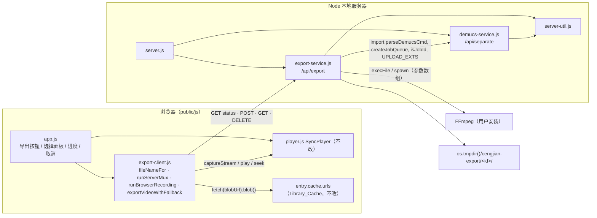
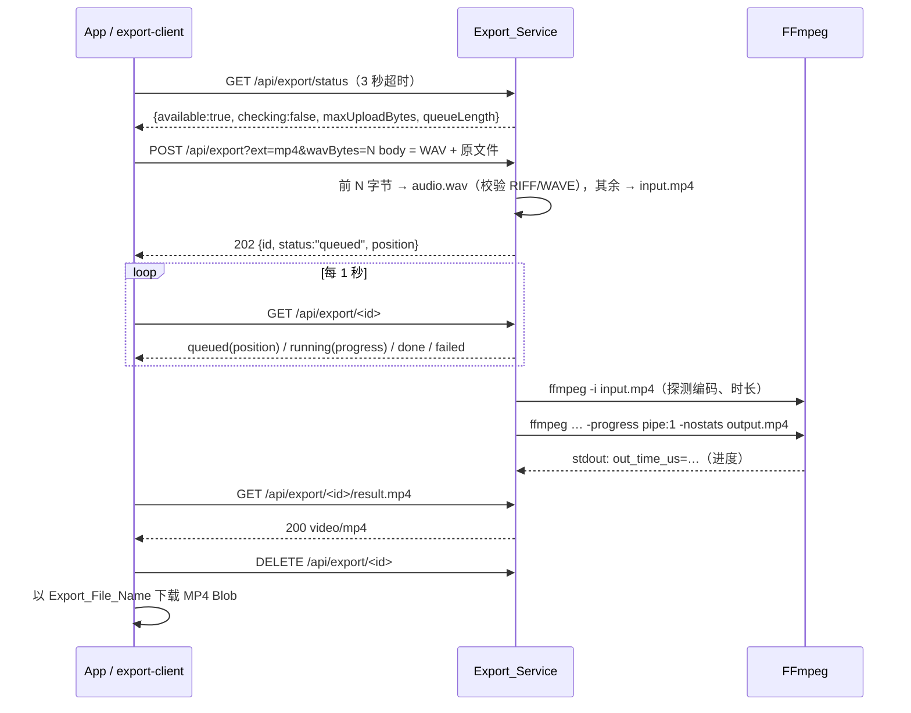
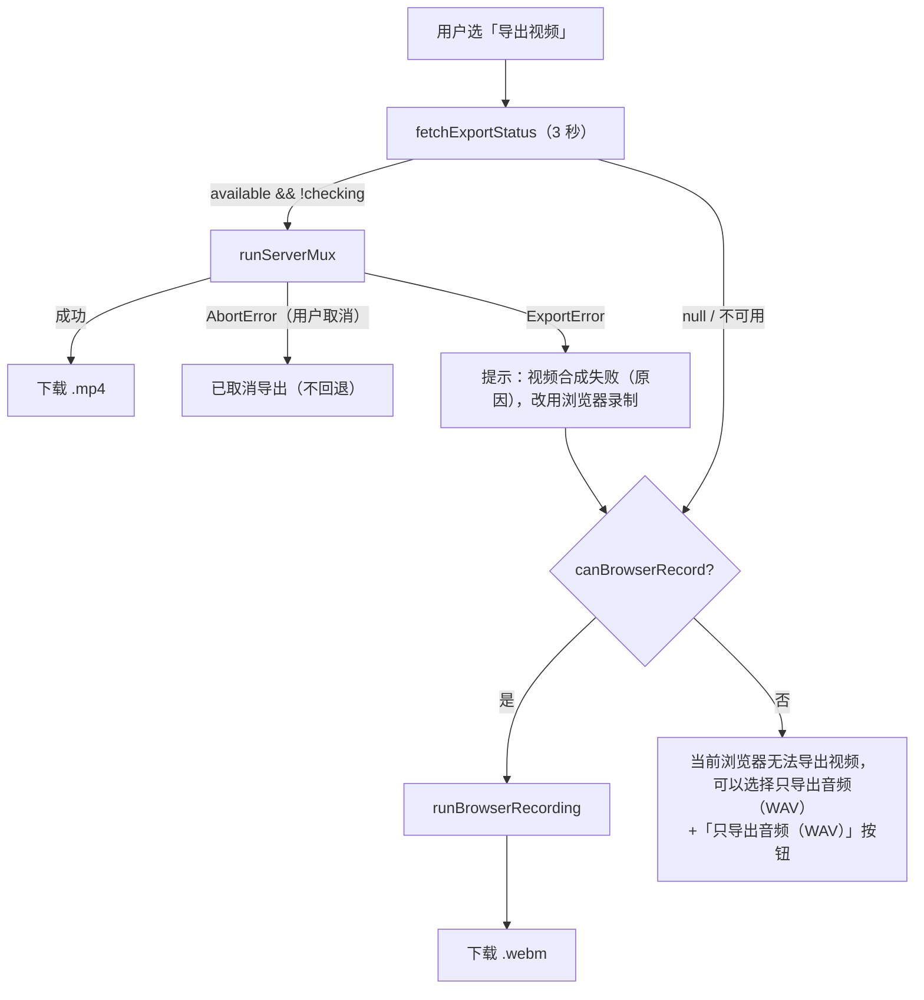

# Design Document：音轨视频导出（stem-video-export）

## Overview

在练习室加一个「导出」按钮，把 Selected_Stem 导出为文件：

- **WAV_Export**：纯浏览器端，把缓存里的 WAV Blob 原样下载。
- **Video_Export / Server_Mux**（首选）：浏览器把 WAV 和 Source_File 用一次 `POST` 上传给本地 Server，新模块 `export-service.js` 用 FFmpeg 合成 MP4（H.264 / HEVC 直接复制画面，其余重编码为 H.264；音频 AAC 192k）。
- **Video_Export / Browser_Recording**（回退）：`captureStream` 取画面轨，专用的隐藏 `<audio>` 播放音轨并经 Web Audio 取音频轨，`MediaRecorder` 以 1 倍速实时录成 WEBM。

设计尽量沿用 Demucs 功能已经验证过的结构：

| 已有模式（来源） | 在本功能中的用法 |
| --- | --- |
| `parseDemucsCmd`（`demucs-service.js`） | 直接导入，解析 `FFMPEG_CMD`，规则与 `DEMUCS_CMD` 完全相同 |
| `createJobQueue`（`demucs-service.js`） | 直接导入，1 个运行中、FIFO、未完成任务上限 4 |
| `isJobId` / `UPLOAD_EXTS`（`demucs-service.js`） | 直接导入，Job_ID 校验与扩展名白名单 |
| `rejectAndDrain`、`sendJson`、`lastStderrLine` 等（`demucs-service.js` 内部闭包） | 提取到新文件 `server-util.js`，两个服务共用；Demucs 行为不变 |
| 失败 / 取消任务的 tombstone（保留 5 分钟）、结果保留 30 分钟 | 同样的 `scheduleExpire` 逻辑 |
| `fetchDemucsStatus`（3 秒超时）、轮询、中止时 `keepalive` DELETE（`remote-separator.js`） | `export-client.js` 中的 `fetchExportStatus` 与 `runServerMux` 按同样结构实现 |
| `separateWithFallback` 的依赖注入写法 | `exportVideoWithFallback`，便于做模型化属性测试 |
| `listenFetchable`、`prop.mjs`、`fake-demucs.mjs`（tests） | 新测试复用；新增 `fake-ffmpeg.mjs` 夹具 |

约束：浏览器零依赖；Server 只用 Node ≥ 18 内置模块、ES 模块；不改动 `player.js` 的同步逻辑与 `library.js` 的缓存逻辑；Demucs_Service 接口不变。

## 关键设计决策

### 决策 1：上传格式——单个 POST，`wavBytes` 分帧

`POST /api/export?ext=<白名单扩展名>&wavBytes=<n>`，`Content-Type: application/octet-stream`，请求体 = **WAV 的 n 个字节，紧接着 Source_File 的全部字节**。浏览器端写法：`body: new Blob([wavBlob, sourceFile])`，不复制数据，浏览器按流发送。

比较过的方案：

| 方案 | 优点 | 缺点 |
| --- | --- | --- |
| multipart/form-data | 浏览器原生 `FormData` | Server 要自己写 multipart 流式解析器（边界跨 chunk、头部解析），零依赖下代码量最大、最易出错 |
| 两步上传（`POST` 建任务 + 两次 `PUT`） | 每次请求只有一个文件 | 任务多出「等第二部分」的中间状态；需要处理只传了一半就消失的客户端、额外的超时和名额占用；客户端要处理两次失败 |
| **单个 POST + `wavBytes` 分帧（选用）** | 一次请求、一个状态机；Server 只需按字节计数把流切成两段，`Content-Length` 可用于提前 413；断线、413、400 的清理路径与 Demucs 上传完全一致 | 需要客户端预先知道 WAV 大小（`Blob.size` 已知，不是问题） |

WAV 放在前面，是因为它小（≤ 约 320 MB），Server 收到前 12 字节就能校验 RIFF/WAVE，不合格立刻 400，不必等待大视频上传完。

### 决策 2：共享代码的组织

- `parseDemucsCmd`、`createJobQueue`、`isJobId`、`UPLOAD_EXTS` 已经是 `demucs-service.js` 的导出，且该模块导入时没有副作用，`export-service.js` 直接 `import`，不复制代码。
- `rejectAndDrain`、`sendJson`/`sendError`、`truncate`/`lastStderrLine`、`positiveInt`/`positiveNumber` 目前是 `demucs-service.js` 的内部函数。新增根目录文件 `server-util.js` 存放它们；`demucs-service.js` 改为从 `server-util.js` 导入。这是纯搬移，行为不变，由现有 `demucs-service.test.mjs` / `demucs-props.test.mjs` 保证（Requirement 13.7）。
- `rejectAndDrain` 原本读取闭包里的 `maxUploadBytes` 和 `draining` 集合，提取后改为工厂 `createRejectDrainer({ maxExtraBytes, drainMs })`，每个服务各建一个实例，`close()` 时调用实例的 `killAll()`。

### 决策 3：不用 ffprobe 检测编码

只依赖 `ffmpeg` 一个可执行文件。运行 `ffmpeg -hide_banner -nostdin -i input.<ext>`（不给输出文件），FFmpeg 打印输入信息后以退出码 1 结束（"At least one output file must be specified"）。解析 stderr 中的：

```
Input #0, mov,mp4,m4a,3gp,3g2,mj2, from '.../input.mp4':
  Duration: 00:03:21.45, start: 0.000000, bitrate: 2345 kb/s
  Stream #0:0[0x1](und): Video: h264 (High) (avc1 / 0x31637661), yuv420p(progressive), 1280x720, 30 fps
  Stream #0:1[0x2](und): Audio: aac (LC) (mp4a / 0x6134706D), 44100 Hz, stereo, fltp, 128 kb/s
```

退出码 1 是正常的，不作为失败；只有「找不到 `Input #0`」、命令启动失败或超时才算探测失败。

### 决策 4：时长对齐用 `apad` + `-t`，而不是单纯 `-shortest`

Requirement 8.5 要求输出时长等于画面时长。音轨 WAV 与原音频等长，但可能和画面差几十毫秒，也可能更短（例如浏览器解码丢了尾部）：

- 单用 `-shortest`：WAV 比画面短时，画面会被截掉。
- 采用：音频滤镜 `-af apad`（用静音把音频补到无限长），再用 `-t <Duration 秒>` 截到 Source_File 时长；探测不出时长时改用 `-shortest`（补齐后的音频无限长，最短的就是画面）。

音频本来就要重编码为 AAC，加滤镜不增加成本；画面仍可 `-c:v copy`。

### 决策 5：浏览器录制用专用的隐藏音频元素

`player.js` 里每条 Stem 是一个 `new Audio()`，存在 `player.stems[id]`，选中时取消静音并跟随 master 播放；master 视频此时是 `muted = true`。如果直接对这些元素调用 `createMediaElementSource`，元素的输出会永久改走 Web Audio 图，录制结束后无法还原，会影响 Player（违反 13.1/13.2 的精神）。`captureStream()` 对静音元素的行为在各浏览器也不一致（Firefox 的 `mozCaptureStream` 会把声音从扬声器"抢走"）。

因此 Browser_Recording：

- **画面**：`video.captureStream()`（或 `mozCaptureStream()`），只取 `getVideoTracks()`，丢弃原音频轨（Requirement 12.2）。
- **声音**：新建一个只用于录制的 `Audio` 元素 `recAudio`，`src` 指向缓存里同一个 Stem Blob URL（不新建、不回收），经 `AudioContext.createMediaElementSource(recAudio) → createMediaStreamDestination()` 得到音频轨。`recAudio` 不接扬声器；用户听到的是 Player 自己正常播放的 Selected_Stem。
- 录制结束后关闭 `AudioContext`、清空 `recAudio.src`，Player 没有任何被修改的连接。

## Architecture



### Server_Mux 时序



### 视频导出路径选择



## Components and Interfaces

### 1. `server-util.js`（新，根目录）

从 `demucs-service.js` 搬出的通用 HTTP / 进程辅助函数。只用 Node 内置模块。

```js
export const JSON_HEADERS; // Content-Type json、Cache-Control no-store、nosniff
export function sendJson(res, code, body, extraHeaders = {});
export function sendError(res, code, message, extraHeaders);
export function positiveInt(value, fallback);    // "^\s*\d+\s*$" 且 > 0 的安全整数，否则 fallback
export function positiveNumber(value, fallback); // 有限且 > 0，否则 fallback
export function truncate(text, max = 200);       // 按码点截断
export function lastStderrLine(text, { ignore } = {}); // 最后一个非空行，≤ 200 码点；ignore 为可选正则，命中的行跳过

/**
 * 与原 rejectAndDrain 逻辑相同：先写完整响应（带 Content-Length、Connection: close），
 * 读掉并丢弃剩余请求体，请求结束后再 end；超过 maxExtraBytes 或 drainMs 则销毁 socket。
 */
export function createRejectDrainer({ maxExtraBytes, drainMs = 10_000 }) {
  return {
    reject(req, res, code, message) {},
    killAll() {}, // close() 时调用
  };
}
```

`demucs-service.js` 的改动仅限：删除这些内部函数的定义、改为导入；在 `createDemucsService` 中 `const drainer = createRejectDrainer({ maxExtraBytes: maxUploadBytes })`，原来调用 `rejectAndDrain(...)` 的地方改为 `drainer.reject(...)`，`close()` 中 `for (const entry of [...draining]) entry.kill()` 改为 `drainer.killAll()`。导出列表（含 `parseDemucsCmd`）保持不变。

### 2. `export-service.js`（新，根目录，`public/` 之外，Requirement 10.7）

#### 2.1 常量与配置

```js
import { parseDemucsCmd, createJobQueue, isJobId, UPLOAD_EXTS } from './demucs-service.js';

export const EXPORT_API_PREFIX = '/api/export';
export const COPYABLE_VIDEO_CODECS = ['h264', 'hevc'];
export const AAC_BITRATE = '192k';
export const X264_ARGS = ['-c:v', 'libx264', '-preset', 'veryfast', '-crf', '20', '-pix_fmt', 'yuv420p'];
const DEFAULT_CMD = 'ffmpeg';
const DEFAULT_MAX_UPLOAD_MB = 10240;  // 10 GB，原视频与音轨 WAV 合计
const DEFAULT_TIMEOUT_MIN = 30;      // 覆盖探测 + 合成

/** command 为 null 表示 FFMPEG_CMD 设置了但无法解析（视为不可用，6.3）。 */
export function readExportConfig(env = process.env) {
  const raw = env.FFMPEG_CMD;
  const command = parseDemucsCmd(raw == null || raw.trim() === '' ? DEFAULT_CMD : raw);
  return {
    command,
    commandError: command ? '' : 'FFMPEG_CMD 无法解析',
    maxUploadBytes: positiveInt(env.EXPORT_MAX_UPLOAD_MB, DEFAULT_MAX_UPLOAD_MB) * 1024 * 1024,
    timeoutMs: Math.round(positiveNumber(env.EXPORT_TIMEOUT_MIN, DEFAULT_TIMEOUT_MIN) * 60_000),
  };
}

export function defaultExportTempRoot() {
  return path.join(os.tmpdir(), 'cengjian-export');
}
```

#### 2.2 路径（Requirement 10.2）

```js
/** 只由 tempRoot、Job_ID、白名单扩展名拼出；ext 不在白名单时抛错（调用方已先校验）。 */
export function exportJobPaths(tempRoot, id, ext) {
  if (!isJobId(id)) throw new Error('invalid job id');
  if (!UPLOAD_EXTS.includes(ext)) throw new Error('invalid ext');
  const dir = path.join(tempRoot, id);
  return {
    dir,
    audio: path.join(dir, 'audio.wav'),
    input: path.join(dir, `input.${ext}`),
    output: path.join(dir, 'output.mp4'),
  };
}
```

#### 2.3 上传参数与分帧（Requirement 7.1、7.4）

```js
/**
 * 解析 ?ext=&wavBytes=。ext 必须在 UPLOAD_EXTS 中（小写化、去掉前导点后比较）；
 * wavBytes 必须是十进制正整数、≥ 12（RIFF 头）且 ≤ maxUploadBytes。
 * @returns {{ ok: true, ext: string, wavBytes: number } | { ok: false, error: string }}
 */
export function parseExportQuery(searchParams, maxUploadBytes);

/** buf 的前 12 字节是否为 "RIFF" <4 字节> "WAVE"。 */
export function isRiffWave(buf);

/**
 * 有状态的分帧器：把任意切分的请求体 chunk 切成 WAV 段与原文件段。
 * feed(chunk) 返回 [{ part: 'wav' | 'source', data: Buffer }]，按到达顺序，data 为 chunk 的切片（不复制）。
 * received() 返回已收到的总字节数。
 */
export function createBodySplitter(wavBytes) {
  let seen = 0;
  return {
    feed(chunk) {
      const out = [];
      if (seen < wavBytes) {
        const take = Math.min(chunk.length, wavBytes - seen);
        out.push({ part: 'wav', data: chunk.subarray(0, take) });
        if (take < chunk.length) out.push({ part: 'source', data: chunk.subarray(take) });
      } else {
        out.push({ part: 'source', data: chunk });
      }
      seen += chunk.length;
      return out;
    },
    received: () => seen,
  };
}
```

#### 2.4 探测解析（Requirement 8.2、8.3、8.8、9.3）

```js
/**
 * 解析 `ffmpeg -i input` 的 stderr。
 * - hasInput：是否出现 "Input #0"（没有则视为探测失败，用 lastStderrLine 作为错误原因）
 * - durationSec：第一处 "Duration: HH:MM:SS(.ff)" 换算成秒；"N/A" 或缺失为 null
 * - video：输入 0 中第一个不带 "(attached pic)" 的 "Video:" 流；
 *   { codec: 小写编码名, ordinal: 它在输入 0 全部 Video 流中的序号 }；没有则 null
 */
export function parseProbeOutput(stderr) {
  const hasInput = /^Input #0\b/m.test(stderr);
  const d = /^\s*Duration:\s*(\d+):(\d{2}):(\d{2}(?:\.\d+)?)/m.exec(stderr);
  const durationSec = d ? Number(d[1]) * 3600 + Number(d[2]) * 60 + Number(d[3]) : null;
  let ordinal = 0;
  let video = null;
  for (const line of stderr.split(/\r?\n/)) {
    const m = /^\s*Stream #0:\d+[^:]*:\s*Video:\s*([A-Za-z0-9_]+)/.exec(line);
    if (!m) continue;
    if (!video && !line.includes('(attached pic)')) video = { codec: m[1].toLowerCase(), ordinal };
    ordinal++;
  }
  return { hasInput, durationSec: durationSec > 0 ? durationSec : null, video };
}
```

正则说明：`[^:]*` 吸收 `[0x1](und)`、`(eng)` 等可选部分；只认 `#0:`，因此探测命令只给一个输入。普通视频的第一个画面流就是 `ordinal 0`，对应 `-map 0:v:0`；只有封面图排在前面的少见文件才会用到 `0:v:1` 等。

#### 2.5 参数构建（Requirement 8.1–8.7）

```js
/**
 * @param {string[]} fixedArgs  FFMPEG_CMD 中可执行文件之后的固定参数
 * @param {{ codec: string, ordinal: number }} video
 * @param {number|null} durationSec
 * @param {{ input: string, audio: string, output: string }} paths
 */
export function buildMuxArgs(fixedArgs, video, durationSec, paths) {
  const copy = COPYABLE_VIDEO_CODECS.includes(video.codec);
  return [
    ...(fixedArgs || []),
    '-hide_banner', '-nostdin', '-y',
    '-i', paths.input,
    '-i', paths.audio,
    '-map', `0:v:${video.ordinal}`,
    '-map', '1:a:0',
    ...(copy ? ['-c:v', 'copy'] : X264_ARGS),
    ...(video.codec === 'hevc' ? ['-tag:v', 'hvc1'] : []),
    '-af', 'apad',
    '-c:a', 'aac', '-b:a', AAC_BITRATE,
    ...(durationSec ? ['-t', formatSeconds(durationSec)] : ['-shortest']),
    '-movflags', '+faststart',
    '-progress', 'pipe:1', '-nostats',
    '-f', 'mp4',
    paths.output,
  ];
}

export function buildProbeArgs(fixedArgs, paths) {
  return [...(fixedArgs || []), '-hide_banner', '-nostdin', '-i', paths.input];
}
```

`formatSeconds` 输出最多 3 位小数的十进制字符串（如 `201.45`）。不出现 `0:a` 的映射，原音频不会进入输出（8.1）。

#### 2.6 进度解析（Requirement 9.2、9.3）

`-progress pipe:1` 在 stdout 上以 `key=value` 行输出，每个块以 `progress=continue` 或 `progress=end` 结束。`out_time_us` 与 `out_time_ms` 在 FFmpeg 中都以**微秒**为单位（`out_time_ms` 是历史遗留的误名），值可能是 `N/A`。

```js
/**
 * 增量解析器：处理跨 chunk 的半行。
 * feed(chunk) 后 progress() 返回 0–100 的整数，或 durationSec 为 null 时返回 null。
 * 取最近一次有效的 out_time_us；没有 out_time_us 的块退而使用 out_time_ms。
 */
export function createProgressParser(durationSec) {
  let pending = '';
  let lastUs = 0;
  return {
    feed(chunk) {
      const lines = (pending + chunk).split(/\r?\n/);
      pending = lines.pop();
      for (const line of lines) {
        const m = /^out_time_(us|ms)=(\d+)\s*$/.exec(line.trim());
        if (m) lastUs = Number(m[2]);
      }
    },
    progress() {
      if (!durationSec) return null;
      return progressPercent(lastUs / 1e6, durationSec);
    },
  };
}

/** Math.round(t / d * 100) 限制在 0..100；d 无效时 null。 */
export function progressPercent(t, d);
```

#### 2.7 服务工厂

```js
/**
 * @param {object} options
 * @param {{file: string, args: string[]} | null} options.command
 * @param {string} [options.commandError]     command 为 null 时写入日志的原因
 * @param {number} options.maxUploadBytes
 * @param {number} options.timeoutMs
 * @param {string} options.tempRoot
 * @param {number} [options.retentionMs=30 min]
 * @param {number} [options.tombstoneMs=5 min]
 * @param {number} [options.maxUnfinished=4]
 * @param {number} [options.probeTimeoutMs=10_000]   启动检测（-version）超时
 * @param {object} [options.env]
 * @param {(msg: string) => void} [options.log=console.log]
 * @param {typeof childProcess.execFile} [options.execFile]
 * @param {typeof childProcess.spawn} [options.spawn]
 * @returns {{ init(): Promise<void>, status(): object, handle(req, res): boolean, close(): Promise<void>, _internal: object }}
 */
export function createExportService(options);
```

与 `createDemucsService` 一样：`init()` 清空并重建 tempRoot、运行一次 `-version` 检测（10 秒），打印一行日志；`handle()` 只认领 `/api/export` 前缀；`close()` 终止所有子进程、清理计时器、`drainer.killAll()`。

**启动检测（6.1–6.3）**：`execFile(command.file, [...command.args, '-version'], { timeout: probeTimeoutMs, windowsHide: true })`。回调无错误则 `available = true`；否则 `available = false`，日志写原因：`FFMPEG_CMD 无法解析` / `命令不存在（ENOENT）` / `检测超时` / `退出码 N`。日志行：

- 可用：`  视频导出: 已启用 FFmpeg`
- 不可用：`  视频导出: 未检测到 FFmpeg（<原因>），将使用浏览器录制`

**上传处理 `handleUpload(req, res, url)`**，检查顺序（前三步都只 `req.resume()` 丢弃请求体，不写文件）：

1. `!available || checking` → 503 `视频导出不可用`（7.3）。
2. `parseExportQuery` 失败 → 400（缺少或不支持的 `ext`、缺少或无效的 `wavBytes`）（7.4）。
3. `queue.unfinished() >= maxUnfinished` → 429 `导出任务过多，请稍后再试`（7.6）。
4. 声明的 `Content-Length > maxUploadBytes` → `drainer.reject(..., 413)`；`Content-Length <= wavBytes` → `drainer.reject(..., 400, '缺少原文件')`。
5. 生成 Job_ID，`queue.submit(job, { uploading: true })`（失败 → 429），`mkdir` 后打开两个写流 `audio.wav`、`input.<ext>`。
6. 每个 `data` chunk：累计字节，超过 `maxUploadBytes` → `abortUpload` + 413；否则交给 `createBodySplitter`，按段写入对应写流；任一 `write()` 返回 `false` 就 `req.pause()`，等对应流 `drain` 后 `req.resume()`。
7. WAV 段累计到 12 字节时调用 `isRiffWave`，不通过 → `abortUpload` + `drainer.reject(..., 400, '音轨不是 WAV 格式')`。
8. `req` 结束：`received < wavBytes` → 400 `音轨 WAV 不完整`；`received === wavBytes` → 400 `缺少原文件`；两种都 `abortUpload` 删除目录。否则 `end()` 两个写流，二者都 `finish` 后 `job.status = 'queued'`，返回 202 `{ id, status: 'queued', position }`，`queue.enqueue(id)`。
9. 连接提前断开（`aborted` / `close` 且 `!req.complete`）→ `abortUpload`：删记录、`queue.finish` 释放名额、关闭两个写流后删目录（7.8）。
10. 任一写流 `error`（例如磁盘满 `ENOSPC`）或 `mkdir` 失败 → `abortUpload` + `drainer.reject(..., 500, '服务器无法保存上传文件')`（7.13）；App 按 5.4 回退录制。

`abortUpload` 与 Demucs 版本结构相同，只是要等两个写流都关闭后再删目录（Windows 下文件句柄未关时删除会失败）。

**任务运行 `runJob(job, done)`**（由 `createJobQueue` 调用）：

1. 设 `status = 'running'`、`progress = 0`；启动一个覆盖整个任务（探测 + 合成）的 `timeoutMs` 计时器，到时设 `job.timedOut = true` 并 `kill` 当前子进程。
2. **探测**：`execFile(cmd, buildProbeArgs(...), { windowsHide: true, maxBuffer: 4 MB })`。退出码非 0 不算错；`err.code === 'ENOENT'` 等启动错误 → 失败 `无法启动 FFmpeg`。`parseProbeOutput(stderr)`：
   - `!hasInput` → 失败，`error` = `lastStderrLine(stderr, { ignore: /At least one output file must be specified/ })` 或 `无法读取原文件`；
   - `video === null` → 失败 `文件里没有画面`（8.8）。
3. **合成**：`spawn(cmd, buildMuxArgs(...), { windowsHide: true, stdio: ['ignore', 'pipe', 'pipe'] })`（无 `shell` 选项，6.4）。stdout 交给 `createProgressParser(durationSec)`，每次 feed 后 `job.progress = parser.progress()`；stderr 只保留最后 64 KB（环形拼接）。
4. 子进程 `close(code, signal)`：
   - `job.cancelled` → 删除目录，`done('cancelled')`（状态已由取消方设置）；
   - `job.timedOut` → 失败 `合成视频超过 N 分钟未完成，已终止`（9.4）；
   - `code !== 0` → 失败，`error` = `lastStderrLine(stderrTail)` 或 `FFmpeg 退出码 N`（9.5）；
   - `stat(output)` 不存在或大小为 0 → 失败 `FFmpeg 没有生成视频文件`；
   - 成功 → `status = 'done'`、`progress = 100`，删除 `audio.wav` 和 `input.<ext>`（10.3），`scheduleExpire(job, retentionMs)`，`done('done')`。
5. 失败统一走 `failJob`：设 `failed` 与 `error`（≤ 200 码点），删目录，`scheduleExpire(job, tombstoneMs)`（10.5）。

**取消 `cancelJob(job)`**：与 Demucs 版本相同的分支（uploading → `abortUpload`；running → `queue.cancel` + `kill`，目录在子进程退出后删除；queued / done → `queue.cancel` + 删目录），之后 `status = 'cancelled'`，保留 tombstone 5 分钟。对已 `failed` / `cancelled` 的任务再次 DELETE 返回 204、不做事。超时（9.4）与取消一样会让 `createJobQueue` 立即启动下一个任务；被 `kill` 的进程可能还要几十毫秒才退出，这段重叠与 Demucs_Service 相同，可以接受（9.1 以任务状态计：任意时刻 `running` 至多 1 个）。

注意 `done` 收到 `'done'` 时任务仍留在内存 `jobs` 表中（用于 `GET` 和下载），但已从 `createJobQueue` 移除，不再占 4 个名额。

#### 2.8 HTTP 接口

| 方法与路径 | 结果 |
| --- | --- |
| `GET /api/export/status` | 200 `{ available, checking, maxUploadBytes, queueLength }`（`available` 在检测中为 `false`）（6.6） |
| `POST /api/export?ext=<ext>&wavBytes=<n>` | 202 `{ id, status: 'queued', position }`；400 / 413 / 429 / 503 如上 |
| `GET /api/export/<id>` | 200，见下方任务 JSON；无效或未知 id → 404（7.7、7.9） |
| `GET /api/export/<id>/result.mp4` | `done` 时 200，`Content-Type: video/mp4`，带 `Content-Length`，流式读取 `output.mp4`；其他状态 404（7.10、7.11） |
| `DELETE /api/export/<id>` | 204；取消任务并删除文件（7.12、10.4） |
| 其他方法 | 405，带 `Allow` 头 |

任务 JSON：

```json
{ "id": "<32 位十六进制>", "status": "queued", "position": 1 }
{ "id": "…", "status": "running", "progress": 42 }
{ "id": "…", "status": "running", "progress": null }
{ "id": "…", "status": "done" }
{ "id": "…", "status": "failed", "error": "文件里没有画面" }
{ "id": "…", "status": "cancelled" }
```

`uploading` 状态对外显示为 `queued`（与 Demucs_Service 一致）。响应中不出现任何文件名（4.6）。

### 3. `server.js` 改动

```js
import { createExportService, readExportConfig, defaultExportTempRoot } from './export-service.js';

export function createServer(root = ROOT, { demucs, exporter } = {}) {
  return http.createServer((req, res) => {
    if (demucs && demucs.handle(req, res)) return;
    if (exporter && exporter.handle(req, res)) return;
    // …静态文件逻辑不变
  });
}

// isMain：
const exporter = createExportService({ ...readExportConfig(), tempRoot: defaultExportTempRoot() });
createServer(ROOT, { demucs, exporter }).listen(port, host, () => {
  // …横幅
  demucs.init();
  exporter.init(); // 清空 cengjian-export 并检测 FFmpeg（10.1、6.1）
});
```

FFmpeg 不可用只影响 `/api/export`，静态文件和 `/api/separate` 照常（6.7）。

### 4. Fake_FFmpeg 夹具 `tests/fixtures/fake-ffmpeg.mjs`

测试通过 `FFMPEG_CMD = JSON.stringify([process.execPath, fixturePath])` 使用。只用 Node 内置模块。

命令行识别：

- 含 `-version` → 版本检测；
- 含 `-i` 但 `-i` 的值之后没有输出文件（探测）→ 打印输入信息到 stderr，退出码 1；
- 否则为合成：收集所有 `-i` 的值作为输入，最后一个参数为输出。

行为控制：

| 环境变量 / 输入内容 | 作用 |
| --- | --- |
| `FAKE_FFMPEG_MODE=ok`（默认） | 检测成功；合成写 3 个进度块后生成输出，退出 0 |
| `probefail` | `-version` 退出 1 |
| `probehang` | `-version` 永不退出（测试 10 秒检测超时，测试中用很短的 `probeTimeoutMs`） |
| `slow` | 合成每 100 ms 写一个进度块，共 10 个，约 1 秒 |
| `fail` | 合成在 stderr 写 `Error while opening encoder\nConversion failed!`，退出 1 |
| `hang` | 合成写一个进度块后永不退出（测试超时、取消运行中任务） |
| `inspecthang` | 探测调用（只有 `-i`）永不退出（测试任务超时覆盖探测阶段，9.4） |
| `nooutput` | 合成退出 0 但不写输出文件 |
| 原文件第一行 `FAKEVIDEO codec=<h264\|hevc\|vp9\|none> duration=<HH:MM:SS.ff\|N/A> [attached=1]` | 探测输出的编码、时长；`none` 只输出 Audio 流；`attached=1` 在前面加一个 `mjpeg (attached pic)` 流 |
| 原文件不以 `FAKEVIDEO` 开头 | 探测只打印 `<path>: Invalid data found when processing input`，没有 `Input #0` |

合成成功时写入的输出文件内容为一行 `FAKEMP4 ` + JSON：

```json
{ "argv": ["-hide_banner", "…"], "inputs": [{ "bytes": 1234, "sha256": "…" }, { "bytes": 88, "sha256": "…" }] }
```

测试下载 `result.mp4` 后解析这一行，就能断言：参数选择（copy / libx264 / hvc1 / `-t` / `-shortest`）、两个输入文件的字节与上传内容逐字节一致（分帧往返）。进度块格式与真实 FFmpeg 相同：`frame=…`、`out_time_us=…`、`out_time_ms=…`、`out_time=00:00:01.000000`、`progress=continue|end`；块会故意拆成多次 `write` 以覆盖跨 chunk 的半行。

### 5. `public/js/export-client.js`（新，浏览器端，零依赖）

与 `remote-separator.js` 相同的原则：不直接访问 DOM 全局，`fetch`、`sleep`、`MediaRecorder`、`AudioContext`、`document`、`URL` 等全部可注入，Node 测试可以直接导入。`UPLOAD_EXTS` 在这里复制一份（服务器文件不能在浏览器加载）。

#### 5.1 文件名（Requirement 4）

```js
export const UNSAFE_FILE_NAME_RE = /[\\/:*?"<>|\u0000-\u001f\u007f]/g;
export const MAX_FILE_BODY = 80;

/**
 * fileNameFor('练习 v2.final.mp4', '人声', 'mp4') === '练习 v2.final-人声.mp4'
 * 1. 去掉最后一个扩展名（最后一个 '.' 之后的部分；以 '.' 开头且没有其他 '.' 的名称视为无扩展名）
 * 2. 不安全字符 → '_'
 * 3. 去掉首尾空格和句点；为空 → '导出'
 * 4. 主体 = base + '-' + label；按码点计数超过 80 时截短 base（label 不截），截短后再次去掉 base 尾部的空格和句点
 *    （第 3 步保证 base 首字符不是空格或句点，所以截短后的 base 不会变空）
 */
export function fileNameFor(sourceName, stemLabel, ext);
```

`stemLabel` 来自 `separator.js` 的 `STEMS`（都是安全的短中文名）；`ext` 只会是 `mp4`、`webm`、`wav`。按码点（`Array.from`）计数，避免把代理对截成一半。

#### 5.2 按钮状态（Requirement 1.2–1.6、3.4）

```js
/**
 * @param {{ hasFile: boolean, separating: boolean, stemsReady: boolean,
 *           selected: string, hasStemUrl: boolean, exporting: boolean }} ctx
 * @returns {{ disabled: boolean, hint: string }}
 */
export function exportButtonState(ctx) {
  if (!ctx.hasFile || ctx.separating || !ctx.stemsReady) return { disabled: true, hint: '' };
  if (ctx.selected === 'original') return { disabled: true, hint: '原曲就是原文件，无需导出' };
  if (!ctx.hasStemUrl) return { disabled: true, hint: '' };
  return { disabled: ctx.exporting, hint: '' };
}
```

不依赖 FFmpeg 或录制能力，因此 WAV_Export 在两者都不可用时仍可用（3.4）。

#### 5.3 状态检测与进度文字

```js
export const EXPORT_API = '/api/export';

/** 与 fetchDemucsStatus 同结构：3 秒超时；网络错误、超时、非 2xx、JSON 无效都返回 null。 */
export async function fetchExportStatus({ fetch, timeoutMs = 3000, signal } = {});
// → { available, checking, maxUploadBytes, queueLength } | null，checking 为 true 时 available 为 false

/**
 * { stage: 'upload' }                     → '上传到本地服务器…'
 * { stage: 'queued', position: N }        → '排队中（第 N 位）'
 * { stage: 'running', progress: N }       → '合成视频 N%'
 * { stage: 'running', progress: null }    → '合成视频中…'
 * { stage: 'download' }                   → '下载视频…'
 * { stage: 'recording', progress: N }     → '浏览器录制中 N%（需要和视频一样长的时间）'
 */
export function exportProgressText(phase);

/** '视频合成失败（<原因>），改用浏览器录制。' 或无原因时 '本地服务器无法合成视频，改用浏览器录制。' */
export function exportFallbackNotice(err);

export const UNSUPPORTED_TEXT = '当前浏览器无法导出视频，可以选择只导出音频（WAV）';

export class ExportError extends Error {
  /** @param {{ reason?: string, stage: 'upload'|'job'|'download'|'record'|'unsupported', cause?: unknown }} opts */
}
```

#### 5.4 `runServerMux`（Requirement 5.4、7.1、9.6、10.6、11.2）

```js
/**
 * @param {File} sourceFile
 * @param {Blob} wavBlob  Selected_Stem 的 WAV
 * @param {{ signal?, onPhase?, fetch?, pollMs = 1000, sleep? }} opts
 * @returns {Promise<Blob>}  MP4
 */
export async function runServerMux(sourceFile, wavBlob, opts);
```

步骤（结构与 `runDemucsSeparation` 相同）：

1. `onPhase({ stage: 'upload' })`；`POST ${EXPORT_API}?ext=${sourceExt(sourceFile)}&wavBytes=${wavBlob.size}`，`body: new Blob([wavBlob, sourceFile])`，带 `signal`。网络错误 → `ExportError('upload', '无法连接本地服务器')`；非 202 → `ExportError('upload', <body.error 或 HTTP 状态>)`（含 413 / 429 / 500 / 503）。
2. 每 `pollMs`（1 秒）`GET ${EXPORT_API}/<id>`：`queued` / `running` 调 `onPhase`；`done` 退出循环；`failed` → `ExportError('job', error)`；`cancelled` 或 404 → `ExportError('job', '任务已被服务器清理')`；连续 5 次轮询失败 → `ExportError('job', '无法获取任务状态')`。
3. `onPhase({ stage: 'download' })`；`GET .../result.mp4` → `res.blob()`；失败 → `ExportError('download', …)`。
4. 下载完成后 `DELETE ${EXPORT_API}/<id>`（等待，忽略错误），返回 Blob。
5. 中止（`signal`）：发 `DELETE`（`keepalive: true`，不等待），抛 `AbortError`。`job` / `download` 阶段失败也发一次 DELETE，尽早释放服务器文件。

`sourceExt(file)`：文件名扩展名在白名单中则用它；否则按 MIME 映射（`video/mp4`→`mp4`、`video/webm`→`webm`、`video/quicktime`→`mov`、`video/x-matroska`→`mkv`）；仍不确定则用 `mp4`（FFmpeg 按内容识别格式，扩展名只决定临时文件名）。请求 URL 只有 `ext` 和 `wavBytes`，不含 Source_File 名（4.6），且都是相对路径 `/api/export…`，只发往提供页面的本地 Server（5.6）。

结果 Blob 保存在浏览器内存（Chrome 对大 Blob 会落盘），这样 App 能确切知道下载何时完成并立即 DELETE；若用户关掉页面，服务器的 30 分钟过期会兜底。

#### 5.5 浏览器录制（Requirement 12）

```js
/** 依次尝试 vp9,opus → vp8,opus → video/webm，返回第一个 isTypeSupported 为 true 的；都不支持返回 null。 */
export const RECORDER_TYPES = ['video/webm;codecs=vp9,opus', 'video/webm;codecs=vp8,opus', 'video/webm'];
export function pickRecorderMime(MediaRecorderCtor);

/**
 * 需要：媒体元素原型上有 captureStream 或 mozCaptureStream、MediaRecorder 存在且
 * pickRecorderMime 非 null、AudioContext（或 webkitAudioContext）存在。
 */
export function canBrowserRecord(env = globalThis);

/** Playback_State 快照。 */
export function capturePlaybackState(player, selected) {
  return { time: player.currentTime, rate: player.rate, playing: !player.paused, loop: player.loop, selected };
}

/** 恢复：setRate → setLoop → select(selected) → seek(time) → 按 playing 调 play() 或 pause()。 */
export async function restorePlaybackState(player, saved);

/**
 * stemId / stemUrl：Export_Stem（导出开始时记录，2.6）；selected：录制开始时 UI 的 Selected_Stem，
 * 用于恢复 Playback_State（Server_Mux 期间用户可能已切换音轨）。
 * @param {{ player: SyncPlayer, video: HTMLVideoElement, stemId: string, stemUrl: string, selected: string,
 *           signal?: AbortSignal, onProgress?: (pct: number) => void, env?: object }} opts
 * @returns {Promise<Blob>}  WEBM
 */
export async function runBrowserRecording(opts);
```

`runBrowserRecording` 流程：

1. `saved = capturePlaybackState(player, selected)`；`mime = pickRecorderMime(env.MediaRecorder)`，为 null → `ExportError('unsupported')`。
2. 创建 `recAudio = new env.Audio()`，`src = stemUrl`、`preload = 'auto'`，等 `loadedmetadata`。
3. `ctx = new AudioContext()`；`ctx.createMediaElementSource(recAudio).connect(dest = ctx.createMediaStreamDestination())`（不接 `ctx.destination`）；`await ctx.resume()`。
4. `capture = video.captureStream ? video.captureStream() : video.mozCaptureStream()`；`stream = new MediaStream([...capture.getVideoTracks(), ...dest.stream.getAudioTracks()])`（12.2）。
5. `player.pause(); player.select(stemId); player.setLoop(false); player.setRate(1); player.seek(0)`，`recAudio.currentTime = 0`（12.1）。用户因此听到的就是正在录制的音轨。
6. `recorder = new MediaRecorder(stream, { mimeType: mime })`，`ondataavailable` 收集非空 chunk，`recorder.start(1000)`；`await player.play()`、`await recAudio.play()`。若之后 `player.paused` 仍为 true（自动播放被拒绝）→ 失败 `浏览器阻止了播放，请再点一次导出`。
7. 视频 `timeupdate`：`recAudio` 与 `video.currentTime` 相差 > 0.25 秒则把 `recAudio.currentTime` 拉回；`onProgress(progressPercent(video.currentTime, player.duration))`（12.5）。
8. 视频 `ended` → `recorder.stop()`，`onstop` 时返回 `new Blob(chunks, { type: 'video/webm' })`（12.7）。
9. `recorder.onerror`、`video` / `recAudio` 的 `error` → 停止录制、丢弃 chunk、抛 `ExportError('record', 原因)`（12.8）。`signal` 中止 → 停止录制、丢弃 chunk、抛 `AbortError`（11.3）。
10. `finally`（任何结局）：移除全部监听；停止 `capture` 的轨道和 `dest` 的轨道；`ctx.close()`；`recAudio.pause()`、清空 `src`；`await restorePlaybackState(player, saved)`（12.9）。Stem Blob URL 不回收（13.1）。

录制期间用户听到的是 Player 正常播放的 Selected_Stem（master 视频本来就是静音的），`recAudio` 只进入录音。

#### 5.6 路径选择（Requirement 5.2–5.5、11.2）

```js
/**
 * @param {{ fetchStatus, runServer, runBrowser, canRecord: () => boolean, onNotice? }} deps
 * @returns {Promise<{ path: 'server' | 'browser', blob: Blob }>}
 *   AbortError 原样抛出、不回退；需要录制但 canRecord() 为 false 时抛 ExportError('unsupported')。
 */
export async function exportVideoWithFallback({ fetchStatus, runServer, runBrowser, canRecord, onNotice }) {
  let status = null;
  try { status = await fetchStatus(); } catch (err) { if (isAbort(err)) throw err; }
  if (status && status.available === true && status.checking !== true) {
    try { return { path: 'server', blob: await runServer() }; }
    catch (err) { if (isAbort(err)) throw err; if (onNotice) onNotice(exportFallbackNotice(err)); }
  }
  if (!canRecord()) throw new ExportError({ stage: 'unsupported' });
  return { path: 'browser', blob: await runBrowser() };
}
```

#### 5.7 下载与读取

```js
/** fetch(缓存 Blob URL) → Blob，与播放用的 WAV 逐字节相同（3.1）；不向 Server 发请求（3.2）。 */
export async function readStemBlob(url, { fetch } = {});

/** 新建 Blob URL → <a download=name> → click → 下一轮事件循环后（setTimeout 0 之后再延迟 1 秒）回收该 URL（3.3）。 */
export function triggerDownload(blob, name, { document, URL, setTimeout } = {});
```

### 6. `app.js` 与 `index.html` / `style.css`

#### 6.1 页面元素

`index.html` 的 `.stem-status-row` 之后新增一行 `.export-row`：

```html
<div class="export-row">
  <button type="button" class="export-btn" id="exportBtn" disabled>导出</button>
  <span class="export-hint" id="exportHint" hidden></span>
  <p class="export-status" id="exportStatus" hidden></p>
  <button type="button" class="cancel-btn" id="cancelExport" hidden>取消导出</button>
  <button type="button" class="link-btn" id="exportWavFallback" hidden>只导出音频（WAV）</button>
</div>
```

选择面板复用分析面板的 sheet 样式：`#exportSheet`（`role="dialog"`、`hidden`）、`#exportBackdrop`，内含三个按钮 `data-export="video"`「导出视频」、`data-export="wav"`「只导出音频（WAV）」、`data-export="cancel"`「取消」。

#### 6.2 状态

```js
state.exporting = null; // { mode: 'wav' | 'server' | 'browser', abort: AbortController, text: string }
state.exportNotice = '';  // 失败原因、回退提示、'已取消导出'
state.exportUnsupported = false; // 显示 UNSUPPORTED_TEXT 和 #exportWavFallback
```

#### 6.3 流程

- `renderExport()`：用 `exportButtonState({ hasFile, separating, stemsReady, selected, hasStemUrl: !!entry.cache?.urls[selected], exporting: !!state.exporting })` 设置 `#exportBtn.disabled` 和 `#exportHint`；`#exportStatus` 显示 `state.exporting.text` 或 `state.exportNotice`；`#cancelExport` 只在 `mode` 为 `server` / `browser` 时显示（11.1）。在 `renderStems()` 末尾调用，因此分离完成、切换音轨时都会刷新。
- 点 `#exportBtn`：`entry.kind === 'audio'` → `startWavExport()`（2.2）；否则打开 `#exportSheet`（2.1）。面板按钮分别调用 `startVideoExport()`、`startWavExport()` 或仅关闭面板（2.5，不触碰 Player）。
- 两种导出开始时都先记录 `target = { entry, stemId: state.selected, label, url: entry.cache.urls[stemId] }`（2.6）；之后的读取、文件名、录制都只用 `target`，不再读 `state.selected`。
- `startWavExport()`：`mode = 'wav'`；`readStemBlob(url)` → `triggerDownload(blob, fileNameFor(entry.name, label, 'wav'))`；结束后 `state.exporting = null`。
- `startVideoExport()`：`mode = 'server'`，调用 `exportVideoWithFallback`：
  - `fetchStatus = () => fetchExportStatus({ signal })`；
  - `runServer = async () => runServerMux(entry.file, await readStemBlob(url), { signal, onPhase })`，`onPhase` 写 `state.exporting.text = exportProgressText(ph)`；
  - `runBrowser`：先设 `mode = 'browser'` 并 `render()`（禁用控件），再 `runBrowserRecording({ player, video: els.video, stemId: target.stemId, stemUrl: target.url, selected: state.selected, signal, onProgress })`；
  - `canRecord = () => canBrowserRecord(window)`；`onNotice` 写 `state.exportNotice`。
  - 成功：`triggerDownload(blob, fileNameFor(entry.name, label, path === 'server' ? 'mp4' : 'webm'))`。
  - `ExportError('unsupported')` → `state.exportUnsupported = true`（5.5、12.4）。
  - `AbortError` → `state.exportNotice = '已取消导出'`（11.4）。
  - 其他错误 → `state.exportNotice = err.reason` 或 `'导出失败'`，按钮恢复可用（13.4）。
  - `finally`：`state.exporting = null`，`renderExport()`、`render()`。
- 每次回调都检查 `stillCurrent()`（`state.current === entry && !abort.signal.aborted`），与 `openEntry` 相同的写法。
- `cancelExport()`：`state.exporting.abort.abort()`（11.2、11.3）。
- `openEntry()` 开头：若 `state.exporting` 存在则先 `cancelExport()`（1.7）。`selectStem` 在 `mode === 'browser'` 时直接返回。

#### 6.4 录制期间锁定控件（Requirement 12.6）

`const locked = state.exporting && state.exporting.mode === 'browser'`：

- `render()` 中 `playBtn`、`ctlPlay`、`speedBtn`、`loopBtn` 设 `disabled = locked`；`progress` 加 `aria-disabled`；`renderStems()` 中全部 Stem 按钮 `disabled ||= locked`。
- `togglePlay`、`cycleSpeed`、`loopBtn` 点击、`selectStem`、进度条 `pointerdown` / `keydown`、全局快捷键处理函数开头都加 `if (locked) return;`。

Server_Mux 和 WAV_Export 期间不锁定，Player 照常可用（13.2），也不修改 Playback_State（13.3）。

## 已知风险

- **浏览器录制耗时等于视频长度**：15 分钟视频要录 15 分钟，期间播放器被锁定；切到后台标签页时浏览器可能降低 `timeupdate` 频率或降帧，录出的画面可能掉帧。iOS Safari 没有 `HTMLMediaElement.captureStream`，只能导出 WAV。
- **HEVC 直接复制进 MP4**：画质无损，但 Windows 上的 Chrome / Firefox 未必能播放 HEVC MP4（取决于系统解码器）；`-tag:v hvc1` 对参数集放在码流内（原本是 `hev1`）的文件，部分 Apple 播放器仍可能拒绝。若要保证到处都能播，可改为 HEVC 也重编码为 H.264，代价是慢得多。
- **上传大文件到本地服务器**：原视频（最大 2 GB）要完整复制一份到 `os.tmpdir()`，加上 WAV 和输出，峰值磁盘占用约为原文件的 2 倍再加几百 MB；结果 MP4 先完整下载进浏览器内存（Blob）再保存，大文件时内存压力较大。状态检测通过、上传中途才失败（例如磁盘满）时，要等上传失败后才回退录制。

## Data Models

### Export_Job（Server 内存）

```js
{
  id: string,                  // Job_ID
  ext: string,                 // 白名单扩展名
  wavBytes: number,
  status: 'uploading' | 'queued' | 'running' | 'done' | 'failed' | 'cancelled',
  progress: number | null,     // 0–100；时长未知为 null
  error: string,               // failed 时，≤ 200 码点
  paths: { dir, audio, input, output },
  durationSec: number | null,
  video: { codec: string, ordinal: number } | null,
  child: ChildProcess | null,  // 当前探测或合成进程
  timer: Timeout | null,       // 任务超时
  expireTimer: Timeout | null, // 结果 30 分钟 / tombstone 5 分钟
  timedOut: boolean,
  cancelled: boolean,
  upload: { req, wavStream, sourceStream, splitter, settled, ... } | null,
  createdAt: number,
}
```

### 临时目录

```
os.tmpdir()/cengjian-export/
  <Job_ID>/
    audio.wav        上传的音轨（完成后删除）
    input.<ext>      上传的原文件（完成后删除）
    output.mp4       FFmpeg 结果（DELETE 或 30 分钟后随目录删除）
```

### Playback_State（浏览器内存）

```js
{ time: number, rate: number, playing: boolean, loop: boolean, selected: string }
```

## Error Handling

| 情况 | Server 行为 | App 行为 |
| --- | --- | --- |
| `FFMPEG_CMD` 无法解析 / 命令不存在 / 检测超时 / 退出码非 0 | `available: false`，日志写原因 | 状态为不可用 → Browser_Recording |
| 状态请求 3 秒无响应 | — | 视为不可达 → Browser_Recording |
| FFmpeg 不可用时 POST | 503，不写文件 | ExportError(upload) → 提示并回退录制 |
| 参数缺失、WAV 头不对、请求体不完整 | 400，删除已写文件 | 同上 |
| 超过上传上限 | 413（声明或累计），`drainer.reject` 保证客户端收到响应 | 同上 |
| 未完成任务已有 4 个 | 429，不写文件 | 同上 |
| 写上传文件失败（如磁盘满 `ENOSPC`）或建目录失败 | 500 `服务器无法保存上传文件`，删除已写文件、释放名额 | ExportError(upload) → 提示并回退录制 |
| 上传中断开 | 删除目录、释放名额 | （通常是用户取消或页面关闭） |
| 探测找不到画面流 | failed：`文件里没有画面` | 按 5.4 提示原因并回退录制 |
| 合成退出码非 0 | failed：stderr 最后一行 | 提示并回退录制 |
| 合成超时 | 终止进程，failed：超时信息 | 提示并回退录制 |
| 轮询连续 5 次失败、任务 404 / cancelled | — | ExportError(job) → 回退录制 |
| 下载结果失败 | — | ExportError(download) → DELETE → 回退录制 |
| 用户取消 | DELETE → cancelled，终止进程，删目录 | 显示「已取消导出」，不回退 |
| 浏览器不支持录制 | — | 显示 UNSUPPORTED_TEXT 和 WAV 按钮 |
| MediaRecorder / 媒体播放错误、自动播放被拒 | — | 不下载，显示原因，恢复 Playback_State |
| 打开另一个文件 | （收到 DELETE） | 先取消当前导出 |

## Correctness Properties

*A property is a characteristic or behavior that should hold true across all valid executions of a system-essentially, a formal statement about what the system should do. Properties serve as the bridge between human-readable specifications and machine-verifiable correctness guarantees.*

属性反思：文件名的替换、去首尾、空名、截短（4.1–4.5）合并为一个不变式属性，另设一个「安全短名不变」的模型属性；按钮的五种条件（1.2–1.6、3.4）合并为一个模型属性；参数构建的各条规则（8.1–8.7）合并为一个属性；进度解析的已知 / 未知时长（9.2、9.3）合并；路径选择、不支持录制、取消不回退（5.2–5.5、11.2、12.4）合并为一个模型属性；Mime 选择与无可用类型（12.3、12.4）合并。`createJobQueue` 的 FIFO 和单进程（9.1）已由现有 `demucs-props.test.mjs` 覆盖，这里不重复，只做集成示例。

### Property 1: 导出文件名不变式

*For any* Source_File 名（含任意 Unicode、不安全字符、首尾空格与句点、多个扩展名、超长名、空名）、任意 Stem_Display_Name 和扩展名 `mp4`/`webm`/`wav`，`fileNameFor` 的结果都满足：以 `-<Stem_Display_Name>.<ext>` 结尾；主体不含任何 Unsafe_File_Name_Character；主体首尾不是空格或句点；主体按码点计数不超过 80；当去扩展名并清理后的名称为空时，主体以「导出」开头。

**Validates: Requirements 4.1, 4.2, 4.3, 4.4, 4.5**

### Property 2: 安全短名保持不变

*For any* 由安全字符组成、首尾不是空格或句点、长度使主体不超过 80 码点的名称 `base`，以及任意扩展名 `e`，`fileNameFor(base + '.' + e, label, ext)` 等于 `base + '-' + label + '.' + ext`。

**Validates: Requirements 4.1**

### Property 3: 发往 Server 的请求不含文件名且只发往本地

*For any* Source_File 名和任意服务器响应序列（成功、失败、404），`runServerMux` 发出的每个请求 URL 都以 `/api/export` 开头（相对路径），且 URL 与请求头中都不包含 Source_File 名（去扩展名后长度 ≥ 3 的部分）。

**Validates: Requirements 4.6, 5.6**

### Property 4: 导出按钮状态模型

*For any* `{ hasFile, separating, stemsReady, selected ∈ 9 个 Stem id, hasStemUrl, exporting }` 组合，`exportButtonState` 返回 `disabled === false` 当且仅当 `hasFile && !separating && stemsReady && selected !== 'original' && hasStemUrl && !exporting`；`hint` 为「原曲就是原文件，无需导出」当且仅当分离已完成且 `selected === 'original'`。结果与 FFmpeg 或录制能力无关。

**Validates: Requirements 1.2, 1.3, 1.4, 1.5, 1.6, 3.4**

### Property 5: 视频导出路径选择模型

*For any* 状态结果（`null`、抛错、`available` 真 / 假、`checking` 真 / 假）、Server_Mux 结果（成功、`ExportError`、`AbortError`）、`canRecord`（真 / 假）和录制结果（成功、`ExportError`）的组合，`exportVideoWithFallback` 满足：`runServer` 被调用当且仅当状态 `available && !checking`；`runServer` 抛 `AbortError` 时原样抛出且 `runBrowser` 不被调用；需要录制且 `canRecord()` 为假时抛 `stage === 'unsupported'` 的 ExportError 且 `runBrowser` 不被调用；`onNotice` 被调用当且仅当 `runServer` 以非 Abort 错误失败；返回的 `path` 与实际成功的那条路径一致。

**Validates: Requirements 5.2, 5.3, 5.4, 5.5, 11.2, 12.4**

### Property 6: 配置读取回退默认值

*For any* `EXPORT_MAX_UPLOAD_MB` 与 `EXPORT_TIMEOUT_MIN` 字符串（含空、负数、小数、非数字、超大数），`readExportConfig` 的 `maxUploadBytes` 等于（值为正安全整数时）`值 × 1048576`，否则 `10240 × 1048576`；`timeoutMs` 等于（值为有限正数时）`round(值 × 60000)`，否则 `1800000`（30 分钟）。

**Validates: Requirements 6.5**

### Property 7: 上传分帧往返

*For any* WAV 字节序列（长度 ≥ 12）、原文件字节序列（长度 ≥ 1）以及把二者拼接后的任意切分方式，把各 chunk 依次送入 `createBodySplitter(wav.length)` 后，所有 `wav` 段拼接等于原 WAV，所有 `source` 段拼接等于原文件，且 `received()` 等于总长度。

**Validates: Requirements 7.1**

### Property 8: 上传参数与 WAV 头校验

*For any* `ext` 与 `wavBytes` 查询值，`parseExportQuery` 返回 `ok` 当且仅当 `ext`（小写化、去前导点后）在 UPLOAD_EXTS 中且 `wavBytes` 是 12 到 `maxUploadBytes` 之间的十进制整数；*for any* 字节缓冲区，`isRiffWave` 为真当且仅当长度 ≥ 12、字节 0–3 为 `RIFF`、字节 8–11 为 `WAVE`。

**Validates: Requirements 7.4**

### Property 9: 探测输出解析

*For any* 按 FFmpeg 格式生成的探测 stderr（随机的容器行、`Duration` 值或 `N/A`、随机顺序的 Audio / Video / Subtitle / attached pic 流，以及流标签的各种写法 `[0x1](und)`、`(eng)`、无标签），`parseProbeOutput` 返回的 `video.codec` 等于第一个非 attached pic 的 Video 流编码（小写），`video.ordinal` 等于它在全部 Video 流中的序号，没有这样的流时 `video === null`；`durationSec` 与生成时长的差小于 0.01 秒，`N/A` 时为 `null`。

**Validates: Requirements 8.2, 8.3, 8.8, 9.3**

### Property 10: 合成参数规则

*For any* 编码名、序号和时长（含 `null`），`buildMuxArgs` 的结果满足：包含 `-map 0:v:<ordinal>` 和 `-map 1:a:0`，不包含任何 `0:a` 映射；编码为 `h264`/`hevc` 时包含 `-c:v copy` 且不含 `libx264`，否则包含完整的 `X264_ARGS`；包含 `-tag:v hvc1` 当且仅当编码为 `hevc`；包含 `-c:a aac -b:a 192k`、`-af apad`、`-movflags +faststart`、`-progress pipe:1 -nostats`；时长非空时包含 `-t <时长>` 且不含 `-shortest`，时长为空时包含 `-shortest`；最后一个参数是 `paths.output`；所有路径参数都来自 `paths`。

**Validates: Requirements 8.1, 8.2, 8.3, 8.4, 8.5, 8.6, 8.7**

### Property 11: 进度解析与切分无关

*For any* 进度块序列（`out_time_us` / `out_time_ms` 为随机非负整数或 `N/A`）、任意时长（含 `null`）和对整个 stdout 文本的任意切分，`createProgressParser` 在送完全部 chunk 后的 `progress()` 等于：时长为空时 `null`，否则 `clamp(round(最后一个有效 out_time / 1e6 / 时长 × 100), 0, 100)`；并且与一次性送入整个文本的结果相同。

**Validates: Requirements 9.2, 9.3**

### Property 12: 错误信息取 stderr 最后一行

*For any* 多行 stderr 文本（含空行、`\r\n`、超过 200 码点的行、非 BMP 字符），`lastStderrLine` 返回最后一个去空白后非空的行，且按码点截断到不超过 200；全部为空时返回空字符串。

**Validates: Requirements 9.5**

### Property 13: 临时路径只由服务器值组成

*For any* 合法 Job_ID 和 UPLOAD_EXTS 中的扩展名，`exportJobPaths` 返回的 `audio`、`input`、`output` 都位于 `path.join(tempRoot, id)` 之下，文件名分别是 `audio.wav`、`input.<ext>`、`output.mp4`；*for any* 不合法的 id 或不在白名单的扩展名，`exportJobPaths` 抛错。

**Validates: Requirements 10.2**

### Property 14: 录制格式选择

*For any* `isTypeSupported` 支持的类型子集，`pickRecorderMime` 返回 `RECORDER_TYPES` 中第一个被支持的类型，子集中不含任何 `RECORDER_TYPES` 时返回 `null`，且 `canBrowserRecord` 在返回 `null` 时为假。

**Validates: Requirements 12.3, 12.4**

### Property 15: 录制结束后恢复 Playback_State

*For any* 录制前的 Playback_State（`time` 在 `[0, duration)`、`rate` ∈ SPEEDS、`playing`、`loop`、任一 Derived_Stem）和任意录制结局（播放到结尾、用户取消、MediaRecorder 错误、媒体错误、自动播放被拒），`runBrowserRecording` 结束后，假 Player 的 `currentTime`、`rate`、`paused`、`loop` 和选中音轨都与录制前相同；录制期间曾被设为选中 `stemId`、`currentTime = 0`、`rate = 1`、`loop = false`。

**Validates: Requirements 2.6, 12.1, 12.9**

### Property 16: 进度百分比

*For any* 有限的 `t` 和 `d`，`progressPercent(t, d)` 在 `d > 0` 时是 0 到 100 之间的整数且等于 `clamp(round(t / d × 100))`，并且对 `t` 单调不减；`d` 不是正有限数时返回 `null`。

**Validates: Requirements 9.2, 12.5**

## Testing Strategy

测试命令不变：`node --test tests/*.test.mjs`。属性测试使用现有 `tests/helpers/prop.mjs`（种子 PRNG、`forAll`，`PROP_SEED` 复现），每个属性至少 100 轮；每个属性测试用注释标注：

```js
// Feature: stem-video-export, Property 7: 上传分帧往返
```

### 新增测试文件

| 文件 | 内容 |
| --- | --- |
| `tests/fixtures/fake-ffmpeg.mjs` | 见第 4 节 |
| `tests/export-props.test.mjs` | Server 端纯函数属性：Property 6、7、8、9、10、11、12、13、16 |
| `tests/export-service.test.mjs` | 真实 HTTP + Fake_FFmpeg 集成测试（用 `listenFetchable`） |
| `tests/export-client.test.mjs` | `export-client.js` 属性与示例：Property 1、2、3、4、5、14、15；`runServerMux` 用假 `fetch` 与假 `sleep` |
| `tests/export-app.test.mjs` | 沿用 `app.test.mjs` 的 FakeEl 假 DOM，驱动 `app.js` 的导出流程 |
| `tests/server-util.test.mjs` | `createRejectDrainer` 等搬移后的函数的示例测试 |

### `export-service.test.mjs`（Requirement 14.2）

每个用例新建一个临时 `tempRoot`、`createExportService({ command: [process.execPath, fixture], env: { ...process.env, FAKE_FFMPEG_MODE }, ... })`、`createServer(publicDir, { exporter })`，`listenFetchable` 后用全局 `fetch` 访问；结束时 `close()` 并删除 tempRoot。

- 启动检测：`ok` → `available: true`；`probefail`、命令不存在、`probehang`（`probeTimeoutMs: 200`）、`command: null` → `available: false` 且日志含原因。检测完成前 `checking: true`。
- 不可用时 POST → 503，tempRoot 中没有任务目录；`GET /index.html` 与 `/api/separate/status` 正常。
- 完整流程：POST（WAV + `FAKEVIDEO codec=h264 duration=00:00:02.00`）→ 202 → 轮询到 `done` → `GET result.mp4`（`video/mp4`）→ 解析 `FAKEMP4` JSON：两个输入的 sha256 与上传内容一致，参数含 `-c:v copy`、`-t 2`；任务目录只剩 `output.mp4` → DELETE 204 → 目录消失、GET 404。
- HEVC：含 `-c:v copy` 和 `-tag:v hvc1`；VP9：含 `libx264 -preset veryfast -crf 20 -pix_fmt yuv420p`；`duration=N/A`：含 `-shortest`，运行中 `progress: null`；`attached=1`：映射 `0:v:1`；`codec=none`：failed `文件里没有画面`。
- 400：缺 `ext`、`ext=exe`、缺 `wavBytes`、`wavBytes=abc`、WAV 头错误（大请求体时也能收到 400）、请求体只有 WAV；每种都检查目录被删。
- 404：`/api/export/xyz`、未知的 32 位 id、未完成任务的 `result.mp4`。
- 413：声明的 `Content-Length` 超限；分块上传（无 `Content-Length`）累计超限；客户端都收到 413 响应体。
- 429：用 `hang` 模式占满 4 个名额后第 5 个 → 429 且没有新目录。
- 排队顺序：`slow` 模式连续提交 3 个，`position` 为 1、2、3，完成顺序与提交顺序一致，任意时刻 `running` 至多 1 个。
- 取消：DELETE 排队中的任务 → `cancelled`、后面任务的 `position` 前移；DELETE 运行中的任务（`hang`）→ 进程被终止、目录删除、下一个任务开始。
- 超时：`timeoutMs: 300` + `hang` → failed，error 含「超过」；`timeoutMs: 300` + `inspecthang` → 同样 failed，探测进程被终止（超时覆盖探测 + 合成，9.4）。
- 写盘失败：`init()` 之后删除 tempRoot 并在原路径放一个普通文件，使任务目录的 `mkdir` 失败（`ENOTDIR`），模拟无法写盘 → 客户端收到 500 `服务器无法保存上传文件`，`queueLength` 回到 0、没有残留的任务记录。
- 失败：`fail` 模式 → failed，error 为 `Conversion failed!`；`nooutput` → `FFmpeg 没有生成视频文件`。
- 过期：`retentionMs: 200` → 到期后 GET 404、目录删除；`tombstoneMs: 200` → 失败任务到期后 404。
- 启动清理：预先在 tempRoot 放旧目录，`init()` 后被删除。
- 上传中断开：用 `http.request` 写一半后 `destroy()`，确认目录被删、`queueLength` 回到 0。
- `spawn` / `execFile` 注入：断言调用选项中没有 `shell: true`（6.4）。

### `export-client.test.mjs`

- 属性 1、2、3、4、5、14、15（见上）。
- 示例：`fetchExportStatus` 在 `fetch` 永不返回时 3 秒（测试用 50 ms）后返回 `null`；`checking: true` 时 `available: false`。
- 示例：`runServerMux` 轮询间隔为 `pollMs`；`onPhase` 序列为 upload → queued → running → download；完成后发 DELETE；中止时发 `keepalive` DELETE 并抛 AbortError；413 / 429 / 500 / 503 / 网络错误 → `ExportError('upload')`。
- 示例：`exportProgressText` 的每种文字；`triggerDownload` 只回收自己创建的 URL。
- 录制示例（假 `MediaRecorder`、假 `AudioContext`、假 `captureStream` 返回带 video / audio 轨的假流）：组成的 `MediaStream` 只包含视频元素的视频轨和 `dest` 的音频轨；`ended` 后返回 `video/webm` Blob；取消时不返回数据；错误时抛 `ExportError('record')`。

### `export-app.test.mjs`（Requirement 14.4）

在 `app.test.mjs` 的假 DOM 基础上增加 `#exportBtn`、`#exportSheet` 等元素和可控的假 `fetch`（区分 `/api/export*` 与 `blob:` URL）、假 `MediaRecorder` / `captureStream`：

- 分离前、选「原曲」（提示文字）、选 Derived_Stem 时按钮的可用状态；
- Audio_Only_Source 点导出直接下载 `xxx-人声.wav`，内容与缓存 Blob 一致，没有 `/api/export` 请求；
- 视频文件：状态不可用 → 走录制、下载 `.webm`；Server_Mux 返回 failed → 显示回退提示、走录制；不支持录制 → 显示 UNSUPPORTED_TEXT 和 WAV 按钮；
- 取消：Server_Mux 中取消 → 发 DELETE、显示「已取消导出」、不走录制；录制中取消 → 不下载；
- 录制后 Playback_State 恢复、录制期间控件禁用；
- 导出前后 `entry.cache.urls` 不变、没有缓存 URL 被回收；
- 导出中打开另一个文件 → 当前导出被取消。

### 回归与静态检查

- 现有全部测试继续通过（14.6），特别是 `demucs-service.test.mjs`、`demucs-props.test.mjs`、`server.test.mjs`，用来确认 `server-util.js` 的搬移没有改变 Demucs_Service 行为（13.7）。
- 在 `server.test.mjs` 增加：`GET /export-service.js`、`/server-util.js` 返回 404（10.7）。
- 冒烟检查：`export-service.js`、`server-util.js` 只导入 `node:` 模块和本地相对路径；`public/js/export-client.js` 只导入 `./` 相对模块（13.5、13.6）。

### README 更新（Requirement 14.5）

新增「导出」一节：按钮用法与「原曲」不可导出；两条视频导出路径及自动回退；FFmpeg 安装（Windows `winget install Gyan.FFmpeg`、macOS `brew install ffmpeg`、Linux 包管理器）；`FFMPEG_CMD`、`EXPORT_MAX_UPLOAD_MB`、`EXPORT_TIMEOUT_MIN`；`/api/export` 接口表；临时文件目录与删除规则；浏览器录制的限制（耗时等于视频长度、录制期间不能操作播放器、iOS Safari 不支持）；新增测试文件说明。
