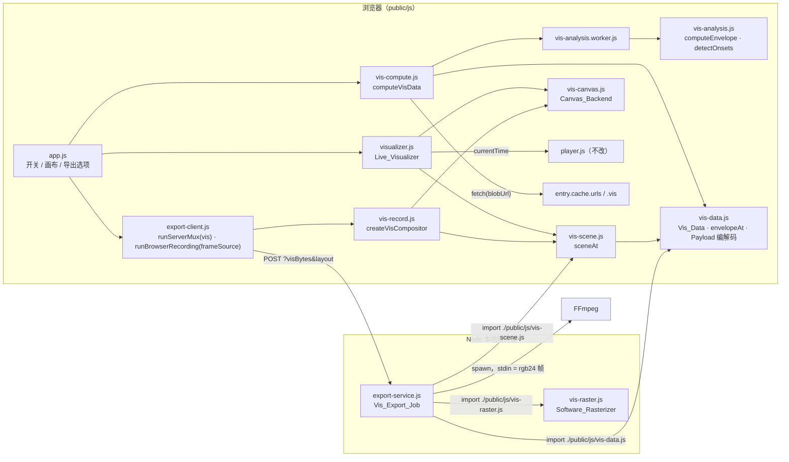
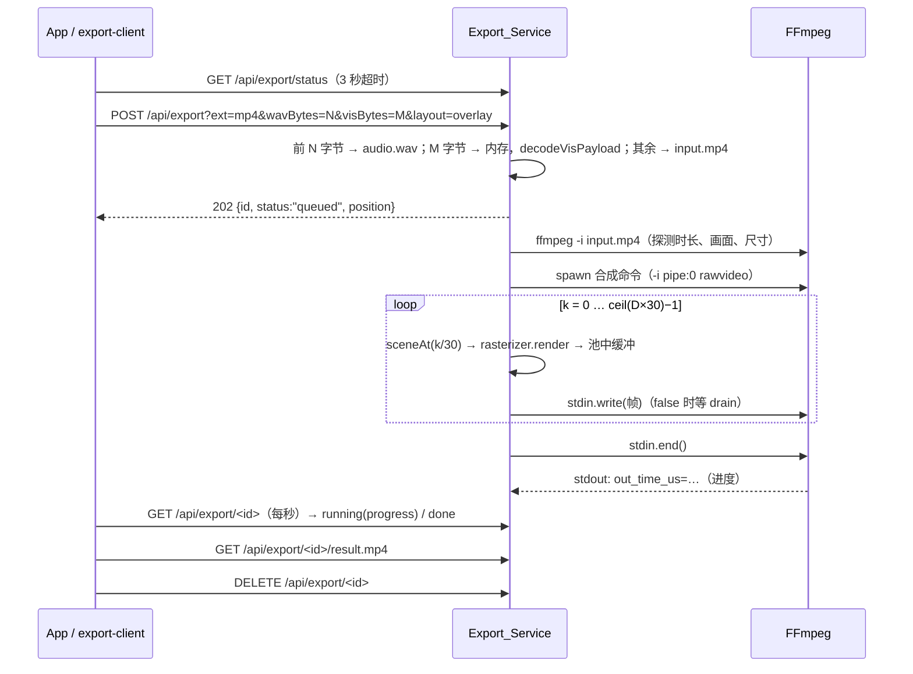
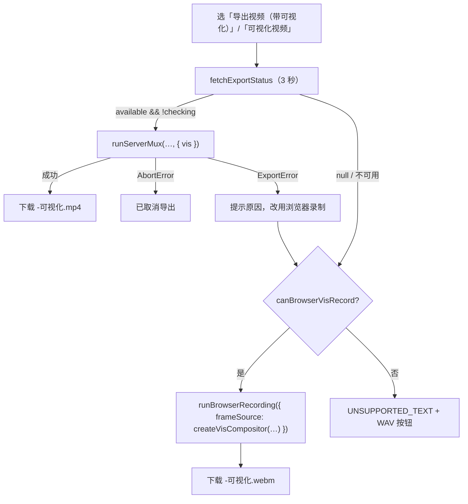

# Design Document：音轨可视化（stem-visualizer）

## Overview

在练习室加一层音乐可视化，并支持导出带可视化的视频：

- **Vis_Analyzer**（新，`public/js/vis-analysis.js` + `vis-analysis.worker.js`）：分离完成后从 8 条 Stem WAV 算出 100 Hz 的 Envelope（`Uint8Array`）和 Onset_Stem 的 Onset 帧序号，结果存进 `entry.cache.vis`。
- **Scene_Function**（新，`public/js/vis-scene.js`）：纯函数 `sceneAt(t, visData, opts)` → Shape 列表。所有随机元素都用整数哈希按 `(stem, 序号, onset)` 取种子，结果只取决于参数。
- **两个后端**：`vis-canvas.js`（Canvas2D，`'lighter'` 加法合成，实时显示）和 `vis-raster.js`（纯 JS Software_Rasterizer，RGB 缓冲加法混合，浏览器和 Node 都能导入，用于导出）。
- **Live_Visualizer**（新，`public/js/visualizer.js`）：以 `player.currentTime` 为 t，在 `requestAnimationFrame` 中按需绘制；暂停、隐藏、关闭时不绘制。
- **Vis_Export**：`runServerMux` 增加可选的 `vis` 参数，上传 WAV + Vis_Payload + 原文件；`export-service.js` 增加 Vis_Export_Job：逐帧渲染、把 `rgb24` 原始帧写入 FFmpeg 标准输入、加法混合、H.264 编码。回退为 `runBrowserRecording` 的新 `frameSource` 选项：在一个录制画布上合成画面和可视化。

沿用的已有结构：

| 已有模式（来源） | 在本功能中的用法 |
| --- | --- |
| `entry.cache`、`evictStemCaches`（`library.js`） | Vis_Data 存在 `entry.cache.vis`，淘汰时随 `entry.cache = null` 一起释放，`library.js` 不改 |
| 模块 Worker + 主线程回退（`separator.js` / `separator.worker.js`） | `vis-analysis.worker.js` 同样的「ready 消息」约定和回退规则 |
| `decodeWav`（`wav.js`） | Worker 和主线程回退都用它解码缓存 WAV |
| `runServerMux`、`exportVideoWithFallback`、`runBrowserRecording`（`export-client.js`） | 加可选参数复用；`exportVideoWithFallback` 原样复用（依赖注入） |
| `createJobQueue`、`abortUpload`、`failJob`、`scheduleExpire`、`createProgressParser`（`export-service.js`） | Vis_Export_Job 走同一个队列、同一套清理和进度逻辑 |
| `fake-ffmpeg.mjs`、`listenFetchable`、`prop.mjs`、`app.test.mjs` 的 FakeEl | 新测试复用；Fake_FFmpeg 增加标准输入读帧 |

约束：浏览器零依赖；Server 只用 Node ≥ 18 内置模块和项目内相对模块；`player.js`、`library.js` 不改；`/api/export` 不带新参数时行为不变。

## 关键设计决策

### 决策 1：预计算 Envelope，而不是实时 `AnalyserNode`

Player 同一时间只播放 Selected_Stem，其余 7 条元素是暂停的，`AnalyserNode` 拿不到它们的声音；为了可视化而让 8 条同时播放（静音）会多出 7 路解码和漂移校正。预计算的代价是一次性的（3 分钟歌曲每条 Stem 解码约 64 MB Float32，逐条处理，峰值只有一条），之后渲染只需查表。由于画面只是 `t` 的函数，变速、拖动、循环无需任何额外处理，导出时 Server 也能用同一份数据离线渲染。

### 决策 2：Envelope 量化为 `Uint8Array`，浏览器和 Server 共用同一份

3600 秒 × 100 Hz × 8 条 = 2.88 MB（`Float32Array` 则为 11.5 MB）。Vis_Payload 直接上传这份量化数据（Base64），Server 解码后得到逐字节相同的数组，所以导出画面与实时画面来自同一份输入。8 位精度对亮度和尺寸足够（1/255 ≈ 0.4%）。

Onset 保存为帧序号（整数，`t = idx / 100`），不保存浮点秒，校验和比较都更简单。

### 决策 3：Scene_Function 输出图元，两个后端各自绘制

| 方案 | 优点 | 缺点 |
| --- | --- | --- |
| 只在浏览器用 Canvas2D 画，导出时实时录制 | 代码最少 | 导出耗时等于歌曲长度；Node 中无 Canvas |
| Server 用 Canvas 的 npm 包 | 两边 API 相同 | 违反零依赖约束，需要原生编译 |
| **纯函数 Scene_Function + Canvas2D 后端 + 纯 JS 光栅化器（选用）** | 零依赖；Scene_Function 可做属性测试；导出快于实时；两边画面来自同一组图元 | 光栅化器要自己写（4 种图元，约 200 行）；两个后端的发光边缘有细微差别 |

图元只有 4 种，都是「核心形状 + 线性衰减的发光边缘」，用有符号距离计算覆盖率，Canvas2D 用渐变或多次描边近似同样的外观：

| `kind` | 字段 | 距离 d（核心外的距离） |
| --- | --- | --- |
| `disc` | `x, y, r, glow` | `dist(p, c) − r` |
| `ring` | `x, y, r, width, glow` | `|dist(p, c) − r| − width / 2` |
| `wave` | `x0, x1, ys[]`（等距采样的 y）、`width, glow` | `|p.y − lerp(ys, p.x)| − width / 2`（竖直距离） |
| `rect` | `x, y, w, h, glow` | 矩形有符号距离（盒 SDF） |

公共字段：`color: [r, g, b]`（0–255 整数）、`alpha`（0–1）、`layer`（Stem id）。覆盖率 `cov(d) = d ≤ 0 ? 1 : (glow > 0 ? max(0, 1 − d / glow)² : 0)`。人声波形用 `wave`（y 是 x 的函数），每列只需算一次插值，比通用折线距离便宜一个数量级。

### 决策 4：服务器渲染用 `rgb24` 原始帧经标准输入送给 FFmpeg，三缓冲池 + 背压

`spawn` FFmpeg 时 `stdio: ['pipe', 'pipe', 'pipe']`，可视化作为 `-f rawvideo -pix_fmt rgb24 -s WxH -r 30 -i pipe:0` 输入。640×360 一帧 691 200 字节，3 分钟 5400 帧约 3.7 GB 流经本机管道，不落盘。

`stream.write(buf)` 在数据真正写出前持有 `buf` 的引用，所以不能在写出前覆盖同一个缓冲。`pumpFrames` 维护 3 个帧缓冲的池：只有某个缓冲的写回调已触发才再次用它渲染；`write()` 返回 `false` 时等 `drain`。每帧之后 `await setImmediate`，让 HTTP 请求（状态轮询、静态文件）得以处理。

渲染在主线程进行，不用 `worker_threads`：一帧约 5–15 ms，每帧让出一次，对本地服务器的响应延迟影响可以接受；Worker 方案要在线程间搬运帧或共享内存，复杂度更高。

可视化帧率固定 30 fps；为使 `blend` 两路输入帧率一致，原画面先经 `fps=30`，所以带可视化的输出一律是 30 fps（原视频是 60 fps 时会降为 30 fps，见「已知风险」）。

### 决策 5：原画面与可视化在 FFmpeg 中加法混合

Software_Rasterizer 在黑色背景上加法绘制，等价于「预乘过透明度的发光层」，与原画面相加就是 Canvas 的 `'lighter'` 效果。滤镜图（Overlay_Layout，OW×OH 为输出尺寸）：

```
[0:v:N]fps=30,scale=OW:OH:force_original_aspect_ratio=decrease,pad=OW:OH:(ow-iw)/2:(oh-ih)/2,setsar=1,format=gbrp[base];
[1:v]scale=OW:OH:flags=bilinear,setsar=1,format=gbrp[vis];
[base][vis]blend=all_mode=addition,format=yuv420p[v];
[2:a:0]apad[a]
```

`gbrp` 让 `blend` 在 RGB 空间相加（在 YUV 中相加色彩会偏）。`force_original_aspect_ratio` + `pad` 保证即使读出的尺寸与解码后不同（例如旋转元数据处理不一致），画面也只会加黑边而不会变形。`apad` 放进滤镜图并 `-map [a]`，不和 `-filter_complex` 混用 `-af`。

Standalone_Layout 不把原文件交给合成命令（原文件只用于探测时长），背景色由光栅化器直接填充：

```
[0:v]scale=1280:720:flags=bicubic,setsar=1,format=yuv420p[v];
[1:a:0]apad[a]
```

合成命令不加 `-nostdin`：输入里有 `pipe:0` 时 FFmpeg 自动关闭键盘交互，而加上 `-nostdin` 的语义与读取标准输入冲突。

### 决策 6：上传分帧扩展为三段

`POST /api/export?ext=&wavBytes=&visBytes=&layout=`，请求体为 WAV（`wavBytes`）+ Vis_Payload（`visBytes`）+ 原文件。没有 `visBytes` 和 `layout` 时完全走原来的 `createBodySplitter` 路径（Requirement 10.3）。Vis_Payload 放在原文件之前，Server 收完这几 MB 就能校验，不合格立即 400，不必等大视频传完；Vis_Payload 只在内存中拼接和解析（≤ 16 MB），不写盘。

### 决策 7：浏览器回退在录制画布上合成

`runBrowserRecording` 增加可选参数 `frameSource: { stream, start(), stop() }`：提供时画面轨取自 `frameSource.stream`（`canvas.captureStream(30)`），不再调用 `video.captureStream()`；其余流程（专用 `recAudio` + `AudioContext` 取音频、Player 切到 Export_Stem 从 0 播放、结束后恢复 Playback_State）完全复用。合成器 `createVisCompositor` 在每个动画帧 `drawImage(video)`（纯音频则填背景色），再以 `'lighter'` 画出 `sceneAt(player.currentTime, …)`。

## Architecture



`vis-data.js`、`vis-scene.js`、`vis-raster.js` 是同构模块：只用 ECMAScript 内置对象，只导入彼此（相对路径），导入时没有副作用，Server 直接从 `./public/js/` 导入。

### Vis_Server_Render 时序



### 带可视化导出的路径选择



## Components and Interfaces

### 1. `public/js/vis-data.js`（新，同构）

```js
export const VIS_VERSION = 1;
export const VIS_FRAME_RATE = 100;
export const VIS_STEM_IDS = Object.freeze(['inst', 'vocal', 'drums', 'bass', 'harmony', 'perc', 'fx', 'other']);
export const ONSET_STEM_IDS = Object.freeze(['drums', 'perc', 'fx', 'other']);
export const ALL_STEM_IDS = Object.freeze(['original', ...VIS_STEM_IDS]);
export const VIS_MAX_DURATION = 3600;           // 秒
export const VIS_MAX_BYTES = 16 * 1024 * 1024;  // Vis_Payload 上限
export const ONSET_MIN_GAP_FRAMES = 5;          // 50 ms

/**
 * Vis_Data：
 * { version: 1, frameRate: 100, frames: number, duration: number,
 *   stems: { [id in VIS_STEM_IDS]?: { env: Uint8Array(frames), onsets: Int32Array | null } } }
 * onsets 只出现在 ONSET_STEM_IDS 中，是严格递增、间隔 ≥ 5 的帧序号。
 */

/**
 * 把各 Stem 的分析结果组装成 Vis_Data：frames = 各 Stem 的最大帧数，duration = 最大时长；
 * 较短的 env 末尾补 0。results 中缺失的 Stem 不出现在 stems 里（1.10）。
 * @param {Record<string, { env: Uint8Array, onsets: Int32Array|null, duration: number }>} results
 */
export function createVisData(results);

/**
 * t 秒处的包络值（0..1），帧间线性插值（3.10）；t 在 [0, duration] 外或 stem 缺失时为 0（3.12）。
 * 帧 i 的采样点位于 t = i / frameRate。
 */
export function envelopeAt(visData, id, t);

/** [t − windowSec, t] 内 envelopeAt 的平均值（连续积分的梯形近似，步长 1 帧），用于 Reduced_Motion（7.2）。 */
export function envelopeMean(visData, id, t, windowSec = 0.3);

/** t 之前 windowSec 秒内（含 t，且 ≥ 0）的 Onset，返回 [{ index, time }]，按时间从近到远，最多 limit 个。 */
export function recentOnsets(visData, id, t, windowSec, limit);

/** Vis_Payload JSON 文本：{ v, frameRate, frames, duration, selected, stems: { id: { env: base64, onsets?: number[] } } } */
export function encodeVisPayload(visData, selected);

/**
 * 严格解析与校验（10.5）。成功返回 { visData, selected }；任何不符都抛 VisPayloadError('可视化数据无效')：
 * - 顶层只有 v、frameRate、frames、duration、selected、stems 六个键；v === 1；frameRate === 100
 * - duration 为有限数，0 < duration ≤ 3600；frames === Math.ceil(duration × 100)
 * - stems 至少 1 个键，全部属于 VIS_STEM_IDS；每项只有 env 和（仅 ONSET_STEM_IDS）onsets
 * - env 是合法 Base64，解码后正好 frames 字节
 * - onsets 是整数数组，0 ≤ idx < frames，严格递增且相邻差 ≥ 5，长度 ≤ ceil(frames / 5)
 * - selected ∈ ALL_STEM_IDS
 * @param {string | Uint8Array} input  Uint8Array 时按 UTF-8 严格解码（TextDecoder fatal）
 */
export function decodeVisPayload(input);

export class VisPayloadError extends Error {}

/** 模块内置的 Base64 编解码，不依赖 Buffer / btoa，浏览器和 Node 结果相同。 */
export function bytesToBase64(bytes);
export function base64ToBytes(text); // 非法字符、长度不是 4 的倍数、填充错误时抛错
```

`TextDecoder` 是浏览器和 Node ≥ 11 的全局对象（ECMAScript 之外，但两边都有），只在 `decodeVisPayload` 收到字节时使用。

### 2. `public/js/vis-analysis.js`（新，纯函数）

```js
export const SILENCE_RMS = 1e-4;
export const ONSET_RISE_DB = 6;          // 相对前 5 帧平均电平的跃升
export const ONSET_GATE = 0.05;          // 帧 RMS 至少为该 Stem 最大 RMS 的 5%
export const ONSET_LOOKBACK_FRAMES = 5;  // 50 ms

/**
 * 每帧 RMS（各声道的平方和合并）。帧 i 覆盖采样 [floor(i·sr/100), min(n, floor((i+1)·sr/100)))；
 * 帧数 = ceil(n · 100 / sr)；n = 0 时返回空数组。
 * @param {Float32Array[]} channels
 * @param {number} sampleRate
 * @returns {Float64Array}
 */
export function frameRms(channels, sampleRate, frameRate = 100);

/**
 * Envelope（1.3、1.4）：max = max(rms)；max < SILENCE_RMS → 全 0；
 * 否则 env[i] = round(255 × sqrt(rms[i] / max))（平方根压缩，让安静段也有可见起伏），最大值正好 255。
 * @returns {Uint8Array}
 */
export function envelopeFromRms(rms);

/**
 * Onset 帧序号（1.5、1.6）：
 *   db[i] = 20·log10(rms[i] + 1e-9)
 *   rise[i] = db[i] − mean(db[i−5 … i−1])（i < 5 时用已有的前几帧；i = 0 时 rise = db[0] − 20·log10(1e-9)）
 *   候选：rise[i] ≥ 6 dB、rms[i] ≥ 0.05·max(rms)，且 rise[i] 是 [i−2, i+2] 内同样满足
 *         rms[j] ≥ 0.05·max(rms) 的帧中的最大值（并列取最早）；未过门限的邻帧不参与比较，
 *         这样跃升恰好落在帧尾时（该帧 rise 极大但 rms 略低于门限），下一帧仍能成为 Onset
 *   依次接受候选，丢弃与上一个已接受帧相差 < 5 帧的候选。
 * 静音 Stem（max < SILENCE_RMS）返回空数组。
 * @returns {Int32Array}
 */
export function detectOnsets(rms, { minGapFrames = 5 } = {});

/** 一条 Stem 的分析：{ env, onsets（仅 ONSET_STEM_IDS，否则 null）, duration: n / sampleRate }。 */
export function analyzeStem(id, channels, sampleRate);
```

`detectOnsets` 以帧起点报告时间：跃升落在帧 i 内时，`rise` 的峰值在帧 i 或 i+1，误差不超过 20 ms（1.6）。

### 3. `public/js/vis-analysis.worker.js`（新，模块 Worker）

与 `separator.worker.js` 相同的约定：加载完成后先 `postMessage({ type: 'ready' })`。

```js
import { decodeWav } from './wav.js';
import { analyzeStem } from './vis-analysis.js';
self.postMessage({ type: 'ready' });
self.onmessage = ({ data: { id, wav } }) => {
  try {
    const { channels, sampleRate } = decodeWav(wav);
    const r = analyzeStem(id, channels, sampleRate);
    const transfer = [r.env.buffer, ...(r.onsets ? [r.onsets.buffer] : [])];
    self.postMessage({ type: 'result', id, ...r }, transfer);
  } catch (err) {
    self.postMessage({ type: 'stem-error', id, message: String(err && err.message || err) });
  }
};
```

### 4. `public/js/vis-compute.js`（新，浏览器）

```js
/**
 * 逐条（VIS_STEM_IDS 顺序）读取 urls[id]（fetch(blobUrl).arrayBuffer()），转移给 Worker 分析，
 * 一次只有一条 Stem 在解码（1.8）。Worker 构造失败或在 'ready' 前出错 → 主线程逐条分析，
 * 每条之间 await yieldFn()（1.9）。单条 'stem-error' 或读取失败 → 跳过该 Stem（1.10）。
 * signal 中止 → worker.terminate()，抛 AbortError，不返回部分结果（2.3）。
 * 全部 Stem 都失败 → 抛 Error('可视化数据生成失败')（2.6）。
 * 不修改、不回收 urls 中的任何 Blob URL（2.8）。
 * @param {Record<string,string>} urls  entry.cache.urls
 * @param {{ signal?: AbortSignal, fetch?, createWorker?: () => Worker, yieldFn?: () => Promise<void>,
 *           decodeWav?, analyzeStem? }} opts
 * @returns {Promise<VisData>}
 */
export async function computeVisData(urls, opts);
```

`createWorker` 默认 `() => new Worker(new URL('./vis-analysis.worker.js', import.meta.url), { type: 'module' })`。

### 5. `public/js/vis-scene.js`（新，同构纯函数）

```js
export const MAX_SHAPES = 400;
export const LAYER_COLORS = Object.freeze({
  inst: [96, 72, 168], vocal: [255, 208, 120], drums: [255, 92, 92], bass: [72, 132, 255],
  harmony: [120, 220, 184], perc: [255, 240, 200], fx: [204, 120, 255], other: [120, 200, 255],
});
export const EMPHASIS = Object.freeze({
  selected: { alpha: 1, size: 1 }, other: { alpha: 0.35, size: 0.8 }, all: { alpha: 0.7, size: 0.9 },
});
export const REDUCED_ALPHA_MAX = 0.4;

/** 层 id 的 Emphasis_Weight（4.1、4.2）。selected 为 'original' 或不在 VIS_STEM_IDS 时全部用 all。 */
export function emphasisFor(layerId, selected);

/** 32 位整数哈希 → [0, 1)，参数为若干整数（Stem 序号、Shape 序号、Onset 帧序号）。没有全局状态（3.9）。 */
export function hash01(...ints);

/**
 * @param {number} t  秒
 * @param {VisData} visData
 * @param {{ selected: string, width: number, height: number, reducedMotion?: boolean }} opts
 * @returns {Shape[]}  按 VIS_STEM_IDS 顺序分层，最多 MAX_SHAPES 个
 */
export function sceneAt(t, visData, opts);
```

尺寸以 `u = min(width, height)` 为单位，中心 `(cx, cy) = (width/2, height/2)`；`w = emphasisFor(id, selected)`，每个 Shape 的 `alpha × w.alpha`，半径 / 宽度 / 发光 / 起伏 `× w.size`（4.4）。`e(id) = envelopeAt(visData, id, t)`。

| 层 | 正常模式（3.2–3.8） | Reduced_Motion（7.1、7.2），`m = envelopeMean(id, t)` |
| --- | --- | --- |
| `inst` 背景辉光 | 1 个 `disc`：中心，`r = 0`，`glow = 0.6u`，`alpha = 0.35·e` | 同一 `disc`，`alpha = REDUCED_ALPHA_MAX·m·0.6` |
| `drums` 光晕 | `recentOnsets(0.6 s, 6)` 每个 → `ring`：`r = 0.08u + age/0.6·0.42u`，`width = 0.012u`，`glow = 0.05u`，`alpha = (1 − age/0.6)²` | 1 个固定 `ring`（`r = 0.2u`），`alpha = REDUCED_ALPHA_MAX·m` |
| `perc` 火花 | `recentOnsets(0.4 s, 6)` 每个 → 10 个 `disc`：方向 `θ = 2π·hash01(5, onset, k)`，距离 `0.05u + age/0.4·(0.25 + 0.15·hash01(6, onset, k))·u`，`r = 0.004u`，`glow = 0.012u`，`alpha = 1 − age/0.4` | 1 个中心 `disc`（`r = 0.02u`，`glow = 0.04u`），`alpha = REDUCED_ALPHA_MAX·m` |
| `bass` 底部脉冲 | 1 个 `rect`：`x = 0, w = width`，`h = (0.04 + 0.16·e)·height`，底边贴画面底部，`glow = 0.06u`，`alpha = 0.25 + 0.6·e` | 固定 `h = 0.1·height`，`alpha = REDUCED_ALPHA_MAX·m` |
| `vocal` 波形 | 1 个 `wave`：`x0 = 0.05·width`、`x1 = 0.95·width`，64 个点，`ys[j] = cy + A·sin(2π·(j/16 + t·0.5))·envelopeAt(t − 0.004·|j − 32|)`，`A = 0.18u`，`width = 0.006u`，`glow = 0.02u`，`alpha = 0.3 + 0.7·e` | `ys` 全为 `cy`（平线），`alpha = REDUCED_ALPHA_MAX·m` |
| `harmony` 色斑 | 5 个 `disc`：基准位置 `hash01(4, k)`，以周期 20–40 秒的正余弦围绕基准缓慢移动，`r = 0`，`glow = (0.18 + 0.1·hash01(7, k))·u`，`alpha = 0.3·e` | 基准位置不动，`alpha = REDUCED_ALPHA_MAX·m·0.75` |
| `fx` / `other` 粒子 | 各 40 个 `disc`：位置 `hash01(stem, k, 0..1)` 散布全画面，`r = 0.003u`，`glow = 0.01u`，`alpha = 0.15 + 0.6·e + 0.25·boost`，`boost = max(0, 1 − 最近 Onset 的 age / 0.3)`；位置随 t 慢速漂移 `0.01u/s` | 位置固定，`alpha = REDUCED_ALPHA_MAX·m` |

- 正常模式下所有 `alpha` 夹到 `[0, 1]`；Shape 数最多 1 + 6 + 60 + 1 + 1 + 5 + 80 = 154 < 400；仍在函数末尾按 `MAX_SHAPES` 截断（3.11）。
- Reduced_Motion 下每层的 Shape 数和几何字段固定（只由 width、height、selected 决定），只有 `alpha` 随 `m` 变化（7.1）。`envelopeMean` 是 300 ms 滑动平均，包络从 0 跳到 1 时，相隔 1/30 秒的平均值最多变化 `(1/30)/0.3 ≈ 0.111`，乘以 `REDUCED_ALPHA_MAX = 0.4` 后透明度变化 ≤ 0.045 < 0.05（7.2）。
- 越界 t（< 0 或 > duration）：`envelopeAt` 返回 0，`recentOnsets` 只返回落在 `[0, duration]` 内的 Onset（3.12）。

### 6. `public/js/vis-raster.js`（新，同构）

```js
/**
 * @param {number} width  ≥ 1 的整数
 * @param {number} height ≥ 1 的整数
 * @returns {{ width, height, frameBytes: number,
 *            render(shapes: Shape[], background: [r,g,b], out?: Uint8Array): Uint8Array }}
 */
export function createRasterizer(width, height);
```

- 内部持有一个 `Float32Array(width × height × 3)` 累加缓冲（创建时分配一次，12.5）。
- `render`：累加缓冲填背景色 → 每个 Shape 计算外接框 `[x − R, x + R]`（R = 半径 + 宽度/2 + 发光，`rect` / `wave` 同理）与画面求交，只遍历交集内像素（12.3）；以像素中心 `(px + 0.5, py + 0.5)` 计算 d 和 `cov(d)`，累加 `color × alpha × cov` → 写到 `out`（未给出时用内部的 `Uint8Array(frameBytes)`，同样只分配一次）：`out[i] = min(255, max(0, round(acc[i])))`（12.1）。
- 只用 `Math`、类型化数组，没有 `import`（12.4）。

### 7. `public/js/vis-canvas.js`（新，浏览器）

```js
/**
 * 在 Canvas2D 上绘制 Shape 列表（12.6）：先 fillRect 背景（transparent=true 时 clearRect），
 * 再 globalCompositeOperation = 'lighter'：
 * - disc：createRadialGradient(r → r + glow)，颜色停靠点按 cov(d) 的二次衰减取 4 个点
 * - ring：外圈 + 内圈两个径向渐变的差，用 'lighter' 叠加近似
 * - wave：先以 width + 2·glow、alpha·0.25 描一次，再以 width、alpha 描一次（lineJoin = 'round'）
 * - rect：createLinearGradient 竖直方向，核心区实色、边缘 glow 内衰减
 * 结束时恢复 globalCompositeOperation。
 * @param {CanvasRenderingContext2D} ctx
 * @param {Shape[]} shapes
 * @param {{ background?: [r,g,b], transparent?: boolean }} opts
 */
export function drawSceneToCanvas(ctx, shapes, opts);
```

### 8. `public/js/visualizer.js`（新，浏览器，全局对象可注入）

```js
/** 设备像素比限制在 [1, 2]（8.4）。 */
export function canvasPixelSize(cssWidth, cssHeight, dpr) {
  const r = Math.min(2, Math.max(1, Number.isFinite(dpr) ? dpr : 1));
  return { width: Math.max(1, Math.round(cssWidth * r)), height: Math.max(1, Math.round(cssHeight * r)) };
}

/** 开关设置（6.6、6.8）：非布尔值用默认值。 */
export function readVisSettings(s) {
  return {
    visVideo: typeof s?.visVideo === 'boolean' ? s.visVideo : false,
    visAudio: typeof s?.visAudio === 'boolean' ? s.visAudio : true,
  };
}

/**
 * 调度模型（5.2、5.3、8.1–8.3），纯函数：
 * - !enabled || !visible || !hasData → { draw: false, schedule: false }
 * - playing → { draw: true, schedule: true }
 * - 暂停：key 与上次绘制不同 → { draw: true, schedule: false }；否则 { draw: false, schedule: false }
 * key = `${t.toFixed(3)}|${selected}|${width}x${height}|${reducedMotion}|${dataId}`
 */
export function visFrameAction({ enabled, visible, hasData, playing, key, lastKey });

/**
 * @param {{ canvas, getTime: () => number, isPlaying: () => boolean, getSelected: () => string,
 *           getVisData: () => VisData|null, isEnabled: () => boolean,
 *           raf?, document?, matchMedia?, devicePixelRatio?: () => number, sceneAt?, drawSceneToCanvas? }} opts
 * @returns {{ invalidate(): void, destroy(): void }}
 */
export function createLiveVisualizer(opts);
```

`invalidate()`：没有挂起的动画帧时 `raf(frame)`。`frame()`：读取 `canvas.clientWidth/Height` 并按 `canvasPixelSize` 调整像素尺寸，计算 `visFrameAction`；`draw` 时 `drawSceneToCanvas(ctx, sceneAt(getTime(), data, { selected, width, height, reducedMotion }), { transparent: true })`；`schedule` 时再 `raf(frame)`。监听 `visibilitychange`（重新可见时 `invalidate()`）和 `matchMedia('(prefers-reduced-motion: reduce)')` 的 `change`（7.3）。App 在 `render()`（Player 每个 tick 都会调用）、切换音轨、开关、窗口尺寸变化时调用 `invalidate()`；因此播放时每个动画帧绘制一次，暂停后最多再画一帧（5.3、8.3）。

Audio_Only_Source 的封面替换画布不透明（`transparent: false`，背景 `#0b0d14`），Video_Source 的叠加画布透明。

### 9. `public/js/vis-record.js`（新，浏览器）

```js
export const VIS_BACKGROUND = [11, 13, 20]; // #0b0d14
export const RECORD_BOX = [1280, 720];

/** 浏览器支持 HTMLCanvasElement.prototype.captureStream、MediaRecorder（pickRecorderMime 非 null）和 AudioContext（14.5）。 */
export function canBrowserVisRecord(env = globalThis);

/**
 * 录制画布：Video_Source 按 video.videoWidth/Height 放进 1280×720 框（偶数），Audio_Only_Source 为 1280×720。
 * start()：每个动画帧 drawImage(video)（或填 VIS_BACKGROUND），再 drawSceneToCanvas(sceneAt(getTime(), visData,
 *   { selected: stemId, width, height, reducedMotion: false }))（14.3）。stop()：停止动画帧、停止 stream 轨道、释放画布（14.7）。
 * @returns {{ canvas, stream: MediaStream, start(): void, stop(): void }}
 */
export function createVisCompositor({ document, video, visData, stemId, getTime, raf, cancelRaf, sceneAt, drawSceneToCanvas });
```

### 10. `public/js/export-client.js` 改动

- `runServerMux(sourceFile, wavBlob, { …, vis })`：`vis = { payload: Blob, layout: 'overlay' | 'standalone' }`。提供时 URL 为 `/api/export?ext=<ext>&wavBytes=<n>&visBytes=<payload.size>&layout=<layout>`，`body: new Blob([wavBlob, vis.payload, sourceFile])`；运行中的阶段报告为 `{ stage: 'rendering', progress }`。不提供时与现在完全相同（9.8、10.3）。
- `exportProgressText`：新增 `{ stage: 'rendering', progress: N }` → `渲染可视化视频 N%`，`progress: null` → `渲染可视化视频中…`（9.6）。
- `runBrowserRecording({ …, frameSource })`：提供 `frameSource` 时画面轨为 `frameSource.stream.getVideoTracks()`，在 `player.play()` 前 `frameSource.start()`，`finally` 中 `frameSource.stop()`；`video` 参数仍作为时钟和 `ended` / `timeupdate` 事件源（Audio_Only_Source 时传 `masterAudio`）。不提供时行为不变。
- `visFileLabel(label)` → `` `${label}-可视化` ``，交给现有 `fileNameFor`（9.5）。

### 11. `export-service.js` 改动（Server）

#### 11.1 新常量与纯函数

```js
import { decodeVisPayload, VIS_MAX_BYTES } from './public/js/vis-data.js';
import { sceneAt } from './public/js/vis-scene.js';
import { createRasterizer } from './public/js/vis-raster.js';

export const VIS_FPS = 30;
export const VIS_RENDER_BOX = [640, 360];
export const VIS_OUTPUT_BOX = [1920, 1080];
export const VIS_STANDALONE_OUTPUT = [1280, 720];
export const VIS_BACKGROUND = [11, 13, 20];
export const VIS_LAYOUTS = ['overlay', 'standalone'];

/**
 * 可视化参数（10.4）：两者都缺 → { ok: true, vis: null }（走原路径）；只有一个 → 400；
 * visBytes 必须匹配 ^\d+$ 且 2 ≤ n ≤ VIS_MAX_BYTES；layout ∈ VIS_LAYOUTS。
 * @returns {{ ok: true, vis: null | { visBytes: number, layout: string } } | { ok: false, error: string }}
 */
export function parseVisQuery(searchParams);

/**
 * 通用分帧器：sizes = [wavBytes, visBytes]，feed(chunk) → [{ part: 0 | 1 | 2, data }]，
 * part 2 为剩余部分（原文件）。received() 为累计字节数。
 */
export function createPartSplitter(sizes);

/**
 * 探测 stderr 中第 ordinal 个 Video 流的 "<W>x<H>"（取流行中第一个 2–5 位数字 x 2–5 位数字），
 * 若随后的 side data 中有 "rotation of ±90"（或 ±270）则交换宽高，返回显示尺寸；读不出返回 null。
 */
export function parseProbeVideoSize(stderr, ordinal);

/** 按比例放进 boxW×boxH（不放大），宽高向下取偶数且 ≥ 2。 */
export function fitEven(width, height, boxW, boxH);

/**
 * 渲染计划（11.3–11.5、11.8、11.9）：
 * D = probe 时长 ?? payload 时长；frames = ceil(D × 30)；
 * overlay：size 已知 → render = fitEven(size, 640, 360)，output = fitEven(size, 1920, 1080)；
 *          size 未知 → render = 640×360，output = 1280×720（由 pad 处理宽高比）
 * standalone：render = 640×360，output = 1280×720
 */
export function visRenderPlan({ layout, probeDuration, payloadDuration, videoSize });

/** 合成参数（11.6、11.8–11.10），见「决策 5」的滤镜图。 */
export function buildVisMuxArgs(fixedArgs, plan, video, paths);

/**
 * 帧泵（11.7、11.12、11.14）：依次 k = 0 … frames−1：
 *   取一个空闲缓冲（池大小 poolSize，缓冲在写回调触发后才回到空闲）→ renderInto(k, buf)
 *   → ok = stdin.write(buf, cb) → ok 为 false 时等 'drain' → await yieldFn()
 * stdin 'error' / 'close'、signal 中止时立即停止，返回 'stopped'；全部写完后 stdin.end()，返回 'done'。
 * @returns {Promise<'done' | 'stopped'>}
 */
export async function pumpFrames({ frames, frameBytes, renderInto, stdin, signal, poolSize = 3, yieldFn });
```

`buildVisMuxArgs` 输出（overlay）：

```js
[
  ...fixedArgs, '-hide_banner', '-y',
  '-i', paths.input,
  '-f', 'rawvideo', '-pix_fmt', 'rgb24', '-s', `${RW}x${RH}`, '-r', '30', '-i', 'pipe:0',
  '-i', paths.audio,
  '-filter_complex', graph,          // 决策 5；standalone 时没有 paths.input，音频为 1:a:0
  '-map', '[v]', '-map', '[a]',
  ...X264_ARGS, '-r', '30',
  '-c:a', 'aac', '-b:a', AAC_BITRATE,
  '-t', formatSeconds(plan.D),
  '-movflags', '+faststart',
  '-progress', 'pipe:1', '-nostats',
  '-f', 'mp4', paths.output,
]
```

#### 11.2 上传处理的改动

在 `handleUpload` 的第 2 步之后调用 `parseVisQuery`：

1. `vis === null` → 原流程，一行不改（10.3）。
2. 否则 `Content-Length`（若有）≤ `wavBytes + visBytes` → 400 `缺少原文件`；超过 `maxUploadBytes` → 413。
3. 用 `createPartSplitter([wavBytes, visBytes])`：part 0 写 `audio.wav`（RIFF 校验不变），part 1 推入内存数组（不写盘，10.8），part 2 写 `input.<ext>`。
4. part 1 收满 `visBytes` 时立即 `decodeVisPayload(Buffer.concat(parts))`；失败 → `abortUpload` + `drainer.reject(..., 400, '可视化数据无效')`（10.5）。成功后 `job.vis = { visData, selected, layout }`，释放原始字节。
5. 请求结束时 `received ≤ wavBytes + visBytes` → 400（`音轨 WAV 不完整` / `可视化数据不完整` / `缺少原文件`），删除目录（10.7）。

总字节检查（413）、断线、写盘失败（500）、429、503 与原流程共用同一段代码（10.6、10.10）。

#### 11.3 `runVisJob(job, done)`

`runJob` 开头：`if (job.vis) return runVisJob(job, done)`。共享的部分（状态、超时计时器、`failJob`、`scheduleExpire`、取消分支、成功后删上传文件）抽成内部辅助函数，两种任务都用；原任务的行为不变。

1. 探测：与原任务相同的 `execFile` + `parseProbeOutput`。`layout === 'overlay'` 且 `video === null` → 失败 `文件里没有画面`（11.2）。`videoSize = parseProbeVideoSize(stderr, video.ordinal)`。
2. `plan = visRenderPlan(...)`；`raster = createRasterizer(plan.render.w, plan.render.h)`；背景 overlay 为黑 `[0,0,0]`，standalone 为 `VIS_BACKGROUND`。
3. `spawn(cmd, buildVisMuxArgs(...), { windowsHide: true, stdio: ['pipe', 'pipe', 'pipe'] })`（无 `shell`）；stdout → `createProgressParser(plan.D)`；stderr 保留最后 64 KB；`child.stdin.on('error', () => {})` 吞掉 `EPIPE`，结果以退出码为准（11.12）。
4. `pumpFrames({ frames: plan.frames, frameBytes: raster.frameBytes, stdin: child.stdin, signal: job.abort.signal, yieldFn: () => new Promise(setImmediate), renderInto: (k, buf) => raster.render(sceneAt(k / 30, visData, { selected, width, height, reducedMotion: false }), bg, buf) })`（11.4、11.7、11.14）。
5. 子进程 `close`：与原任务相同的判定顺序（取消 → 超时 → 退出码非 0 → 无输出文件 → 成功）。取消和超时时先 `job.abort.abort()` 停止帧泵，再 `kill` 子进程（11.13）。`pumpFrames` 返回 `'stopped'` 而进程退出码为 0 的情况视为失败 `FFmpeg 提前结束`。
6. 结束时 `job.vis = null`，释放 Vis_Data（10.8）。

### 12. `app.js` / `index.html` / `style.css` 改动

#### 12.1 页面元素

```html
<!-- .stage 内，video / audioArt 之后、stageTap 之前 -->
<canvas class="vis-canvas" id="visCanvas" aria-hidden="true" hidden></canvas>
<!-- .controls 内 -->
<button type="button" class="vis-toggle" id="visToggle" aria-pressed="false" disabled>可视化</button>
<span class="vis-hint" id="visHint" hidden></span>
<!-- #exportSheet 内，data-export="video" 之后 -->
<button type="button" class="btn btn-outline btn-block" data-export="visvideo" hidden>导出视频（带可视化）</button>
```

CSS：`.vis-canvas { position: absolute; inset: 0; width: 100%; height: 100%; pointer-events: none; }`（6.1，点击穿透到 `#stageTap`）；`.media-card.vis-on.audio-only .audio-art .bars { display: none; }`，画布在 `.audio-art` 下方显示，文件名照常（6.2）。

#### 12.2 状态与设置

```js
state.vis = { status: 'idle' | 'computing' | 'ready' | 'failed', abort: AbortController | null };
// settings 增加 visVideo、visAudio（readVisSettings），saveSettings 原样保存整个对象
```

#### 12.3 流程

- `openEntry()` 开头：`state.vis.abort?.abort()`，`state.vis = { status: 'idle', abort: null }`（2.3）。
- `entry.cache` 已有且 `entry.cache.vis` 存在 → `status = 'ready'`（2.2）；`entry.cache` 刚建立（分离完成）或已有但无 `vis` → `startVisCompute(entry)`（1.1、1.2）。
- `startVisCompute(entry)`：`status = 'computing'`，`computeVisData(entry.cache.urls, { signal })`；成功且 `state.current === entry && entry.cache` 仍存在 → `entry.cache.vis = data`、`status = 'ready'`（2.1）；AbortError 静默；其他错误 → `status = 'failed'`（2.6）。每一步 `renderVis()`。
- `renderVis()`：`on = enabledFor(entry.kind) && status === 'ready'`；`#visCanvas.hidden = !on`；`mediaCard.classList.toggle('vis-on', on)`；`#visToggle.disabled = status !== 'ready'`、`aria-pressed`；`#visHint` 显示「可视化准备中…」/「可视化数据生成失败」（2.6、2.7、6.3–6.5）；`visualizer.invalidate()`。
- `render()` 末尾和 `selectStem()` 中调用 `visualizer.invalidate()`（4.3、5.2）。
- `#visToggle` 点击：翻转 `settings.visVideo` 或 `settings.visAudio`，`saveSettings()`，`renderVis()`（6.7）。
- 导出：`onExportClick()` 中 `kind === 'audio'` 时，`state.vis.status === 'ready'` → 以音频模式打开选择面板（隐藏 `data-export="video"`，`visvideo` 按钮文字为「可视化视频」）；否则直接 `startWavExport`（9.2、9.3）。视频模式下 `visvideo` 按钮在 `status === 'ready'` 时显示，文字「导出视频（带可视化）」（9.1）。
- `onExportOption('visvideo')` → `startVisExport(target)`：与 `startVideoExport` 结构相同，差别只有：
  - `runServer`：`runServerMux(entry.file, wav, { signal, onPhase, vis: { payload: new Blob([encodeVisPayload(entry.cache.vis, target.stemId)], { type: 'application/json' }), layout: entry.kind === 'video' ? 'overlay' : 'standalone' } })`；
  - `canRecord`：`canBrowserVisRecord(window)`；
  - `runBrowser`：`frameSource = createVisCompositor({ video: entry.kind === 'video' ? els.video : null, visData: entry.cache.vis, stemId: target.stemId, getTime: () => player.currentTime, … })`，`runBrowserRecording({ …, video: player.master, frameSource })`；
  - 文件名 `fileNameFor(entry.name, visFileLabel(target.label), path === 'server' ? 'mp4' : 'webm')`（9.5）。
  - Vis_Data 在点击时取一次引用，导出过程中缓存被淘汰也不受影响。
- 取消、打开另一文件、锁定控件、Playback_State 恢复全部沿用现有的 `state.exporting` 机制（9.7、14.6、14.7）。

## Data Models

### Vis_Data（浏览器内存 `entry.cache.vis`；Server 内存 `job.vis.visData`）

```js
{
  version: 1,
  frameRate: 100,
  frames: 18000,          // ceil(duration × 100)
  duration: 179.995,      // 秒，= 最长 Stem 的采样数 / 采样率
  stems: {
    drums: { env: Uint8Array(18000), onsets: Int32Array([12, 57, 103, …]) },
    bass:  { env: Uint8Array(18000), onsets: null },
    // … 最多 8 条，缺失的 Stem 不出现
  },
}
```

### Vis_Payload（上传 JSON）

```json
{
  "v": 1, "frameRate": 100, "frames": 18000, "duration": 179.995, "selected": "drums",
  "stems": {
    "drums": { "env": "AAECAwQF…", "onsets": [12, 57, 103] },
    "bass": { "env": "AAAAAQEC…" }
  }
}
```

### Shape

```js
{ kind: 'disc', layer: 'perc', x, y, r, glow, color: [r, g, b], alpha }
{ kind: 'ring', layer: 'drums', x, y, r, width, glow, color, alpha }
{ kind: 'wave', layer: 'vocal', x0, x1, ys: number[], width, glow, color, alpha }
{ kind: 'rect', layer: 'bass', x, y, w, h, glow, color, alpha }
```

### Vis_Export_Job（在 Export_Job 上增加的字段）

```js
{
  vis: { visData, selected, layout } | null, // 结束时置 null
  plan: { D, frames, fps: 30, render: { w, h }, output: { w, h } } | null,
  abort: AbortController,                     // 停止帧泵
}
```

### 设置（localStorage `cengjian.settings`）

```js
{ speed, loop, demucsModel, visVideo: boolean /* 默认 false */, visAudio: boolean /* 默认 true */ }
```

## 已知风险

- **输出帧率降为 30 fps**：带可视化导出时原画面经 `fps=30`，60 fps 的练舞视频会变成 30 fps。不带可视化的「导出视频」不受影响。
- **重新编码耗时**：带可视化必须重新编码 H.264；1080p 在 CPU 上 `veryfast` 通常快于实时，但较慢的电脑上可能接近实时，30 分钟超时仍然适用。
- **事件循环占用**：渲染在 Server 主线程，每帧 5–15 ms 后让出一次；同时进行的 Demucs 上传和状态查询会有十几毫秒的延迟。
- **正常模式的闪烁**：鼓点密集时光晕每秒可能超过 3 次闪现。打开系统的「减少动态效果」会改用平缓模式；导出视频始终是完整动效（「假设」第 3 条）。
- **两个后端的细微差别**：Canvas 渐变与光栅化器的二次衰减不完全相同，发光边缘略有差异（「假设」第 8 条）。
- **浏览器录制**：耗时等于文件长度；后台标签页中动画帧会被降频，录出的可视化可能掉帧，应保持页面在前台。
- **旋转元数据**：手机竖拍视频的尺寸读取依赖探测输出中的 `rotation` 信息；读错时由 `pad` 加黑边，不会变形。

## Error Handling

| 情况 | Server 行为 | App 行为 |
| --- | --- | --- |
| 某条 Stem WAV 读取或解码失败 | — | 跳过该 Stem，其余照常；该层不显示（1.10） |
| 8 条全部失败 / Worker 出错且主线程也失败 | — | `state.vis.status = 'failed'`，显示「可视化数据生成失败」，开关不可用；播放和导出照常（2.6） |
| 计算中打开另一个文件 | — | 中止：`worker.terminate()`，丢弃部分结果（2.3） |
| 计算完成时文件已不是当前文件或缓存已被淘汰 | — | 丢弃结果，不写 `entry.cache.vis` |
| 只给了 `visBytes` 或 `layout` 之一、值无效 | 400，不写文件（10.4） | ExportError(upload) → 提示并回退录制 |
| Vis_Payload 不是合法 JSON / 不符合格式 | 400 `可视化数据无效`，删除已写文件（10.5） | 同上 |
| 请求体在原文件之前结束 | 400 `可视化数据不完整` / `缺少原文件`，删除目录（10.7） | 同上 |
| 总量超限 | 413（10.6） | 同上 |
| overlay 但没有画面流 | failed `文件里没有画面`（11.2） | 提示并回退录制 |
| FFmpeg 提前退出、`EPIPE` | 帧泵停止；按退出码和 stderr 最后一行标记失败，退出码 0 时为 `FFmpeg 提前结束`（11.12） | 提示并回退录制 |
| 任务超时（含渲染） | 停止帧泵、终止进程，failed 超时信息（11.13） | 提示并回退录制 |
| 用户取消 | DELETE → 停止帧泵、终止进程、删目录 | 「已取消导出」，不回退 |
| 浏览器不支持画布录制 | — | UNSUPPORTED_TEXT + WAV 按钮（14.5） |
| 录制中 MediaRecorder / 媒体错误 | — | 不下载，显示原因，停止合成器，恢复 Playback_State（14.7、14.8） |
| localStorage 不可用或设置无效 | — | 使用默认值（6.8），保存失败时静默（与现有设置相同） |

## Correctness Properties

*A property is a characteristic or behavior that should hold true across all valid executions of a system-essentially, a formal statement about what the system should do. Properties serve as the bridge between human-readable specifications and machine-verifiable correctness guarantees.*

属性反思：Envelope 的长度、取值、归一化、存储类型和确定性（1.3、1.4、1.7、2.5）合并为一个模型属性，缩放不变性单列（它是独立的蜕变关系）；Onset 的不变式和定位精度分开（一个对任意信号，一个对构造的信号）；鼓 / 打击乐 / 粒子的 Onset 窗口规则（3.2、3.3、3.7）合并为一个属性；贝斯 / 人声 / 纯伴奏 / 和声的「随包络单调」（3.4、3.5、3.6、3.8）合并；Scene 的确定性和与调用顺序无关（3.9）同时覆盖 5.1–5.5 的同步（画面只是 t 的函数）；Live_Visualizer 的 rAF、暂停、隐藏规则（5.2、5.3、8.1–8.3）合并为一个调度模型属性；Vis_Payload 的往返与拒绝非法输入合并；帧泵的背压、停止、让出合并。录制回退的路径选择已由 stem-video-export 的 Property 5 覆盖（`exportVideoWithFallback` 原样复用），这里只做示例测试。

### Property 1: Envelope 模型

*For any* 声道数 1–2、采样率 ∈ {22050, 44100, 48000}、长度 0–3 秒的随机采样（含整段静音、整段低于 1e-4 的微弱信号），`analyzeStem` 的 `env` 是长度为 `ceil(n × 100 / sr)` 的 `Uint8Array`；每个值等于参考实现（逐帧按定义计算 RMS 后 `round(255 × sqrt(rms / max))`）；最大 RMS ≥ 1e-4 时最大值为 255，否则全为 0；对同一输入调用两次结果逐字节相同。

**Validates: Requirements 1.3, 1.4, 1.7, 2.5**

### Property 2: Envelope 缩放不变

*For any* 最大 RMS ≥ 1e-3 的随机采样和缩放系数 k ∈ [0.1, 10]（缩放后不要求限制在 ±1），`envelopeFromRms(frameRms(k · x))` 与 `envelopeFromRms(frameRms(x))` 的每个值相差不超过 1。

**Validates: Requirements 1.4**

### Property 3: Onset 不变式

*For any* 随机 RMS 序列（含静音段、噪声、阶跃、单帧尖峰），`detectOnsets` 返回的帧序号严格递增，都在 `[0, frames)` 内，相邻差 ≥ 5（50 ms）；每个序号 i 满足 `rise[i] ≥ 6 dB` 且 `rms[i] ≥ 0.05 × max(rms)`；最大 RMS < 1e-4 时返回空数组。

**Validates: Requirements 1.5, 1.4**

### Property 4: Onset 定位

*For any* 1–20 个跃升时刻（相邻间隔 ≥ 150 ms，第一个 ≥ 50 ms，最后一个距结尾 ≥ 100 ms）、各自的峰值幅度 ∈ [0.2, 1]，以及由此构造的信号（跃升前静音，跃升后为种子 PRNG 噪声乘以时间常数 30 ms 的指数衰减），`detectOnsets` 返回的 Onset 个数等于跃升个数，且第 j 个 Onset 的时间与第 j 个跃升时刻相差不超过 20 ms。

**Validates: Requirements 1.6**

### Property 5: Vis_Payload 往返与校验

*For any* 合法 Vis_Data（随机的 Stem 子集、frames 1–5000、随机 env 字节、合法 Onset 序列）和任意 `selected ∈ ALL_STEM_IDS`，`decodeVisPayload(encodeVisPayload(v, s))` 得到逐字节相同的 env、相同的 onsets、frames、duration 和 selected，编码文本中只含 ASCII；*for any* 对合法 Payload 的一次破坏（删除或新增键、未知 Stem id、env 少 / 多一个字节、非法 Base64 字符、Onset 乱序 / 间隔 < 5 / 越界 / 出现在非 Onset_Stem、frames 与 duration 不一致、v 或 frameRate 不对、selected 未知、非法 UTF-8、截断的 JSON），`decodeVisPayload` 抛 `VisPayloadError`。

**Validates: Requirements 10.5, 10.9**

### Property 6: Envelope 插值

*For any* Vis_Data、Stem 和 t，`envelopeAt` 在 t 为帧点 `i / 100`（0 ≤ i < frames）时等于 `env[i] / 255`；在两个相邻帧点之间等于两端值的线性插值，因而介于两端值之间；t < 0、t > duration、Stem 缺失时为 0；结果总在 [0, 1] 内。

**Validates: Requirements 3.10, 3.12**

### Property 7: 场景确定性

*For any* Vis_Data、时刻序列 t₁…tₙ（随机顺序，含重复、负数和超过时长的值）、`selected`、尺寸和 `reducedMotion`，按该顺序调用 `sceneAt` 得到的每个结果与对同一参数单独调用的结果深度相等；参数对象和 Vis_Data 在调用后没有被修改。

**Validates: Requirements 3.9, 5.1, 5.4, 5.5**

### Property 8: 场景输出界限

*For any* Vis_Data（含只有部分 Stem、全静音、Onset 极密集）、任意有限 t、宽高 ∈ [16, 4096]、任意 `selected` 和 `reducedMotion`，`sceneAt` 返回不超过 400 个 Shape；每个 Shape 的 `kind` 是四种之一，所有数值字段是有限数，`alpha ∈ [0, 1]`，`color` 是三个 0–255 的整数，`r`、`width`、`glow`、`w`、`h` ≥ 0，中心或起点位于 `[−0.25·width, 1.25·width] × [−0.25·height, 1.25·height]` 内。

**Validates: Requirements 3.11, 3.12**

### Property 9: 每条 Stem 一层

*For any* VIS_STEM_IDS 的子集作为 Vis_Data 中有数据的 Stem，以及任意 t ∈ [0, duration]，`sceneAt` 输出中出现的 `layer` 值都属于该子集；在 Reduced_Motion 下（每层 Shape 数固定）出现的 `layer` 集合正好等于该子集；不同层的 Shape 使用不同的 `color`。

**Validates: Requirements 3.1**

### Property 10: Onset 窗口图形

*For any* Onset 序列和 t（正常模式），`layer === 'drums'` 的 `ring` 个数等于 `min(6, (t − 0.6, t] 内的鼓 Onset 数)`，且按 Onset 由近到远，半径严格递增、透明度不增；`layer === 'perc'` 的 `disc` 个数等于 `10 × min(6, (t − 0.4, t] 内的打击乐 Onset 数)`；`fx` / `other` 的粒子在 t 位于某个 Onset 后 0.3 秒内时，透明度总和不小于把该 Onset 去掉后的透明度总和。

**Validates: Requirements 3.2, 3.3, 3.7**

### Property 11: 随包络单调

*For any* Vis_Data、t 和两份只在 t 附近的 `bass` / `vocal` / `inst` / `harmony` Envelope 值上有差别（e₁ ≤ e₂）的数据，正常模式下：`bass` 光带的高度和透明度不减；`vocal` 波形各点到中线的最大距离不减，e = 0 时为平线；`inst` 与 `harmony` Shape 的透明度不减。

**Validates: Requirements 3.4, 3.5, 3.6, 3.8**

### Property 12: 选中音轨强调

*For any* Vis_Data、t、尺寸和 `selected`，把 `sceneAt` 的输出与「所有层权重都为 1」的参考输出逐个 Shape 对比：`selected` 是 Derived_Stem 时，该层 Shape 的透明度等于参考值（夹到 1 之前）× 1.0、尺寸字段 × 1.0，其他层透明度 × 0.35、尺寸 × 0.8；`selected === 'original'` 时所有层透明度 × 0.7、尺寸 × 0.9。

**Validates: Requirements 4.1, 4.2, 4.4**

### Property 13: 减少动态效果

*For any* Vis_Data、`selected`、尺寸和两个时刻 t₁、t₂，`reducedMotion: true` 时两次输出的 Shape 个数相同，且除 `alpha` 外的所有字段逐个相等；*for any* t，`|alpha(t) − alpha(t + 1/30)| ≤ 0.05` 对每个对应的 Shape 成立。

**Validates: Requirements 7.1, 7.2**

### Property 14: 实时绘制调度模型

*For any* 事件序列（播放、暂停、拖动、切换音轨、尺寸变化、开关、页面隐藏 / 显示、减少动态效果变化、空闲的动画帧），用假 `raf` 和假 Player 驱动 `createLiveVisualizer`：任意时刻至多一个挂起的动画帧；绘制只发生在 `raf` 回调里；开关关闭、页面不可见或没有 Vis_Data 时不绘制且不安排新帧；播放时每个动画帧绘制一次且以当时的 `currentTime` 为 t；暂停时绘制次数等于 key（t、selected、尺寸、开关、减少动态效果）变化的次数。

**Validates: Requirements 5.2, 5.3, 4.3, 7.3, 8.1, 8.2, 8.3**

### Property 15: 画布像素尺寸

*For any* 非负显示宽高和任意 dpr（含 0、负数、NaN、3、4），`canvasPixelSize` 返回的宽高都 ≥ 1，并等于 `max(1, round(css × clamp(dpr, 1, 2)))`（dpr 非有限数时按 1）。

**Validates: Requirements 8.4**

### Property 16: 开关设置默认值

*For any* 存储对象（缺失、`null`、数组、键值为字符串 / 数字 / `null` / 布尔），`readVisSettings` 的 `visVideo` 在原值是布尔时等于原值，否则为 `false`；`visAudio` 在原值是布尔时等于原值，否则为 `true`。

**Validates: Requirements 6.6, 6.8**

### Property 17: 可视化导出文件名

*For any* Source_File 名、Stem_Display_Name 和扩展名 `mp4` / `webm`，`fileNameFor(name, visFileLabel(label), ext)` 以 `-<label>-可视化.<ext>` 结尾，并满足 stem-video-export Property 1 的全部不变式（无不安全字符、首尾无空格和句点、主体 ≤ 80 码点）。

**Validates: Requirements 9.5**

### Property 18: 可视化上传请求

*For any* Source_File 名、WAV 大小、Vis_Payload 大小、`layout` 和服务器响应序列，`runServerMux(..., { vis })` 发出的 POST URL 是相对路径 `/api/export?…`，查询参数正好是 `ext`、`wavBytes`、`visBytes`、`layout`，`visBytes` 等于 Payload 大小；请求体依次为 WAV、Payload、Source_File；URL、请求头和 Payload 中都不含 Source_File 名（去扩展名后长度 ≥ 3 的部分）；不传 `vis` 时 URL 与本功能加入前相同。

**Validates: Requirements 10.1, 10.2, 10.9, 9.8**

### Property 19: 可视化查询参数校验

*For any* `visBytes` 与 `layout` 的取值组合（缺失、空串、负数、小数、前导空格、十六进制、超大数、大小写变化的 layout），`parseVisQuery` 在两者都缺失时返回 `{ ok: true, vis: null }`；返回带 `vis` 的 `ok` 当且仅当 `visBytes` 匹配 `^\d+$` 且在 2 到 16777216 之间、`layout` ∈ {`overlay`, `standalone`}；其余情况 `ok === false`。

**Validates: Requirements 10.4**

### Property 20: 三段分帧往返

*For any* WAV 字节（≥ 12）、Payload 字节（≥ 2）、原文件字节（≥ 1）以及对三者拼接的任意切分，依次送入 `createPartSplitter([wav.length, payload.length])` 后，part 0、1、2 各自拼接分别等于 WAV、Payload 和原文件，且 `received()` 等于总长度。

**Validates: Requirements 10.1, 10.7**

### Property 21: 尺寸解析与渲染分辨率

*For any* 按 FFmpeg 格式生成的探测输出（随机的 Video 流尺寸 16–7680、可选的 `rotation of ±90 / 180` 、多个 Video 流和 attached pic），`parseProbeVideoSize` 返回第 `ordinal` 个 Video 流的尺寸，±90 时宽高交换；*for any* 正整数宽高和框，`fitEven` 的结果是 ≥ 2 的偶数，不超过框，也不超过原尺寸（向下取偶后），宽高比与原比例的相对误差不超过 `2 / min(结果宽, 结果高)`；该宽高比上界仅在精确适配（未取偶、未钳制到 2 之前）的短边 ≥ 2 时成立。精确短边 < 2 时结果被钳制为 2，比例无法保持（例如 `fitEven(15, 7490, 48, 17)` → 2×16），此时只要求前述偶数、≥ 2 与不超框约束。

**Validates: Requirements 11.1, 11.5**

### Property 22: 帧计划

*For any* 探测时长（含 `null`）、Payload 时长、`layout` 和画面尺寸（含 `null`），`visRenderPlan` 的 `D` 在探测时长存在时等于它，否则等于 Payload 时长；`frames === Math.ceil(D × 30)`；`render` 不超过 640×360，overlay 且尺寸已知时 `output` 不超过 1920×1080 且宽高比与 `render` 一致到偶数取整误差，standalone 时 `output` 为 1280×720、`render` 为 640×360。

**Validates: Requirements 11.3, 11.4, 11.5, 11.9**

### Property 23: 可视化合成参数

*For any* 渲染计划、画面流（编码、序号）和路径，`buildVisMuxArgs` 的结果满足：包含 `-f rawvideo -pix_fmt rgb24 -s <render.w>x<render.h> -r 30 -i pipe:0`；包含完整的 `X264_ARGS`，不含 `-c:v copy`；包含 `-c:a aac -b:a 192k`、`-t <formatSeconds(D)>`、`-movflags +faststart`、`-progress pipe:1 -nostats`，不含 `-shortest` 和 `-nostdin`；滤镜图含 `apad` 和 `scale=<output.w>:<output.h>`；overlay 时滤镜图引用 `0:v:<ordinal>` 并含 `blend=all_mode=addition`，`-i` 的第一个值为 `paths.input`；standalone 时参数中不出现 `paths.input`；不映射任何原文件音频（`0:a`）；最后一个参数是 `paths.output`。

**Validates: Requirements 11.6, 11.8, 11.9, 11.10**

### Property 24: 帧泵背压

*For any* 帧数 0–200、池大小 1–4、随机的 `write` 返回值序列、随机延迟的写回调和 `drain` 事件，以及可选的在随机时刻发生的 `error` / `close` / 中止，`pumpFrames` 满足：`write` 返回 `false` 之后、`drain` 之前不再调用 `write`；一个缓冲在其写回调触发之前不会再次交给 `renderInto`；每写一帧调用一次 `yieldFn`；没有中断时按 k = 0…frames−1 的顺序正好写 frames 次、随后调用 `end()` 并返回 `'done'`；发生 `error` / `close` / 中止后不再调用 `renderInto` 和 `write`，返回 `'stopped'`。

**Validates: Requirements 11.7, 11.12, 11.13, 11.14**

### Property 25: 光栅化背景、单调与范围

*For any* 尺寸 1–64、背景色和 Shape 列表，`render([], bg)` 的每个像素等于 `bg`；在列表末尾再加一个 Shape 后，任一像素的任一通道都不减少；每个 Shape 外接框之外、且不在其他 Shape 外接框之内的像素等于 `bg`。

**Validates: Requirements 12.1, 12.3**

### Property 26: 光栅化确定性与顺序无关

*For any* 尺寸、背景色和 Shape 列表，同一个光栅化器连续两次 `render` 的结果逐字节相同，且返回同一个缓冲对象（未传 `out` 时）；把 Shape 列表随机重排后渲染，每个通道与原结果相差不超过 1。

**Validates: Requirements 12.2, 12.5**

### Property 27: 画布录制能力检测

*For any* 环境能力组合（`HTMLCanvasElement.prototype.captureStream` 有 / 无、`MediaRecorder` 有 / 无及其支持的类型子集、`AudioContext` / `webkitAudioContext` 有 / 无），`canBrowserVisRecord` 为真当且仅当三者都有且 `pickRecorderMime` 非 null。

**Validates: Requirements 14.5**

### Property 28: 可视化录制后恢复 Playback_State

*For any* 录制前的 Playback_State 和任意录制结局（播放到结尾、取消、MediaRecorder 错误、媒体错误、自动播放被拒），带 `frameSource` 的 `runBrowserRecording` 结束后假 Player 的位置、速度、播放状态、循环和选中音轨都与录制前相同；录制期间曾选中 Export_Stem、位置 0、速度 1、循环关闭；`frameSource.start()` 和 `frameSource.stop()` 各被调用一次，录制流中的画面轨全部来自 `frameSource.stream`。

**Validates: Requirements 14.2, 14.4, 14.7**

## Testing Strategy

测试命令不变：`node --test tests/*.test.mjs`。属性测试用 `tests/helpers/prop.mjs`（种子 PRNG、`forAll`，`PROP_SEED` 复现），每个属性至少 100 轮；每个属性测试用注释标注：

```js
// Feature: stem-visualizer, Property 4: Onset 定位
```

### 新增测试文件

| 文件 | 内容 |
| --- | --- |
| `tests/vis-analysis.test.mjs` | Property 1–4；示例：单声道 / 立体声、22050 Hz、长度不是帧长整数倍、静音 |
| `tests/vis-data.test.mjs` | Property 5、6；Base64 与 Node `Buffer` 的结果一致（只在测试中对照）；`createVisData` 补齐不同长度 |
| `tests/vis-scene.test.mjs` | Property 7–13；示例：每种 Layer_Style 在典型时刻的 Shape 快照（数量、kind、layer） |
| `tests/vis-raster.test.mjs` | Property 25、26；示例：单个 disc 中心像素 = 背景 + color × alpha，半径 + glow 之外不变；`vis-canvas.js` 用记录调用的假 ctx 检查 `'lighter'` 与恢复 |
| `tests/visualizer.test.mjs` | Property 14–16；`computeVisData` 示例：假 Worker 一次只收到一条 Stem、`ready` 前出错回退主线程、单条失败跳过、全部失败抛错、中止时 `terminate` 并抛 AbortError、`urls` 不变 |
| `tests/vis-export-props.test.mjs` | Property 19–24 |
| `tests/vis-export-service.test.mjs` | 真实 HTTP + Fake_FFmpeg 集成测试（见下） |
| `tests/vis-export-client.test.mjs` | Property 17、18、27、28；示例：`exportProgressText` 的 rendering 文字、`createVisCompositor` 用假 canvas 每帧先 drawImage 再画场景、纯音频填背景 |
| `tests/vis-app.test.mjs` | 沿用 FakeEl 假 DOM 驱动 `app.js`（见下） |
| `tests/vis-perf.test.mjs` | `BENCH_PERF=1` 才运行（13.2）：640×360、3 分钟数据中均匀抽 900 帧，`sceneAt` + `render` 平均每帧 < 33 ms（13.1），输出平均值和 P95 |

同构冒烟检查（12.4、15.5）：读取 `vis-data.js`、`vis-scene.js`、`vis-raster.js` 的源码，确认只有 `./` 相对导入，且不出现 `window`、`document`、`self`、`process`、`require`。

### Fake_FFmpeg 扩展（16.4）

- 原文件首行增加 `size=<W>x<H>` 与可选 `rotate=90`，探测输出中 Video 流行带 `, <W>x<H>,`，`rotate=90` 时追加 `displaymatrix: rotation of -90.00 degrees`。
- 合成调用中有 `-i pipe:0` 时读取标准输入：从 `-s` 取尺寸、`-pix_fmt rgb24` 得每帧字节数，读到 EOF 后在 `FAKEMP4` JSON 中加入 `stdin: { bytes, frames, remainder, size, sha256 }`；进度块的 `out_time_us` 按已读帧数 / 30 计算。
- `FAKE_FFMPEG_MODE=slowstdin`：每读 64 KB 暂停 20 ms 读取（制造背压）；`stdinexit`：读完 1 帧后在 stderr 写 `Error while decoding stream` 并以退出码 1 结束（制造 `EPIPE`）。
- 原有模式和输出格式不变。

### `vis-export-service.test.mjs`（16.5）

- 完整流程（overlay）：POST（WAV + 合法 Payload + `FAKEVIDEO codec=h264 duration=00:00:02.00 size=1280x720`）→ 202 → done → 下载 → `stdin.frames === 60`、`remainder === 0`、`size === '640x360'`，参数含 `blend=all_mode=addition`、`scale=1280:720`、`libx264`、`-t 2`；WAV 输入 sha256 与上传一致；任务目录中没有 Payload 文件 → DELETE。
- standalone：`codec=none` 的原文件 + `layout=standalone` → done，参数中没有原文件路径，`scale=1280:720`，帧数 `ceil(D × 30)`。
- `duration=N/A`：使用 Payload 时长计算帧数和 `-t`。
- overlay + `codec=none` → failed `文件里没有画面`。
- `rotate=90` + `size=1920x1080` → `-s 202x360` 以内的偶数竖屏尺寸（按 `fitEven(1080, 1920, 640, 360)`）。
- 400：只有 `visBytes`、只有 `layout`、`visBytes=1`、`visBytes` 超上限、`layout=side`（不写文件）；Payload 非法 JSON、frames 不一致（删除目录）；请求体在 Payload 中途结束、只有 WAV + Payload。
- 413：总量超过 `maxUploadBytes`。
- 不带可视化参数的请求：与 stem-video-export 的完整流程结果相同（回归）。
- 背压：`slowstdin` 下任务完成、帧数正确，测试期间 `GET /api/export/status` 在 500 ms 内响应（11.14）。
- `stdinexit` → failed，error 为 `Error while decoding stream`，服务器没有未捕获的 `EPIPE`。
- 取消：渲染中 DELETE → 进程被终止、`renderInto` 不再被调用（通过 `_internal` 计数）、目录删除；超时：`timeoutMs: 300` + `slowstdin` 的长时长 → failed 超时。
- 排队：一个 Vis_Export_Job 与一个普通 Export_Job 共用 4 个名额和单进程规则。

### `vis-app.test.mjs`（16.6）

在 `app.test.mjs` 的假 DOM 基础上加入 `#visCanvas`、`#visToggle`、`#visHint`、`data-export="visvideo"`，注入假 Worker（同步回复合成的分析结果）、假 `matchMedia`、假 `requestAnimationFrame`：

- 视频文件默认关闭、纯音频默认打开；点开关后 `localStorage` 中 `cengjian.settings` 含 `visVideo` / `visAudio`，重新加载后保持；无效值用默认值。
- 计算中显示「可视化准备中…」、开关不可用；完成后可用；失败显示「可视化数据生成失败」，播放和导出不受影响。
- 纯音频文件开启时 `.media-card` 有 `vis-on`、画布显示、文件名保留；关闭后恢复封面。
- 计算中打开另一个文件 → 假 Worker 收到 `terminate`，新文件的 `entry.cache.vis` 不含旧数据；再次打开已计算的文件不再创建 Worker。
- 选择面板：视频文件在数据就绪后出现「导出视频（带可视化）」；纯音频文件就绪时出现 WAV / 「可视化视频」/ 取消，未就绪时直接下载 WAV。
- Vis_Export：状态不可用 → 走画布录制、下载 `-可视化.webm`；服务器失败 → 回退提示；不支持画布录制 → UNSUPPORTED_TEXT 和 WAV 按钮；取消 → 「已取消导出」。
- `entry.cache.urls` 在全部流程前后不变。

### 现有测试的调整

- `tests/export-app.test.mjs` 中「纯音频文件点导出直接下载 WAV」的用例：在可视化数据未就绪（假 Worker 不回复或不注入 Worker 且 WAV 不可解码）的前提下保持原断言；另在 `vis-app.test.mjs` 覆盖就绪后的新行为（「假设」第 9 条）。
- 其余现有测试不改，全部继续通过（16.8）。

### README 更新（16.7）

新增「可视化」一节：开关位置与默认值、8 条音轨各自的样式、选中音轨更亮、减少动态效果、数据在分离完成后计算并随缓存释放；在「导出」一节加入「导出视频（带可视化）」/「可视化视频」、快速渲染需要本地 FFmpeg（输出 H.264 MP4、30 fps）、没有 FFmpeg 时实时录制 WEBM、`visBytes` / `layout` 参数和 400 规则；在「测试」一节列出新增测试文件和 `BENCH_PERF=1 node --test tests/vis-perf.test.mjs`。
